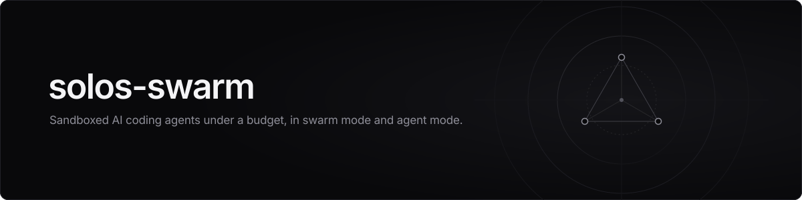
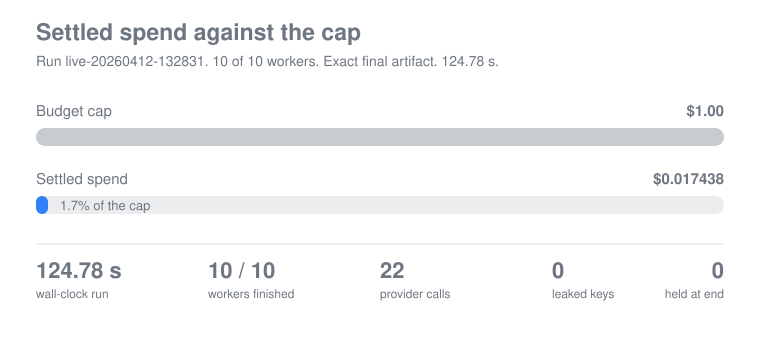
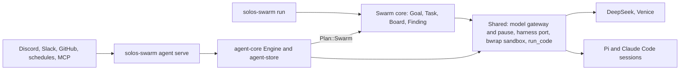
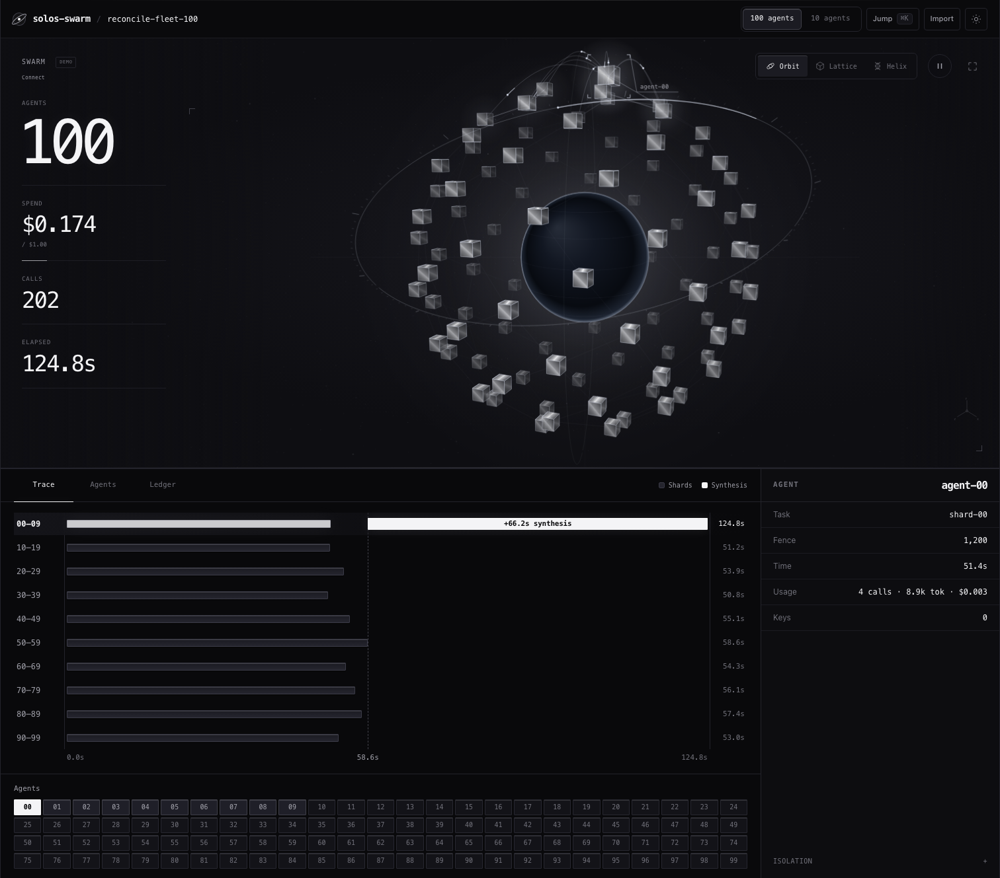

# solos-swarm

<p align="center">
  
</p>

[](https://github.com/GuiBibeau/solos-swarm/actions/workflows/ci.yml)
[](Cargo.toml)
[](package.json)
[](package.json)
[](LICENSE)

solos-swarm runs AI coding agents on Linux under a governed kernel. A broker makes every model call for the agents,
so no agent holds a key. It holds each call's cost against a budget in integer microUSD, settles it from the
provider's reported usage, and refuses calls while the operator pauses. Agents run in bubblewrap sandboxes, and every
event goes to a hash-chained log. One Rust workspace builds one binary, `solos-swarm`, with two modes on that kernel.

## Try it

You need Linux or a Linux VM, and Rust 1.96.0. The `smoke` command needs no key, no network and no sandbox.

```sh
cargo build --locked --release
./target/release/solos-swarm smoke --dir work/smoke
```

The second command prints one JSON line with `"verdict":"PASS"` and `"live_spend":0`. Every entry in `checks` has
`"ok":true`: `claim`, `settle_once`, `no_held_budget`, `pause_refuses_model`, `unpause_admits`, `drain_settles`,
`drain_holds_nothing` and `resume_keeps_ledger`. It runs the binary's own broker, ledger, pause gate, drain and resume
against a scripted provider.

## Numbers

<p align="center">
  <a href="docs/BENCHMARKS.md"></a>
</p>

A recorded live run from 2026-04-12 on `deepseek-chat` (run `live-20260412-132831`), not a target. Source:
[docs/BENCHMARKS.md](docs/BENCHMARKS.md).

## Two modes

**Swarm mode** (`solos-swarm run`) is a batch run: one Goal, 1 to 30 sandboxed Pi agents, a deadline and one
artifact. Each agent claims a Task, posts progress to a shared Board and submits a Finding, and a coordinator
combines the Findings into the artifact. The broker holds each call's worst-case cost against the Goal's budget and
the Task's envelope, then settles the reported usage, with cache hits at the cache price. `scripts/remote.py` operates
runs on a Linux host over SSH, with immutable candidates, `stable` and `canary` channels, pause, drain and `doctor`.

**Agent mode** (`solos-swarm agent serve`) is an always-on agent. It takes requests from Discord, Slack, GitHub,
schedules and MCP hosts such as Claude Code and Codex. A Router model judges each request, and accepted work becomes
a Ticket that runs on a sandboxed worker (Pi or Claude Code) or on a governed swarm. A worker's commands can run on
a remote node of yours. The agent answers in the thread the request came from.

- On GitHub it acts as the bot of its own GitHub App (`solos-bot` in production). A worker commits in a clone, and
  its `ready` report becomes a pull request that the host pushes and opens. No token reaches a worker.
- Workers use vault logins and API keys without seeing their values, and browse with a headless browser that signs
  every step. `solos-swarm agent trail` checks those steps with public keys only.
- The agent keeps memos: facts and lessons the owner writes or workers propose, which a separate review call keeps
  or rejects. A daily dream checks the memos against the day's transcripts.
- `agent status`, `agent health`, `agent prune`, `agent stop` and a web dashboard of Tickets serve the operator.

The two modes share the model gateway (`src/gateway/`: prices, providers, the upstream request and the pause gate),
the harness port (`src/harness.rs`), the sandbox builder (`src/bwrap.rs`) and `run_code` (`src/code.rs`). A swarm is
also one way agent mode runs a Ticket. Agent mode's domain is the pure crate `crates/agent-core`, and its SQLite
store is `crates/agent-store`.



[docs/ARCHITECTURE.md](docs/ARCHITECTURE.md) maps the code, and
[ADR 0001](docs/adr/0001-hexagonal-ports-and-two-modes.md) records why there are two modes on one kernel. The
repository also holds the frozen `mvp` cluster (`solos-swarm mvp`: Raft over mTLS QUIC, a witness and an isolated
evaluator), which neither mode runs.

## Get started

### Build and test

Runs need Linux with `bwrap` (bubblewrap). CI pins Rust 1.96.0 and Node 24.18.0.

```sh
python3 scripts/bootstrap_tokenizers.py --output work/tokenizers
cargo build --locked --release
cargo test --locked -- --test-threads=1
npm ci --ignore-scripts --no-audit --no-fund && npm run test:broker
python3 -m venv work/dashboard-python && work/dashboard-python/bin/pip install -r scripts/requirements-dashboard.txt
work/dashboard-python/bin/python -m unittest discover -s tests -p 'test_*.py'
node --test tests/dashboard-*.test.mjs
./target/release/solos-swarm smoke --dir work/smoke   # broker, ledger, pause, drain and resume, with no key, network or sandbox
```

CI (`.github/workflows/ci.yml`) runs the same Rust tests through `cargo-nextest` (`.config/nextest.toml`), in
parallel, and the agent dashboard's tests in `web/agent-dashboard`. [docs/rust-style.md](docs/rust-style.md) lists
the lints and gates.

### Run a swarm

`scripts/prepare_case.py` freezes a synthetic reconciliation Goal for 10 agents and a separate evaluator payload.
`scripts/check_run.py` then checks the run against that payload. The credential file holds a DeepSeek key.

```sh
python3 scripts/prepare_case.py --seed 20260412 --goal /tmp/run-01/case/goal.json --expected /tmp/eval-01/expected.json
./target/release/solos-swarm run --config /tmp/run-01/case/goal.json --run-dir /tmp/run-01/evidence \
	--pi-root . --node "$(command -v node)" --credential-file /run/credentials/deepseek.key
python3 scripts/check_run.py --run-dir /tmp/run-01/evidence --expected /tmp/eval-01/expected.json
```

To run on a remote Linux host from your machine (SSH access, bubblewrap on the host, and a provider key in the Pi
auth file):

```sh
python3 scripts/remote.py doctor                                 # host and controller health, no spend
python3 scripts/remote.py deploy                                 # build an immutable candidate and print its id
python3 scripts/remote.py candidates promote --candidate ID      # gate (integrity, doctor, smoke, idle probe), then switch
python3 scripts/remote.py start --candidate current --run-id RUN --seed 1 --goal-file goal.json --expected-file expected.json --refuse-peak
python3 scripts/remote.py status --run-id RUN
python3 scripts/remote.py collect --run-id RUN --output evidence/RUN   # leaves the code/ scratch directory on the host
```

Next: [docs/RUNBOOK.md](docs/RUNBOOK.md) for runs,
[docs/self-update-operations.md](docs/self-update-operations.md) for channels and drains, and
[docs/pause-mode.md](docs/pause-mode.md) for peak-hour refusal.

### Run the agent

This `agent.yaml` runs the whole agent with no model and no sandbox. The scripted Router accepts each request as one
worker session, and the scripted executor reports every Assignment `ready` at once.

```yaml
policy:
  people: [mcp:alice]
sources:
  - kind: mcp
channels:
  - kind: mcp
router: {kind: scripted}
executor: {kind: scripted}
budgets: {session_microusd: 500000}
```

```sh
./target/release/solos-swarm agent serve --config agent.yaml --state-dir state     # serves until Ctrl-C
# in another terminal, once serve has created state/mcp/:
claude mcp add solos-agent -- "$PWD/target/release/solos-swarm" mcp --state-dir "$PWD/state" --operator alice
```

Claude Code then lists `agent_request`, `agent_replies`, `agent_status` and the memo tools. For a real agent, give `router` and
`executor` the `kind: pi` sections, add a Discord or GitHub Source, and start `agent serve` with `--pi-root`,
`--node` and `--credential-file`.

Next: [docs/agent-mode/production.md](docs/agent-mode/production.md) for the production config, the systemd units
and `scripts/agent-deploy`. [docs/agent-mode/README.md](docs/agent-mode/README.md) links every guide, among them
the setup of [Discord](docs/agent-mode/how-to/discord.md), [the GitHub App](docs/agent-mode/how-to/github-app.md),
[MCP hosts](docs/agent-mode/how-to/mcp.md), [repositories](docs/agent-mode/how-to/repositories.md) and
[memory](docs/agent-mode/how-to/memory.md).

## Dashboards

The swarm dashboard follows one run's agents, model, budget and receipts from its `state.json`. It is read-only,
listens on `127.0.0.1` and starts no agents. Orbit, lattice and helix lay out the same recorded workers. `?demo=1`
loads the bundled example presets, and **Import** opens a saved snapshot.

```sh
python3 scripts/dashboard_server.py --state RUN/state.json --config RUN/config.yaml
```



[docs/dashboard.md](docs/dashboard.md) covers the local Lima VM and the SSH tunnel to a remote box.

The agent's web dashboard is a Next.js app on Vercel, behind Sign in with Vercel. `solos-swarm agent publish` uploads
a snapshot of each Ticket to a private Vercel Blob store that the app reads. Setup:
[web/agent-dashboard/README.md](web/agent-dashboard/README.md) and
[docs/agent-mode/production.md](docs/agent-mode/production.md#dashboard).

## Documentation

| Document | What it holds |
|---|---|
| [`docs/ARCHITECTURE.md`](docs/ARCHITECTURE.md) | The workspace, the ports, the module map of both modes, and the frozen `mvp` cluster's design. |
| [`docs/adr/0001-hexagonal-ports-and-two-modes.md`](docs/adr/0001-hexagonal-ports-and-two-modes.md) | Why one hexagon serves two modes. |
| [`docs/agent-mode/README.md`](docs/agent-mode/README.md) | The agent-mode index: concepts, architecture, the configuration reference, the status of each phase (P0 to P15), and a how-to guide for each Source, worker, node, vault and browser. |
| [`docs/agent-mode/production.md`](docs/agent-mode/production.md) | Agent mode in production: `scripts/agent-deploy`, the config, the dashboard, health checks, pruning. |
| `docs/agent-mode/{vault-browser,pstack,github-app,memory}/` | Design records for the vault and browser, pstack in workers, the GitHub App and memory. |
| [`web/agent-dashboard/README.md`](web/agent-dashboard/README.md) | The agent's web dashboard: Vercel setup, environment, sign-in. |
| [`docs/RUNBOOK.md`](docs/RUNBOOK.md) | Run one swarm on the box with `scripts/remote.py`: check the host, build and promote a candidate, start, watch, collect, recover, roll back. |
| [`docs/goal-fetch-policy.md`](docs/goal-fetch-policy.md) | The `fetch` policy a Goal needs to probe a live site. |
| [`docs/mvp-cluster.md`](docs/mvp-cluster.md) | The frozen `mvp` cluster: host UIDs, tokenizers, offline bundles, the daemons, qualification. |
| [`docs/pause-mode.md`](docs/pause-mode.md) | `control.json`, `PAUSE`, `SWARM_REFUSE_PEAK`, the 503 reply, unpaused deadlines. |
| [`docs/self-update-operations.md`](docs/self-update-operations.md) | Swarm channels, promote, rollback, prune, drain, doctor, smoke, outage pause. |
| [`docs/self-update-and-graceful-restart.md`](docs/self-update-and-graceful-restart.md) | The design and failure modes behind self-update. |
| [`docs/running-a-tournament.md`](docs/running-a-tournament.md) | Runbook from the first live tournament. |
| [`docs/dashboard.md`](docs/dashboard.md) | The swarm dashboard server and the Mac tunnel script. |
| [`replay/README.md`](replay/README.md) | The replay-scored policy loop for the tournament self-review. |
| [`docs/CAMPAIGNS.md`](docs/CAMPAIGNS.md) | Matched 1-vs-10 worker evaluation design and schemas. |
| [`docs/BENCHMARKS.md`](docs/BENCHMARKS.md) | Live 10-agent DeepSeek results, microbenchmarks and acceptance SLOs. |
| [`docs/rust-style.md`](docs/rust-style.md) | Rust style, lints and the gates CI runs. |
| [`skills/verify-solos-swarm/SKILL.md`](skills/verify-solos-swarm/SKILL.md) | Release qualification for immutable candidates and 10-worker runs. |
| [`.claude/skills/verify-agent-mode/SKILL.md`](.claude/skills/verify-agent-mode/SKILL.md) | Live verification of agent mode on the remote box, one recipe per feature. |
| [`CHANGELOG.md`](CHANGELOG.md) | Every merged pull request since #6. |

## Star history

[](https://star-history.com/#GuiBibeau/solos-swarm&Date)

## Contributing

Read [CONTRIBUTING.md](CONTRIBUTING.md) before you open a pull request. Report security issues privately, as
[SECURITY.md](SECURITY.md) says.

## License

Apache-2.0. Copyright 2026 Gui Bibeau. [NOTICE](NOTICE) lists vendored third-party code.
