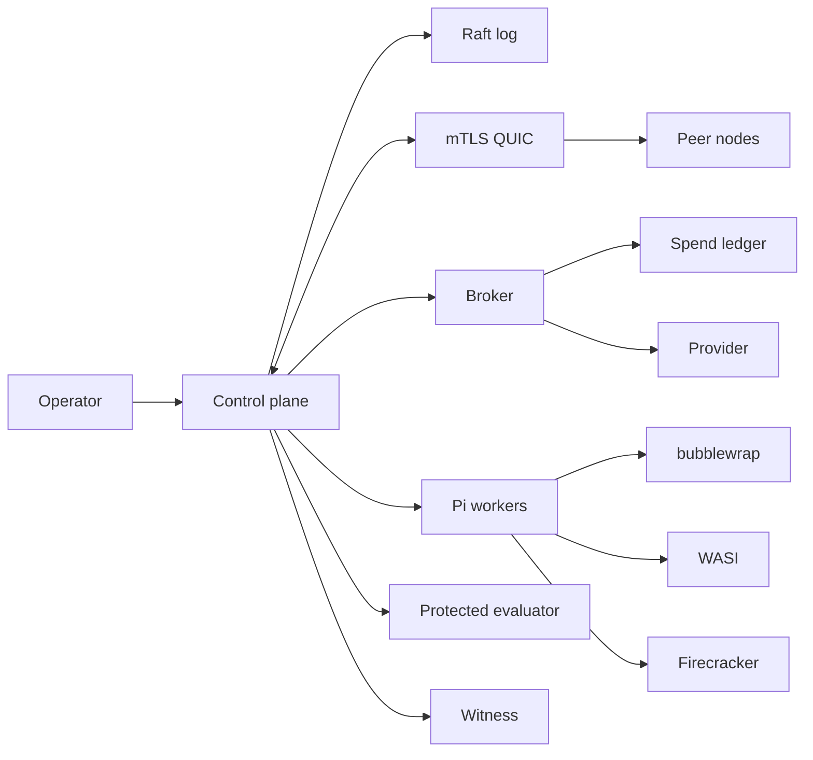

# solos-swarm

Rust control plane for a swarm of Pi agents. One Goal, brokered work, bounded spend, recorded evidence.

## Architecture



```text
operator -> control plane -> Raft / mTLS QUIC
                |-> broker -> spend ledger -> provider
                |-> Pi workers -> bubblewrap | WASI | Firecracker
                |-> protected evaluator
                -> witness
```

## Primitives

| Object | Role |
|---|---|
| Goal | Intent, security posture, spend ceiling, evaluator contract |
| Need | Versioned sub-requirement and acceptance predicate |
| Task | Delegated work; budget narrows; no new Capability |
| Board | Signed posts; data only; never a grant |
| Capability | Compiled grant from policy, Goal, and agent definition |
| Finding | Versioned evidence with provenance and markings |
| Attempt | Immutable candidate plus evaluator-signed score |

Normative text: [docs/TRD.md](docs/TRD.md).

## Isolation

| Boundary | Mechanism |
|---|---|
| Generated code | WASI in a bounded worker process |
| Native tools | Firecracker on KVM; gVisor only when KVM is absent |
| Pi agent loops | bubblewrap, Landlock, seccomp, user systemd |
| Cluster | mTLS QUIC and Raft |
| Provider spend | Brokered ledger; admission reserves before dispatch |
| Evaluation | Separate UID, private corpus, pinned evaluator key |
| Audit | Append-only witness; read-only `mvp verify` |

Workers do not receive provider keys.

## CLI

```sh
cargo build --locked --release
solos-swarm mvp serve --config /absolute/path/runtime.json
solos-swarm mvp witness-serve --config /absolute/path/witness.json
solos-swarm mvp qa --config /absolute/path/qa.json --profile integration --output /absolute/path/evidence
solos-swarm mvp campaign --config /absolute/path/campaign.json --output /absolute/path/campaign
```

| Command | Use |
|---|---|
| `mvp serve` | Control plane |
| `mvp witness-serve` | Independent witness |
| `mvp evaluator-serve` | Protected evaluator |
| `mvp qa` | Authenticated scenarios |
| `mvp campaign` | Matched evaluation cells |
| `mvp inspect` / `mvp verify` | Read-only evidence |

Provisioning: [docs/MVP-RUNBOOK.md](docs/MVP-RUNBOOK.md). Campaigns: [docs/CAMPAIGNS.md](docs/CAMPAIGNS.md).

## Layout

| Path | Contents |
|---|---|
| `src/` | Runtime modules (domain, kernel, ledger, sandbox, qa) |
| `extensions/` | Pi broker and MVP session extensions |
| `scripts/` | Bundle, remote preview, qualification, tokenizers |
| `tests/` | Python, Rust integration, Node broker checks |
| `assets/` | Guest programs and pinned tokenizer templates |
| `docs/` | TRD, runbook, campaigns, POC results, traceability |
| `skills/` | Operator verification skill |
| `docs/internal/` | Historical process notes |

## Local verification

```sh
python3 scripts/bootstrap_tokenizers.py --output work/tokenizers
cargo check --locked --all-targets
cargo clippy --locked --all-targets -- -D warnings
cargo test --locked
python3 -m unittest discover -s tests -p 'test_*.py'
npm ci --ignore-scripts --no-audit --no-fund
npm run test:broker
```

## Remote preview

`scripts/remote.py` runs the historical single-host preview over SSH. The host is an OpenSSH alias or `user@host`.

| Input | Value |
|---|---|
| `--host` or `SOLOS_SSH_HOST` | SSH target; example default `remote-ai` |
| `--auth-file` | Pi auth JSON; default `~/.pi/agent/auth.json`, entry `deepseek` |
| Host Node | `~/.local/opt/node-v24.18.0-linux-x64` |

```sh
export SOLOS_SSH_HOST=example-host
python3 scripts/remote.py deploy
python3 scripts/remote.py start --candidate CANDIDATE_ID --run-id RUN_ID --seed 20261012
python3 scripts/remote.py status --run-id RUN_ID
python3 scripts/remote.py collect --run-id RUN_ID --output work/evidence/RUN_ID
python3 scripts/remote.py cancel --run-id RUN_ID
```

Recorded preview: [docs/POC-RESULTS.md](docs/POC-RESULTS.md). That report covers its frozen binary. Requirement coverage: [docs/MVP-TRACEABILITY.md](docs/MVP-TRACEABILITY.md).

## Docs

| Document | Use |
|---|---|
| [docs/TRD.md](docs/TRD.md) | Requirements |
| [docs/MVP-RUNBOOK.md](docs/MVP-RUNBOOK.md) | Build, identity, startup, evidence |
| [docs/CAMPAIGNS.md](docs/CAMPAIGNS.md) | 1-worker and 10-worker matched cells |
| [docs/POC-RESULTS.md](docs/POC-RESULTS.md) | Ten-agent preview measurements |
| [docs/MVP-TRACEABILITY.md](docs/MVP-TRACEABILITY.md) | Requirement ID to source map |
