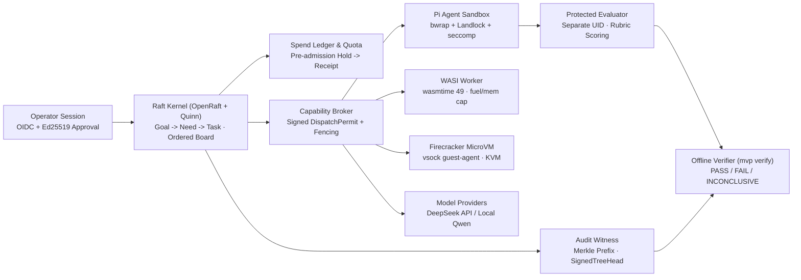

# solos-swarm

<p align="center">
  
</p>

[](https://github.com/GuiBibeau/solos-swarm/actions/workflows/ci.yml)
[-0A0B0E?logo=rust&labelColor=111318)](Cargo.toml)
[](package.json)
[](package.json)
[](LICENSE)

`solos-swarm` is a Rust control plane, scheduler, and capability broker for running governed AI agent swarms across multi-machine Linux clusters. It replicates authoritative state over mTLS QUIC with OpenRaft, isolates every Pi coding agent, WASI module, and Firecracker tool inside Tier-P sandboxes without ambient credentials, and enforces pre-admission microUSD budget holds before any model or tool call executes. Independent evaluator and audit-witness services verify rubric completion, provenance lineage, and Ed25519 Merkle checkpoints before a run can qualify.

## Architecture

<p align="center">
  
</p>

```text
+--------------------------------------------------------------------------------------------------+
| OPERATOR SESSION (OIDC / Ed25519 Approval) -> RegisterGoal / ApplySwarm / OfflineAdmission       |
+--------------------------------------------------------------------------------------------------+
                                                 |
                                                 v
+--------------------------------------------------------------------------------------------------+
| REPLICATED RAFT KERNEL (OpenRaft 0.9 over Quinn mTLS QUIC · SPIFFE X.509 SVIDs)                  |
|                                                                                                  |
|  +------------------------+  +--------------------------+  +----------------------------------+  |
|  | Work Graph & Board     |  | Capability & Spend Gate  |  | Authoritative Audit Log          |  |
|  | Goal -> Need -> Task   |  | Signed DispatchPermit    |  | Unsampled Ed25519 Merkle tree    |  |
|  | Ordered Board & cursor |  | Peak-rate microUSD hold  |  | State checkpoints & explain API  |  |
|  | Atomic placement/fence |  | Once-only receipt settle |  | Separate from loopback OTLP JSON |  |
|  +------------------------+  +--------------------------+  +----------------------------------+  |
+--------------------------------------------------------------------------------------------------+
              |                                  |                                  |
              | Signed Permit + Fencing Token    | Scoped Capability Lease          | Signed Checkpoint
              v                                  v                                  v
+---------------------------+      +---------------------------+      +----------------------------+
| TIER-P WORKER SANDBOXES   |      | MODEL & TOOL BROKER       |      | INDEPENDENT VERIFICATION   |
|                           |      |                           |      |                            |
| * Pi 1.1.0 Coding Agents  | ---> | * DeepSeek API adapter    |      | * Evaluator (separate UID) |
|   bwrap + Landlock +      |      | * Local Qwen/llama.cpp    |      |   Peer-checked Unix socket |
|   seccomp + Unix RPC      |      | * Tokenizer & Jinja gate  |      |   Protected oracle rubric  |
| * WASI Worker (wasmtime)  |      | * One-use / FD secret     |      | * Witness (witness-serve)  |
| * Firecracker KVM microVM |      |   (zero keys in workers)  |      |   Co-signs SignedTreeHead  |
+---------------------------+      +---------------------------+      +----------------------------+
```



## Core Primitives

| Primitive | Module | Contract |
|---|---|---|
| `Goal` | `src/domain.rs`, `src/security.rs` | Top-level governed objective binding intent, maximum microUSD budget, wall-clock deadline, model/price table, and Ed25519 operator approval (`bind_goal_contract`). |
| `Need` | `src/domain.rs`, `src/planner.rs` | Verifiable sub-requirement inside a `Goal` with a declared acceptance predicate (such as `catalog-final`), planning mode (`scored_history` or `single_draft_refinement`), and rubric binding. |
| `Task` | `src/domain.rs`, `src/scheduler.rs`, `src/placement.rs` | Fenced unit of work claimed by a workload identity. Carries a monotonic `fencing_token`, node placement lease, and W3C trace correlation across broker and QUIC hops. |
| `Ordered Board` | `src/domain.rs`, `src/flow.rs` | Append-only, revision-ordered coordination log per `Goal` supporting bounded reads, cursors, draft history selection, and explicit retraction barriers. |
| `Capability Lease` | `src/security.rs`, `src/delegation.rs` | Versioned grant and signed `DispatchPermit` bound to a holder SPIFFE SVID, certificate hash, `Goal`, `fencing_token`, confirmation tier (`C0`/`C1`/`C2`), and stop/retraction epochs. |
| `Finding & Attempt` | `src/domain.rs`, `src/artifacts.rs` | Broker-signed worker outputs and scored candidate submissions. Retain producer identity, input data markings, content hashes, and retraction lineage. |
| `Spend Ledger` | `src/ledger.rs`, `src/quota.rs` | Conservative financial accounting that reserves peak cache-miss microUSD before dispatch, settles once against signed provider receipts, and pauses tasks on budget or quota denial. |
| `Witness & Evaluator` | `src/witness.rs`, `src/evaluator.rs` | Separate failure domains: the evaluator scores `Attempt` artifacts against private oracle fixtures under a distinct UID; the witness verifies append-only Merkle consistency and signs `SignedTreeHead`. |
| `Raft over mTLS QUIC` | `src/cluster.rs`, `src/transport.rs` | Replicated state machine built on `openraft` (`0.9.25`) and `quinn` (`0.11.12`) using TLS 1.3 (`rustls`), custom ALPN (`solos-swarm-raft/1`), and SPIFFE workload certificate verification. |

## Execution Runtimes & Crate Layout

### Sandbox & Runtime Tiers

| Runtime Tier | Entrypoint / Assets | Isolation & Enforcement |
|---|---|---|
| **Pi Agent Workers** | `solos-swarm run`, `solos-swarm sandbox-enter`, `extensions/broker.ts`, `extensions/mvp.ts` | Pinned `@earendil-works/pi-coding-agent@1.1.0` inside `bwrap --unshare-all` (user, PID, mount, network namespaces), Landlock read-only filesystem rules, `seccompiler` BPF filters, and a `0600` Unix RPC socket. Workers never receive provider API keys. |
| **WASI Tool Sandbox** | `solos-swarm wasi-worker --policy <path>`, `src/wasi_worker.rs` | Separate bounded OS process running `wasmtime` (`49.0.0`) with WASI preview1, deterministic Cranelift compilation, fuel metering, memory limits, and pre-entry policy lockdown. |
| **Native Tool MicroVMs** | `src/tools.rs`, `src/tool_identity.rs`, `assets/guest-agent.py`, `assets/guest-broker.py` | Hardware-virtualized Firecracker KVM microVMs with a scoped broker SVID and vsock command channel. Explicit `gVisor` fallback is permitted only on hosts without KVM. |
| **Model Provider Gate** | `src/provider.rs`, `src/broker.rs`, `scripts/local_provider.py`, `assets/tokenizers/` | Unified admission, tokenizer/Jinja validation (`minijinja` + `tokenizers`), and receipt path for hosted DeepSeek (`deepseek-flash`) and pinned local Qwen (`qwen3-4b-gguf`) / `llama.cpp` servers. |

### Binary & Module Map

`Cargo.toml` defines a single locked Rust 2024 package (`solos-swarm`) exposing both the `solos_swarm` library (`src/lib.rs`) and the `solos-swarm` CLI (`src/main.rs`, `src/mvp.rs`):

| Layer | Files | Responsibility |
|---|---|---|
| **Kernel & Consensus** | `src/kernel.rs`, `src/cluster.rs`, `src/node.rs`, `src/transport.rs` | Replicated `KernelState`, OpenRaft storage/network implementation, QUIC mTLS transport, and offline epoch startup ceremonies. |
| **Domain & Scheduling** | `src/domain.rs`, `src/scheduler.rs`, `src/placement.rs`, `src/planner.rs`, `src/flow.rs`, `src/modules.rs` | `Goal`/`Need`/`Task` state transitions, ordered `Board` cursors, planning rounds, multi-node placement, and module lifecycle. |
| **Security & Accounting** | `src/security.rs`, `src/identity.rs`, `src/delegation.rs`, `src/ledger.rs`, `src/quota.rs`, `src/resource_guard.rs` | SPIFFE SVID validation, Ed25519 domain signing, `DispatchPermit` issuance/refresh verification, microUSD holds, and host resource guards. |
| **Sandboxes & Broker** | `src/runtime.rs`, `src/broker.rs`, `src/sandbox.rs`, `src/wasi_worker.rs`, `src/tools.rs`, `src/tool_identity.rs`, `src/provider.rs`, `src/context.rs`, `src/artifacts.rs` | Daemon execution loop, Unix/HTTP capability broker, bubblewrap/Landlock/seccomp entry, WASI worker, Firecracker tool driver, and context/artifact stores. |
| **Verification & Telemetry** | `src/audit.rs`, `src/witness.rs`, `src/evaluator.rs`, `src/evaluator_runtime.rs`, `src/qa.rs`, `src/scenarios.rs`, `src/diagnostics.rs`, `src/telemetry.rs` | Merkle audit log, witness service, protected evaluator server, 3-family scenario catalog, QA/campaign runners, and loopback OTLP JSON exporter. |

## Quickstart

### 1. Build and run local contract checks

Requires Rust `1.96.0` (edition 2024), Python `3.11+`, and Node `24.18.0` (or `>=22.19.0`).

```sh
# Verify and stage pinned tokenizer assets
python3 scripts/bootstrap_tokenizers.py --output work/tokenizers

# Build locked release binary
cargo build --locked --release

# Run formatting, lint, serialized Rust suite, Python unit tests, and Pi broker tests
cargo fmt --all -- --check
cargo clippy --locked --all-targets -- -D warnings
cargo test --locked -- --test-threads=1
python3 -m unittest discover -s tests -p 'test_*.py'
npm ci --ignore-scripts --no-audit --no-fund
npm run test:broker
```

On a Linux host with `bwrap` and pinned Node/Pi installed, verify host isolation readiness:

```sh
solos-swarm doctor --pi-root /path/to/solos-swarm --node ~/.local/opt/node-v24.18.0-linux-x64/bin/node
```

### 2. Run the governed MVP services and verification CLI

Runtime startup consumes operator-prepared configuration, approved policy, and workload identity files:

```sh
# Start the independent audit witness and protected evaluator service
solos-swarm mvp witness-serve --config /absolute/path/witness.json
solos-swarm mvp evaluator-serve   --bundle /absolute/path/bundle.json   --certificate /absolute/path/evaluator.der   --private-key /absolute/path/evaluator.key   --ca /absolute/path/ca.pem   --state /absolute/path/evaluator-state.json   --ipc-socket /absolute/path/evaluator.sock   --broker-uid 1001

# Launch the governed swarm runtime daemon
solos-swarm mvp serve --config /absolute/path/runtime.json

# Execute targeted QA profiles (quick | release-small | integration | acceptance | eval)
solos-swarm mvp qa --config /absolute/path/qa.json --profile integration --output /absolute/path/evidence

# Execute a matched 1-vs-10 worker evaluation campaign
solos-swarm mvp campaign --config /absolute/path/campaign.json --output /absolute/path/campaign
```

### 3. Inspect state and verify cryptographic evidence offline

Read-only inspection and verification replay no external effects:

```sh
# Inspect authoritative objects (goal | explain | board | need | task | intent | finding | attempt | request | review)
solos-swarm mvp inspect --snapshot /absolute/path/snapshot.json --kind board --id GOAL_ID
solos-swarm mvp inspect --snapshot /absolute/path/snapshot.json --kind explain --id GOAL_ID/TASK_ID

# Verify a snapshot against a witnessed SignedTreeHead and trusted public key
solos-swarm mvp verify   --snapshot /absolute/path/snapshot.json   --head /absolute/path/head.json   --trusted-key /absolute/path/public-key.json   --output /absolute/path/verification.json

# Verify an individual domain-separated Ed25519 signature
solos-swarm mvp verify-signature   --input /absolute/path/signed-permit.json   --trusted-key /absolute/path/public-key.json   --domain dispatch-permit
```

### 4. Stage and run a remote 10-agent preview over SSH

For single-host remote deployment to a configured Linux SSH target (example alias `remote-ai`; set `--host` or `SOLOS_SSH_HOST`):

```sh
# Build and freeze an immutable candidate bundle on the remote host
python3 scripts/remote.py deploy

# Start a bounded 10-agent run ($1 cap, 8 calls/agent, 2048 output tokens/call, 600s deadline)
python3 scripts/remote.py start --candidate CANDIDATE_ID --run-id poc-20261012-01 --seed 20261012
python3 scripts/remote.py status --run-id poc-20261012-01
python3 scripts/remote.py collect --run-id poc-20261012-01 --output work/evidence/poc-20261012-01

# Cancel an active run and confirm worker + credential cleanup
python3 scripts/remote.py cancel --run-id poc-20261012-01
```

## Documentation

| Document | Scope |
|---|---|
| [`docs/TRD.md`](docs/TRD.md) | Full Technical Requirements Document: domain model, Raft/QUIC consensus, Tier-P security architecture, spend ledger, and 500-agent acceptance criteria. |
| [`docs/MVP-RUNBOOK.md`](docs/MVP-RUNBOOK.md) | Cold-checkout operator runbook for provisioning certificates, witness/evaluator services, offline startup ceremonies, and `mvp serve`. |
| [`docs/MVP-TRACEABILITY.md`](docs/MVP-TRACEABILITY.md) | Requirement-by-requirement traceability matrix mapping TRD and `SEC-*` controls to source modules, tests, and qualification status. |
| [`docs/CAMPAIGNS.md`](docs/CAMPAIGNS.md) | Guide for running matched 4-cell evaluation campaigns (1 vs. 10 workers, `scored_history` vs. `single_draft_refinement`). |
| [`docs/POC-RESULTS.md`](docs/POC-RESULTS.md) | Measured 10-agent live DeepSeek preview report, conservative spend accounting, and negative control demonstrations. |
| [`docs/internal/QA-BACKLOG.md`](docs/internal/QA-BACKLOG.md) | Historical P0/P1 verification stories (`QA-00` through `QA-11`). |
| [`docs/internal/TRD-CHANGES.md`](docs/internal/TRD-CHANGES.md) | Historical change log for the verification and release-qualification TRD amendment. |
| [`docs/internal/qualification-notes.md`](docs/internal/qualification-notes.md) | Recorded check diary for the expanded MVP candidate. |
| [`skills/verify-solos-swarm/SKILL.md`](skills/verify-solos-swarm/SKILL.md) | Agent verification skill for launching, driving, inspecting, and qualifying immutable `solos-swarm` candidates. |

## License

Apache-2.0. Copyright 2026 Gui Bibeau.
