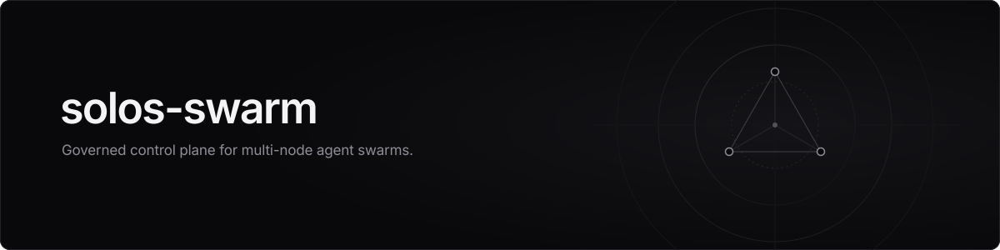
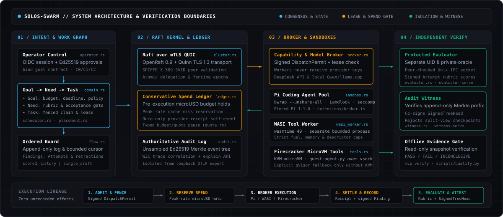

# solos-swarm

<p align="center">
  
</p>

[](https://github.com/GuiBibeau/solos-swarm/actions/workflows/ci.yml)
[](Cargo.toml)
[](package.json)
[](package.json)
[](LICENSE)

A Rust control plane, scheduler, and capability broker for governed agent swarms across Linux clusters.

## Architecture

<p align="center">
  
</p>

## Primitives

| Primitive | Role |
|---|---|
| `Goal` | Top-level intent, microUSD budget cap, deadline, and signed operator approval. |
| `Need` | Verifiable sub-requirement with an acceptance predicate and rubric binding. |
| `Task` | Fenced work unit carrying a monotonic token, lease, and trace context. |
| `Board` | Revision-ordered coordination log with bounded reads, cursors, and retractions. |
| `Capability Lease` | Signed `DispatchPermit` bound to workload SVID, `Goal`, fence, and epoch. |
| `Finding & Attempt` | Broker-signed worker outputs and scored candidates with provenance lineage. |
| `Spend Ledger` | Pre-dispatch peak microUSD hold and once-only provider receipt settlement. |
| `Witness & Evaluator` | Isolated oracle scorer and append-only Merkle `SignedTreeHead` witness. |
| `Raft over mTLS QUIC` | OpenRaft state machine over Quinn TLS 1.3 with SPIFFE peer validation. |

## Runtimes

| Runtime | Isolation |
|---|---|
| `Pi Agent Sandbox` | Pinned Pi 1.1.0 inside `bwrap`, Landlock, `seccomp`, and Unix RPC socket. |
| `WASI Worker` | Separate `wasmtime` process with deterministic fuel and memory caps. |
| `Firecracker MicroVM` | KVM microVMs with scoped broker SVID over vsock (`gVisor` fallback). |
| `Model Broker` | Keyless worker gate for DeepSeek API and local Qwen / `llama.cpp`. |

## Quickstart

```sh
# Build and verify contracts
python3 scripts/bootstrap_tokenizers.py --output work/tokenizers
cargo build --locked --release
cargo test --locked -- --test-threads=1
python3 -m unittest discover -s tests -p 'test_*.py'
npm ci --ignore-scripts --no-audit --no-fund && npm run test:broker
```

```sh
# Launch witness, evaluator, runtime, and QA
solos-swarm mvp witness-serve --config /path/to/witness.json
solos-swarm mvp evaluator-serve --bundle /path/to/bundle.json --certificate /path/to/eval.der   --private-key /path/to/eval.key --ca /path/to/ca.pem --state /path/to/state.json   --ipc-socket /path/to/evaluator.sock --broker-uid 1001
solos-swarm mvp serve --config /path/to/runtime.json
solos-swarm mvp qa --config /path/to/qa.json --profile integration --output /path/to/evidence
```

```sh
# Inspect state and verify evidence offline
solos-swarm mvp inspect --snapshot /path/to/snapshot.json --kind board --id GOAL_ID
solos-swarm mvp verify --snapshot /path/to/snapshot.json --head /path/to/head.json   --trusted-key /path/to/public-key.json --output /path/to/verification.json
```

## Documentation

| Document | Scope |
|---|---|
| [`docs/ARCHITECTURE.md`](docs/ARCHITECTURE.md) | Domain model, Raft over mTLS QUIC, Tier-P sandboxes, and spend ledger. |
| [`docs/RUNBOOK.md`](docs/RUNBOOK.md) | Identity provisioning, offline startup, cluster recovery, and operations. |
| [`docs/CAMPAIGNS.md`](docs/CAMPAIGNS.md) | Matched 1-vs-10 worker evaluation design and schemas. |
| [`docs/BENCHMARKS.md`](docs/BENCHMARKS.md) | Live 10-agent DeepSeek results, microbenchmarks, and acceptance SLOs. |
| [`skills/verify-solos-swarm/SKILL.md`](skills/verify-solos-swarm/SKILL.md) | Release qualification workflow for immutable candidates. |

## License

Apache-2.0. Copyright 2026 Gui Bibeau.
