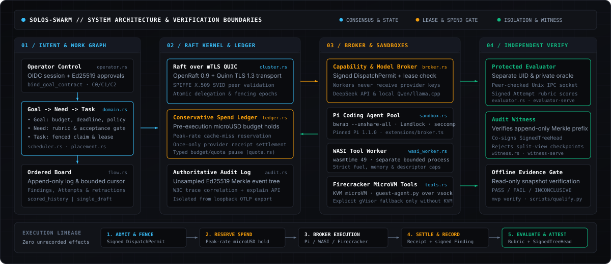
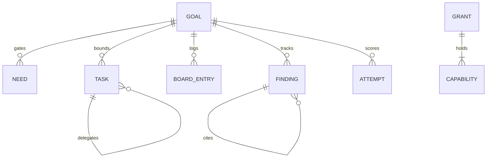
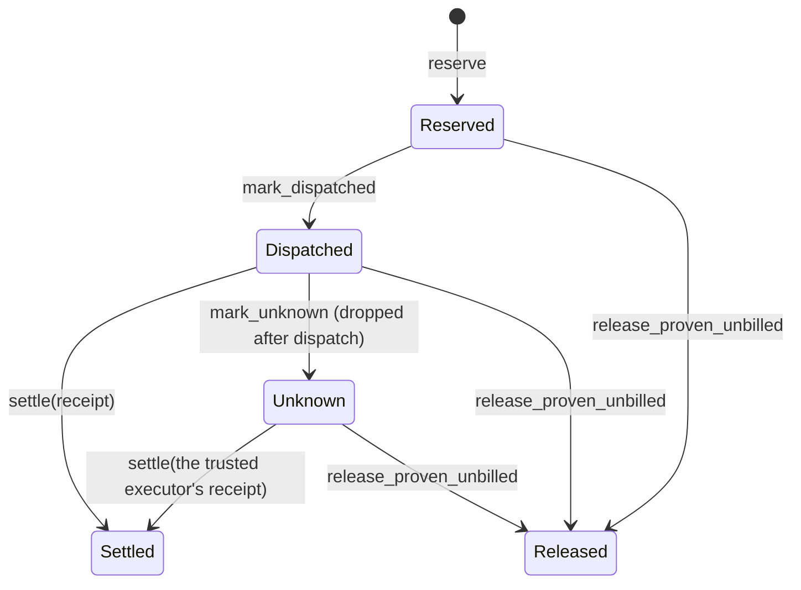

# Architecture

This page maps the code of `solos-swarm`: the workspace, the commands and the code each one runs, the ports and
their adapters, and the frozen `mvp` cluster. Why the code has this shape is in
[ADR 0001](adr/0001-hexagonal-ports-and-two-modes.md). Agent mode's concepts and the status of each phase are in
[agent-mode/README.md](agent-mode/README.md).

## Three stacks in one binary

One Cargo workspace builds one binary, `solos-swarm`. It holds two live modes and one frozen stack:

| Stack | Commands | Core | State | Status |
|---|---|---|---|---|
| Swarm mode | `run`, `resume-plan`, `smoke`, `doctor`, `fetch-probe` | Goal, Task, Board, Finding and Artifact in `src/broker.rs`, run by `swarm::run_goal` (`src/swarm.rs`) | One run directory: `state.json`, the hash-chained `events.jsonl`, agent transcripts | Live |
| Agent mode | `agent ...`, `mcp`, `node ...`, `vault ...`, `browser init-key` | Trigger, Thread, Eval, Ticket, Assignment, Change and Memo in `crates/agent-core`, driven by `src/agent/runtime.rs` | One state directory: `agent.db` (SQLite, schema 9), Ticket directories, transcripts, the trail's blobs | Live |
| `mvp` cluster | `mvp ...`, `sandbox-enter`, the hidden `wasi-worker` | `src/domain.rs` and `src/kernel.rs` over openraft (`src/cluster.rs`) | The Raft store, the Merkle audit log, and the witness's and evaluator's own state | Frozen: kept and tested, not extended |

Swarm mode is also one of agent mode's execution plans: a `Plan::Swarm` Ticket runs one governed swarm through
`swarm::run_goal_until` (`src/agent/swarm_executor.rs`), under what the Ticket's budget has left.

## Workspace

| Path | Package | Holds |
|---|---|---|
| `.` | `solos-swarm` | The binary (`src/main.rs`), swarm mode, agent mode's shell and adapters (`src/agent/`), the shared kernel, and the `mvp` stack. |
| `crates/agent-core` | `solos-agent-core` | Agent mode's domain: the Engine, the model, the core ports, `AllowlistPolicy` and `MemoryRepositories`. No I/O and no async runtime. |
| `crates/agent-store` | `solos-agent-store` | `SqliteStore`, which implements `Repositories` on one SQLite file (`rusqlite` 0.41.1, bundled SQLite, WAL), with the durable Effect queue, the spend ledger and the hash-chained event log. Schema version 9 (`LATEST` in `src/schema.rs`). |

`default-members` lists all three, so `cargo test` and `cargo clippy` cover the workspace. `agent-core` depends on
`serde`, `serde_json` and `sha2` only, and `crates/agent-core/tests/boundary.rs` refuses any other dependency and any
`std::` path outside an allowlist of pure modules. The test scans the source, so it is a check, not a proof.
`agent-store` depends on `agent-core` and `rusqlite`. `agent-core` never depends on the store.

Other parts of the repository:

| Path | What it is |
|---|---|
| `extensions/broker.ts` | The Pi extension of every swarm agent and of agent mode's Pi Router and workers. It calls the broker over its Unix socket. `SWARM_TOOLSET` picks the tool set: unset for a swarm agent, `router` or `worker` in agent mode. |
| `extensions/agent-tools.json` | Agent mode's tool schemas, generated from the registry in `src/agent/broker/registry.rs`. A Rust test holds it equal to the registry. |
| `extensions/mvp.ts` | The `mvp` stack's Pi extension. It calls the `mvp` broker (`src/node.rs`) over TLS. |
| `scripts/` | Swarm operations in Python (`remote.py`, `prepare_case.py`, `check_run.py`, `dashboard_server.py`), `agent-deploy` and the systemd units in `scripts/systemd/`. |
| `dashboard/` | The swarm dashboard, a static page that `scripts/dashboard_server.py` serves. |
| `web/agent-dashboard/` | The agent's web dashboard, a Next.js app on Vercel with its own `package.json`. |
| `vendor/pstack/` | pstack, vendored verbatim and pinned by its `MANIFEST`. Agent-mode workers read it. |
| `replay/` | The replay-scored policy loop for the tournament self-review. |

## Ports and adapters

Each technology sits in an adapter behind a port, and only the composition roots, `run` (`src/main.rs`) and
`agent serve` (`src/agent/mod.rs`), name concrete adapters. Agent mode's core does no I/O. Swarm mode's core is not
split out yet: its pure parts (claims, envelopes, progress) still sit beside the HTTP and file code of
`src/broker.rs`.

### The agent core

The core ports are synchronous: `Repositories`, `Policy` and `Clock` (`crates/agent-core/src/ports.rs`). An Engine
command reads through an overlay of the store, and commits the state change, its events and its `Effect`s in one
`ChangeSet`. The external work leaves the core as data: `Effect::Assess` (ask the Router), `Launch`, `Deliver` and
`Stop` (the executor), `Send` (a Channel) and `Forge` (publish a pull request). The runtime (`src/agent/runtime.rs`)
is one task that owns the Engine, so state has one writer. It hands each due Effect to its adapter, marks it done or
failed with a retry time, and applies what adapters report as Engine commands (`Fact`s).

### Shell ports

The shell ports are async and live in the root crate.

| Port | Defined in | Adapters |
|---|---|---|
| `Source` | `src/agent/ports.rs` | `JsonlSource` (`src/agent/jsonl.rs`), `SlackSource` (`src/agent/slack/`), `DiscordSource` (`src/agent/discord/`), `GithubSource` (`src/agent/github/`), `ScheduleSource` (`src/agent/schedule.rs`), the `kind: mcp` inbox and `CommandSource` (`src/agent/mcp.rs`) |
| `Channel` | `src/agent/ports.rs` | `JsonlChannel`, `SlackChannel`, `DiscordChannel`, `GithubChannel`, `McpChannel` |
| `Router` | `src/agent/ports.rs` | `PiRouter` (`src/agent/pi_router.rs`), `ScriptedRouter` (`src/agent/scripted.rs`) |
| `Executor` | `src/agent/ports.rs` | `PiExecutor` for session Tickets on Pi or Claude Code (`src/agent/pi_executor.rs`), `SwarmExecutor` (`src/agent/swarm_executor.rs`), `ScriptedExecutor`, `SimulatedExecutor` (`src/agent/simulated.rs`, for `agent bench`) |
| `Forge` | `src/agent/ports.rs` | `GithubForge` and `LocalForge` (`src/agent/forge/`) |
| `ExecutionEnvironment` | `src/agent/environment.rs` | `Local` (bwrap on this host), `RemoteNode` (`src/remote/listener.rs`) |
| `AgentHarness` | `src/harness.rs` | `PiHarness`, `ClaudeCodeHarness` (`src/harness/claude_code.rs`), `ScriptedHarness` (`src/harness/scripted.rs`) |
| `Provider` (model upstream) | `src/gateway/upstream.rs` | `OpenAiCompatible`, for DeepSeek and Venice |

[agent-mode/README.md](agent-mode/README.md#ports) gives each port's shape.

### What the two modes share

| Piece | Code | Swarm mode | Agent mode |
|---|---|---|---|
| Model gateway | `src/gateway/`: `pricing.rs`, `upstream.rs`, `pause.rs`, `anthropic.rs` | The swarm broker (`src/broker.rs`) prices, sends and pauses every call through it | The agent broker (`src/agent/broker.rs`) does the same for the Router, workers, the memory review and the dream. `anthropic.rs` serves Claude Code workers |
| Harness | `src/harness.rs` | `PiHarness` launches each swarm agent | The Router and every worker session |
| Sandbox builder | `src/bwrap.rs`, with the binds from `src/exposure.rs` | The Pi launch and `run_code` | The same, plus the browser and the dependency builds. `exposure.rs` also decides which paths a vault, key or token may not sit under |
| `run_code` | `src/code.rs` (`CodeExecutor`) | A swarm agent's `run_code` grant | A worker's `run_code` and background jobs, on this host or a node |

The ledgers and event logs are separate implementations of one design. Swarm mode keeps its ledger and its
`events.jsonl` chain in `src/broker.rs`. Agent mode keeps its ledger (`crates/agent-store/src/ledger.rs`) and its
chain (`crates/agent-store/src/chain.rs`) in `agent.db`, hash-chained like `events.jsonl`.

## Sandboxes

Every Pi session, in both modes, runs under `bwrap --unshare-all --die-with-parent --new-session` with a cleared
environment, a tmpfs `/tmp` and `/work`, and the broker socket bound read-only at `/broker.sock`. It has no network
and no key. Its only way out is the broker, which authenticates its token. `run_code` builds its own sandbox, also
with no network. Two agent-mode sandboxes share the host's network: the browser (`src/browse/`) and the dependency
build (`src/agent/forge/deps.rs`). Each binds system files, its own program and one working directory, and no token,
key, vault or broker socket.

## Model spend

Both brokers price model calls with `PriceTable` (`src/gateway/pricing.rs`), in integer micro-USD
(1 USD = 1,000,000 micro-USD).

- Before a call, the broker holds ⌈in × Pin / 106⌉ + ⌈out × Pout / 106⌉.
  `in` is the request's size in bytes plus 4,096 (`REQUEST_FRAMING_BYTES`), all priced at the cache-miss rate, and
  `out` is the call's `max_output_tokens`. The hold overstates the invoice on purpose.
- After the call, the broker settles the reported usage. Uncached input at Pin and cached input at the
  cache-hit rate are rounded up once together, and the output is rounded up apart. A receipt keeps the total, cached
  and uncached input counts. A missing cache counter gets no discount, and a price table with no cache-hit rate
  prices all input at Pin.
- In swarm mode, a call that fails after dispatch marks its intent `unknown`, releases its hold, and still counts
  against the agent's call ceiling. A provider error does not stop the Goal. Only an accounting failure, a settlement
  above its hold, does.
- In agent mode, each Ticket, the Router and the memory review have their own account in `agent.db`
  (`crates/agent-store/src/ledger.rs`), and any of them may run with no cap
  ([Budgets](agent-mode/README.md#budgets)).

Goals from `scripts/prepare_case.py` price input at 300,000, output at 1,200,000 and cache hits at 6,000 micro-USD
per million tokens. These are conservative
[DeepSeek Flash peak rates](https://api-docs.deepseek.com/quick_start/pricing/) verified on 2026-10-27, with no
off-peak discount. `scripts/check_run.py` recomputes every charge of a run from the retained provider responses and
the Goal's rates.

## Module map

### Swarm mode

| Module | Responsibility |
|---|---|
| `src/main.rs` | The CLI and the `run` composition root: flags, credential, Goal file, upstream, `PiHarness` and the provider |
| `src/swarm.rs` | `run_goal` and `run_goal_until`: the spawn loop, nudges, deadline, broker socket, shutdown, `cleanup.json` and `runtime-report.json` |
| `src/broker.rs`, `src/broker_control.rs` | The swarm broker: Goal validation, claims, Board, Findings, Artifact, envelopes, the ledger, `events.jsonl`, drain and resume |
| `src/broker_goal_text.rs` | The words a Goal brings to its run: the nudges, and the fields of a record the host files for an agent that never filed |
| `src/broker_fetch.rs` | `fetch_url` behind a guard: a Goal's `fetch` policy and the refusal of non-public addresses, for both modes |
| `src/progress.rs` | Budget notices and partial-findings progress |
| `src/smoke.rs` | `solos-swarm smoke`: the broker, ledger, pause, drain and resume against a scripted provider |

### Shared kernel

| Module | Responsibility |
|---|---|
| `src/gateway/` | Prices, holds and settlements (`pricing.rs`), the admitted upstreams and the request (`upstream.rs`), the pause gate (`pause.rs`), and the Anthropic Messages facade (`anthropic.rs`) |
| `src/harness.rs`, `src/harness/` | The `AgentHarness` port and its Pi, Claude Code and scripted adapters |
| `src/bwrap.rs`, `src/exposure.rs` | The one bwrap builder, and what each sandbox can see |
| `src/code.rs` | `run_code`'s sandbox and receipts |
| `src/sealed.rs` | The AES-256-GCM envelope of the vault and the artifact store |

### Agent mode

| Module | Responsibility |
|---|---|
| `crates/agent-core/src/engine.rs` | The Engine: every command in one transaction |
| `crates/agent-core/src/model.rs` | Triggers, Threads, Evals, Tickets, Assignments, Plans, Reports, Effects and events |
| `crates/agent-core/src/policy.rs` | `AllowlistPolicy`: people, bots, approvers and accept modes |
| `crates/agent-core/src/{change,delivery}.rs` | The Change a Ticket owes, and the `ready` gate for a pull request |
| `crates/agent-core/src/memo.rs` | Memos, their trust, and the index shown to the Router and workers |
| `crates/agent-core/src/trail.rs` | The browser trail's steps and their digests |
| `crates/agent-store/src/` | `SqliteStore`, the Effect queue (`queue.rs`), the ledger (`ledger.rs`), the chain (`chain.rs`), the Watchdog's record (`watchdog.rs`) and the schema (`schema.rs`) |
| `src/agent/mod.rs`, `src/agent/runtime.rs` | `agent serve`: wiring, and the loop that owns the Engine |
| `src/agent/config.rs`, `src/agent/config/` | `agent.yaml`, with unknown fields refused |
| `src/agent/broker.rs`, `src/agent/broker/` | The agent broker: accounts, holds, the tool registry (`registry.rs`), the repeat guard (`repeat.rs`), vault use (`secrets.rs`), the browser tools (`browser.rs`), memos and their review (`memory.rs`, `review.rs`), and the Messages facade (`messages.rs`) |
| `src/agent/pi_router.rs` | The Router as one long-lived Pi session |
| `src/agent/pi_executor.rs`, `src/agent/jobs.rs` | Worker sessions, their prompts and turns, and background jobs |
| `src/agent/swarm_executor.rs`, `src/agent/goal_template.rs` | Swarm Tickets and their Goal templates |
| `src/agent/forge/` | Mirrors, clones, the harvest and admission of commits, pull requests, installed dependencies (`deps.rs`) and evidence (`evidence.rs`) |
| `src/agent/github/` | The GitHub App (`app.rs`), the Source, the Channel, identity pins and `agent github check` |
| `src/agent/slack/`, `src/agent/discord/`, `src/agent/mcp.rs`, `src/agent/schedule.rs`, `src/agent/jsonl.rs` | The other Sources and Channels |
| `src/agent/markdown.rs`, `src/agent/links.rs` | Replies shaped for each channel, and links to the dashboard |
| `src/agent/earlier.rs`, `src/agent/plain_answer.rs`, `src/agent/transcript.rs`, `src/agent/dream.rs` | A relaunched worker's earlier replies, a plain-text answer filed as a Report, transcript reading, and the daily dream |
| `src/agent/watchdog.rs`, `src/agent/status.rs`, `src/agent/health.rs`, `src/agent/prune.rs`, `src/agent/stop.rs`, `src/agent/memo.rs` | The Watchdog, and `agent status`, `health`, `prune`, `stop` and `memo` |
| `src/agent/publish/` | `agent publish`: Ticket snapshots to the dashboard's Blob store |
| `src/agent/trail.rs`, `src/agent/trail/`, `src/browse.rs`, `src/browse/` | The signed browser (Lightpanda over CDP) and `agent trail` |
| `src/vault.rs`, `src/vault/` | The vault of logins and API keys, and `solos-swarm vault` |
| `src/agent/pstack.rs` | The vendored pstack tree, checked against its `MANIFEST` |
| `src/agent/bench/`, `src/agent/simulated.rs` | `agent bench` and `agent workload` |
| `src/agent/environment.rs`, `src/remote/` | Where commands run: this host, or a node over mutually pinned TLS (`node init`, `node serve`) |
| `src/mcp.rs`, `src/mcp/` | `solos-swarm mcp`: one principal's broker tools, or an operator's tools over a state directory |
| `src/bridge.rs` | The hidden `bridge` command: a loopback port in a Claude Code sandbox piped to the broker socket |

## The frozen `mvp` cluster

`solos-swarm mvp` runs the original multi-node design: a control plane replicated with openraft, a Pi-facing broker
over mutual TLS, an audit witness and an isolated evaluator. Its subcommands are `serve`, `witness-serve`,
`evaluator-serve`, `offline-startup-request`, `offline-startup-assemble`, `campaign`, `qa`, `inspect`, `verify`,
`verify-signature` and `catalog` (`src/mvp.rs`). Neither mode runs it.
[ADR 0001](adr/0001-hexagonal-ports-and-two-modes.md) keeps it frozen, not deleted: its local-model support, QUIC
transport, SPIFFE identities and scoped tool credentials are to become adapters when a phase needs them. [RUNBOOK.md](RUNBOOK.md) has its host layout and operations.

  

### Domain primitives

`src/domain.rs` holds the state machine and `src/kernel.rs` is its one mutation boundary.

| Symbol | Type | Scope | Invariant in the code |
|---|---|---|---|
| `G` | `GoalRecord` | Root | A micro-USD ceiling and an evaluation contract. The Goal is versioned, and `AmendGoal` can change it, the ceiling included. |
| `N` | `Need` | Per `G` | A Task needs its Need accepted. The Goal is complete when its required Needs are satisfied. |
| `T` | `Task` | Per `G` | A lease, a fencing token, and `depth <= 4` |
| `B` | `BoardEntry` | Per `G` | Signed and append-only. An entry grants no authority. |
| `C` | `Capability` | Per `Grant` | Attenuates monotonically across delegations. A Task carries only capability names. |
| `F` | `Finding` | Per `G` | The minimum trust of its sources and the union of their markings |
| `A` | `Attempt` | Per `G` | Scored in the evaluator's `Search` phase. The `HeldOut` phase is frozen once per version. |

### One Raft cluster

One openraft cluster (`src/cluster.rs`) replicates the control plane. Peers speak Raft over QUIC (`quinn` and
`rustls`, TLS 1.3 with mutual authentication), and an offline certificate carries one SPIFFE identity. The whole
`KernelState` (domain, security, ledger, audit and quotas) is one value at the key `kernel/state`, committed in one
transaction. The cluster's own `Mutation`s are `Put`, `Delete`, `GrantLease`, `RenewLease`, `RevokeLease` and
`ExpireLeases`. Domain changes are `DomainCommand`s, such as `RegisterGoal`, `AmendGoal`, `ProposeNeed`,
`AcceptNeed`, `DelegateTask`, `ClaimTask`, `CompleteTask`, `AppendBoard`, `AppendFinding`, `RetractFinding`,
`SubmitAttempt`, `ScoreAttempt`, `StopGoal` and `ResumeGoal`.

A Task's fencing token is one `u64`: the store revision at which its placement committed (`allocation.fence`). A
claim needs a fence above the stored one. Later operations check `claimed_by`, the incarnation, the fence and the
lease's expiry together, so a stale token fails closed.

### Authorization

`SecurityState::authorize` (`src/security.rs`) checks a broker request in this order:

1. The subject and the policy are live.
2. The Grant is live: its lease, revocation and stop scope.
3. The capability matches: kind, resource, expiry and isolation, the Goal's resources and classes, and the
   constraints. Then the spend capability.
4. A `target/` resource is on the Goal's target allowlist.
5. The request's lineage markings are within the Grant's `read_markings`, and the recipient is cleared for them.
6. The confirmation tier's approvals are present.
7. `ledger.reserve` holds the cost.
8. The broker signs a `DispatchPermit`.

RBAC roles, with `Abac` conditions on time, cost, tier and isolation, apply to operators only. An agent holds no role.

A child capability attenuates its parent (`Capability::attenuates`) when it has the same `kind` and `goal_id`, a
narrower `resource`, `constraints` and budget `Limits`, a `confirmation` and a `minimum_isolation` at least as high, a
`not_before` no earlier and an `expiry` no later. A delegated Task's budget is at most what its parent has left, and its
depth is its parent's plus one, at most 4.

A request's confirmation tier is the highest of its capability's, its operation class's and its spend capability's,
and untrusted lineage raises it one step (C1 to C2, C2 to C3).

| Tier | Operation class | Requirement |
|---|---|---|
| `C0` | `ReadOnly` | None beyond the checks above |
| `C1` | `Reversible` | None of its own. A billable or model request still needs the tokenizer check and a ledger hold. |
| `C2` | `External` | One exact-action human approval, or the Goal's `unattended_c2` with a taint exemption |
| `C3` | `Destructive` | Two distinct exact-action human approvals, from MFA-verified operators |

### Sandbox tiers

| Tier | Runtime | Runs |
|---|---|---|
| `W` | `wasmtime` 49.0.4 with fuel and memory caps, in process or out of process (`wasi-worker`) | Wasm tools |
| `P` | `systemd-run --user` (CPU, memory and task limits), `bwrap --unshare-all` with `/usr` read-only, Landlock (ABI 6 or later unless `allow_degraded_landlock`) and a default-deny seccomp filter | Pi workers with `extensions/mvp.ts` |
| `G` | `runsc` (gVisor), only when the policy sets `allow_no_kvm_fallback` | Installed tools without KVM |
| `V` | Firecracker microVM on KVM, with a vsock to the guest | Installed tools |

A Pi worker's tools come from `make_tools` (`src/node.rs`), filtered by its Grant: `claim_task`, `board_read`,
`audit_read`, `board_post`, `propose_need`, `delegate_task`, `submit_finding`, `read_findings`, `task_status`,
`complete_task`, `submit_attempt`, `retract_finding`, `request_flag`, `request_stop`, `fetch_url` and `explain`, plus
the tools of installed modules. They are served over TLS 1.3 with mutual authentication on a Unix socket
(`src/transport.rs`).

### Ledger

The `mvp` ledger (`src/ledger.rs`) prices the usage categories `input_tokens`, `cached_input_tokens` and
`output_tokens` from its signed price table, and rounds each category up apart. Both input categories are bounded by
the serialized request's bytes plus `server_overhead_tokens`.

An `Unknown` intent keeps its hold and is never retried on its own. A release needs a nonzero proof hash.

### Lineage, taint and context assembly

For a Finding $F$ that cites sources $S_1, \dots, S_k$:

$$\text{trust}(F) = \min_i \text{trust}(S_i), \qquad \text{markings}(F) = \bigcup_i \text{markings}(S_i)$$

`RetractFinding` keeps the log entry and sets `flagged` on the Finding and on the Findings that descend from it. It
marks the Needs they satisfied as unsatisfied again and reopens the actions that cite them. It also flags each Attempt
that cites them, and adds the Attempt's `candidate_hash` to the planner's exclusion set. Only a Finding can be
retracted.

Prompt assembly (`src/planner.rs`, `src/context.rs`) measures the fixed contract tokens first with
`VerifiedTokenizer`, adds a retraction marker and summary, and packs earlier Attempts under `ScoredHistory` or
`SingleDraftRefinement`.

### Audit log, witness and evaluator

| Subsystem | Mechanism | Verification |
|---|---|---|
| Audit log (`src/audit.rs`) | RFC 6962 SHA-256 Merkle tree | Ed25519, signature domain `audit-tree-head`. Its signer also signs agent mode's browser trail. |
| Witness (`src/witness.rs`) | Append-only consistency check | Ed25519, signature domain `audit-witness-receipt` |
| Evaluator (`src/evaluator.rs`) | A separate Unix user (UID 995 in the RUNBOOK's layout) that owns its directory, with no access for group or others, and checks the broker's UID on its IPC socket | Splits the `Search` phase, capped by `max_search_evaluations`, from the `HeldOut` phase, frozen once per version |

### `mvp` module map

| Module | Responsibility |
|---|---|
| `src/mvp.rs`, `src/runtime.rs` | The `mvp` subcommands (a module of the binary) and the host daemon |
| `src/domain.rs`, `src/kernel.rs` | The Goal, Need, Task, Board, Finding and Attempt state machine, and the one mutation boundary |
| `src/cluster.rs` | openraft over QUIC with mutual TLS: the revisioned store and leases |
| `src/transport.rs` | TLS 1.3 with mutual authentication over local Unix sockets |
| `src/security.rs`, `src/identity.rs` | Grants, capabilities, RBAC, tiers and permits. The workload CA, SPIFFE identities and OIDC with MFA |
| `src/operator.rs` | The operator's HTTP transport: an OIDC nonce challenge at `/operator/challenge`, then `/operator/session` and `/operator/command` |
| `src/ledger.rs`, `src/quota.rs` | Envelopes, caps and intents, and the shared provider quota |
| `src/scheduler.rs`, `src/placement.rs` | Placement proposals (`Pack`, `StrictPack`, `Spread`, `StrictSpread`) and gang placement onto the ledger |
| `src/delegation.rs`, `src/planner.rs` | A child Task's authority, money and placement, and history selection and context packing |
| `src/context.rs`, `src/provider.rs` | Hash-pinned tokenizers and request admission, and the OpenAI-compatible SSE transport |
| `src/node.rs` | The Pi-facing broker over mutual TLS (`make_tools`) |
| `src/sandbox.rs`, `src/wasi_worker.rs`, `src/resource_guard.rs` | The W, P, G and V tiers (and `sandbox-enter`), out-of-process Wasm, and node capacity reserved before a tool starts |
| `src/tools.rs`, `src/tool_identity.rs`, `src/modules.rs` | Installed tool adapters, a scoped identity per call, and the installed-module registry |
| `src/artifacts.rs`, `src/flow.rs` | The encrypted, content-addressed artifact store, and egress observation |
| `src/evaluator.rs`, `src/evaluator_runtime.rs` | The protected evaluator and its supervision |
| `src/audit.rs`, `src/witness.rs` | The RFC 6962 Merkle log and the witness daemon |
| `src/qa.rs`, `src/scenarios.rs` | The scenario and campaign runner, and the seeded catalog cases and their scoring |
| `src/diagnostics.rs`, `src/telemetry.rs` | Bounded, optional diagnostic export, and correlation metadata that is never authorization |
