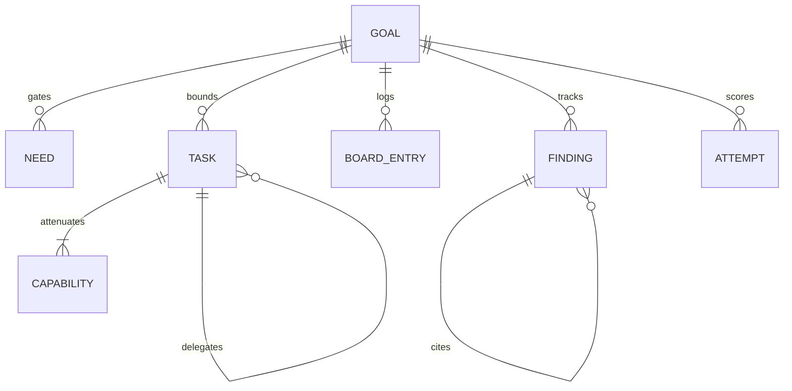
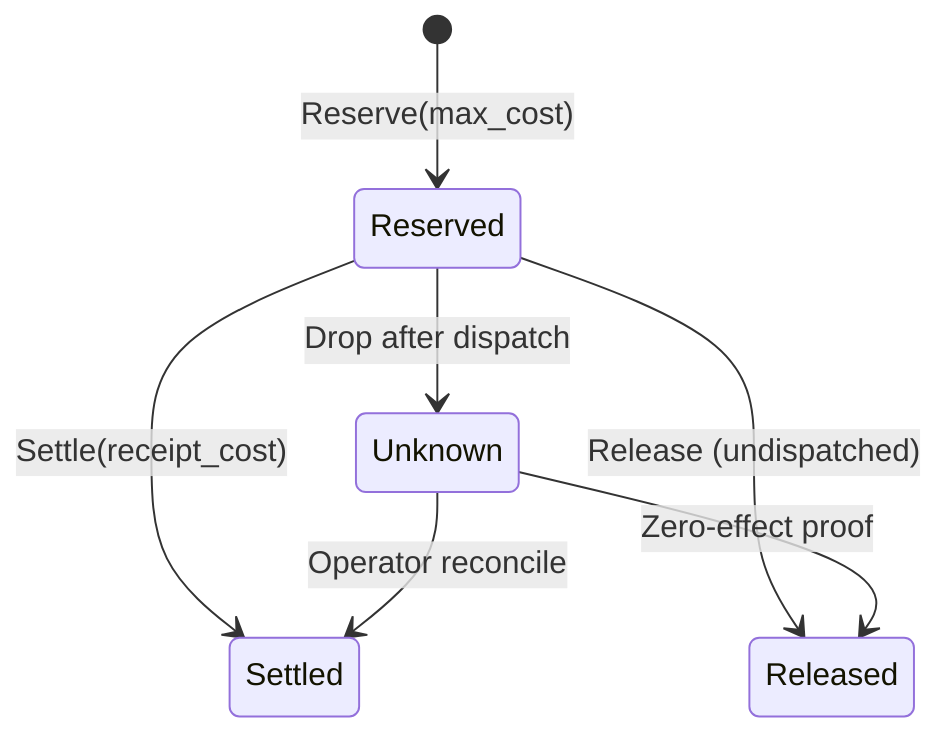

# Architecture

Technical specification for `solos-swarm`.


## 1. Domain primitives

| Symbol | Type | Scope | Core invariant |
|---|---|---|---|
| `G` | `GoalRecord` | Root | Fixed micro-USD ceiling and evaluation contract |
| `N` | `Need` | Per `G` | Blocks dependent tasks until satisfied |
| `T` | `Task` | Per `G` | CAS lease, fencing token, `depth <= 4` |
| `B` | `BoardEntry` | Per `G` | Append-only signed data, never grants authority |
| `C` | `Capability` | Per `T` | Monotonic subset attenuation across delegations |
| `F` | `Finding` | Per `G` | Inherits min source trust and union markings |
| `A` | `Attempt` | Per `G` | Scored on `search`, gated from `final_holdout` |





## 2. Control plane and Raft groups

State splits across three Raft groups over QUIC (`quinn` + `rustls` TLS 1.3 mTLS).

| Group | State | Operations |
|---|---|---|
| `core` | Nodes, leases, kill switches, revocations | `GrantLease`, `EngageKillSwitch`, `RevokeCapability` |
| `coord` | `G`, `N`, `T`, `B`, `F`, `A` | `RegisterGoal`, `ClaimTask`, `SubmitFinding`, `RetractFinding` |
| `ledger` | Accounts, envelopes, holds, settlements | `ReserveBudget`, `SettleBudget`, `ReleaseHold`, `MarkIntentUnknown` |

Every `ClaimTask` increments the store revision and binds `fencing_token = (task_id, agent_id, lease_id, revision)`. Stale tokens fail closed before admission.


## 3. Authorization pipeline

Every broker request passes five sequential gates:

```text
KillSwitch & Lease -> RBAC Role -> ABAC Markings -> Capability & Tier -> Ledger Reserve
```

### Delegation attenuation

A child task capability $C_{\text{child}}$ and budget $B_{\text{child}}$ must satisfy:

- $\text{kind}(C_{\text{child}}) = \text{kind}(C_{\text{parent}})$
- $\text{operations}(C_{\text{child}}) \subseteq \text{operations}(C_{\text{parent}})$
- $\text{resources}(C_{\text{child}}) \subseteq \text{resources}(C_{\text{parent}})$
- $\text{constraints}(C_{\text{child}}) \subseteq \text{constraints}(C_{\text{parent}})$
- $\text{isolation\_tier}(C_{\text{child}}) \ge \text{isolation\_tier}(C_{\text{parent}})$
- $\text{confirmation\_tier}(C_{\text{child}}) \ge \text{confirmation\_tier}(C_{\text{parent}})$
- $\text{expires\_ms}(C_{\text{child}}) \le \text{expires\_ms}(C_{\text{parent}})$
- $B_{\text{child}} \le B_{\text{parent.available}}$, $\quad \text{depth}(T_{\text{child}}) = \text{depth}(T_{\text{parent}}) + 1 \le 4$

### Confirmation tiers

| Tier | Scope | Requirement |
|---|---|---|
| `C0` | Local reads (`claim_task`, `board_read`, `read_findings`) | Active lease and capability |
| `C1` | Internal writes and model calls | Capability, tokenizer check, ledger hold |
| `C2` | Approved external target probes | Goal allowlist and passing QA record |
| `C3` | High-impact external actions or cap overrides | Two distinct MFA-verified human operators |


## 4. Sandbox tiers

| Tier | Runtime | Workload |
|---|---|---|
| `W` | `wasmtime` (`43.0`) with fuel and memory caps | Deterministic parsers and compute tools |
| `P` | `bwrap` + read-only SquashFS + Landlock v3 + seccomp + cgroups v2 | Pi worker processes (`extensions/broker-tools.mjs`) |
| `G` | `runsc` (gVisor) user-space kernel | Containerized CLI tools without KVM |
| `V` | Firecracker / KVM microVM | Untrusted native binaries |

Tier `P` workers expose only six mTLS broker tools: `claim_task`, `board_read`, `board_post`, `submit_finding`, `read_findings`, and `submit_artifact`.


## 5. Two-phase cap ledger

All amounts use integer micro-USD (`1 USD = 1,000,000 micro-USD`).



Pre-dispatch hold calculation:

$$\text{hold\_microusd} = \left\lceil \frac{\text{input\_tokens} \times P_{\text{in}} + \text{max\_output\_tokens} \times P_{\text{out}}}{10^6} \right\rceil$$

Dropped connections after socket write enter `Unknown`. Holds stay locked and never auto-retry.


## 6. Lineage, taint, and context assembly

For any derived finding $F$ citing sources $S_1, \dots, S_k$:

$$\text{trust}(F) = \min_i \text{trust}(S_i), \qquad \text{markings}(F) = \bigcup_i \text{markings}(S_i)$$

Retracting a finding or attempt keeps the log entry, marks transitive descendants `tainted = true`, reopens dependent `Need` records, and adds the candidate digest to the planner exclusion set.

Prompt assembly (`src/planner.rs`, `src/context.rs`) measures fixed contract tokens first with `VerifiedTokenizer`, injects retraction tombstones, and packs prior attempts under `ScoredHistory` or `SingleDraftRefinement`.


## 7. Merkle audit log and isolated evaluator

| Subsystem | Mechanism | Verification |
|---|---|---|
| Audit log (`src/audit.rs`) | RFC 6962 SHA-256 Merkle tree | Ed25519 `solos-swarm:tree-head:v1` |
| Witness (`src/witness.rs`) | Append-only consistency check | Ed25519 `solos-swarm:witness-receipt:v1` |
| Evaluator (`src/evaluator.rs`) | Separate Unix UID (`995`), `0700` bundle dir | Splits `search` from one-shot `final_holdout` |


## 8. Module map

| Module | Responsibility |
|---|---|
| `src/domain.rs`, `src/kernel.rs` | Domain structs, state machine, taint walks |
| `src/cluster.rs`, `src/transport.rs` | Raft CAS store, leases, QUIC mTLS |
| `src/security.rs`, `src/identity.rs` | RBAC, ABAC, capability attenuation, SPIFFE, OIDC |
| `src/operator.rs` | `/v1/operator/*` challenge-response gateway |
| `src/ledger.rs`, `src/quota.rs` | Micro-USD reserve/settle ledger and rate quotas |
| `src/scheduler.rs`, `src/placement.rs` | Gang placement (`PACK`, `SPREAD`) and envelopes |
| `src/delegation.rs`, `src/planner.rs` | Child task attenuation and context packing |
| `src/context.rs`, `src/provider.rs` | Verified tokenizers and OpenAI/SSE adapter |
| `src/sandbox.rs`, `src/wasi_worker.rs` | Tier `P` Linux isolation and Tier `W` Wasmtime |
| `src/tools.rs`, `src/tool_identity.rs` | Tool dispatch and per-call credentials |
| `src/artifacts.rs`, `src/flow.rs` | Content-addressed store and flow monitor |
| `src/evaluator.rs`, `src/evaluator_runtime.rs` | Holdout isolation and candidate runners |
| `src/audit.rs`, `src/witness.rs` | RFC 6962 Merkle log and witness daemon |
| `src/qa.rs`, `src/scenarios.rs` | Scenario generator and qualification runner |
| `src/mvp.rs`, `src/runtime.rs` | CLI entrypoints and service orchestration |
