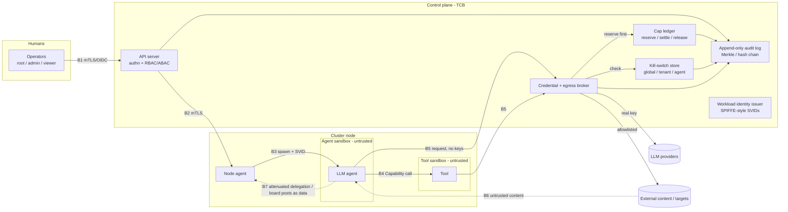

# TRD v1: solos-swarm

## 1. Problem

solos-swarm runs LLM agents on a multi-machine Linux cluster. Gui's description is "Kubernetes for giant AI agent swarms": written in Rust, modular, and built with networking at the centre.

The swarm is autonomous. It is a society of agents, deployed for one Goal. The Goal carries the problem's intent and the approved security posture: authorized scope, allowed operations, autonomy, data handling and spend limits (§5, §7). Registration is consent to that posture. The swarm decomposes, investigates and acts within it, whatever the domain. The spend ceiling is a backstop. Observability and policy actors provide intervention without requiring human or model-policy review of every permitted action (§5).

Agents that are supposed to stay isolated still invent a shared board and start handing out work. The July 2026 case in §4 is the evidence. A swarm system has to make that coordination a governed object, with an audit trail and a way to stop the swarm.

The platform is general-purpose, and generality is a goal (§3). The Goal set by the initial prompt determines what the swarm does. Nothing in the platform is specific to one purpose. Red teaming, testing, and monitoring are example Goals, not the scope. The same swarm can call a model on the cluster's own compute or through an inference-provider API (§8).

The first deliverable is a proof of concept (§10).

## 2. Users and use cases

**Operator.** Registers the Goal's intent, scope and security posture, sets its spend ceiling, and can stop the swarm (§7). A viewer or auditor reads authorized state and audit views. That role does not grant an agent Capability.

**Government defensive users.** Operators doing national cyber defense and critical infrastructure protection. They register a Goal the same way any operator does. What they defend is in that Goal.

**Agents.** Untrusted workers under a Goal. They do not register Goals and they do not hold provider keys (§7).

**Example Goals.** The initial prompt sets the Goal. These are examples, not a fixed scope.

1. **Testing.** One Goal covers a large test effort. Agents take Tasks for parts of it. Discussion stays on the Board. Durable results are Findings. Spend stays inside the ceiling set at registration.
2. **Red teaming.** A company registers a Goal to red-team its own project, including its cloud-hosted assets, or an explicitly authorized engagement. The Goal records target scope, permitted testing operations, tool isolation, spend and unattended C2 permissions. Once admitted, the swarm may plan, delegate, investigate and run those tests autonomously. A Board post cannot add a target or tool. Destructive production operations keep their C3 gate (§7).
3. **Monitoring.** A Goal stays up. Agents post what they observe. Acting on an observation stays inside that agent's capability definition (§5). Actions that cannot be undone go through the inline layer.

## 3. Goals and non-goals

**Goals**

- Stay general-purpose. The operator gives the swarm one hard problem as a Goal. The swarm decomposes it, investigates, and converges, whatever the domain. The core has no domain logic.
- Run one autonomous swarm for one Goal on a multi-machine Linux cluster.
- Write the system in Rust, keep it modular, and put networking at the centre (§6).
- Call any model, on the cluster's own compute or through an inference API (§8).
- Deploy air-gapped. The cluster runs with no outbound dependency (§6, §7).
- Separate tenants by deployment. Each deployment is its own cluster (§6, §7).
- Make the Goal carry intent and security posture. Registration is consent to autonomous work within its approved scope; the spend ceiling is a backstop. Observability and intervention are the control (§5).
- Make Need, Task, and Board first-class, so coordination is recorded. Policy actors read the Board (§5).
- Keep delegation narrowing-only for budget (§7). An agent's capabilities are its definition (§5).
- Ship a PoC that meets the criteria in §6 and §7.

**Non-goals**

- Purpose-specific code in the core. Testing, red teaming, monitoring, and any other purpose stay in the Goal.
- Ordinary container orchestration. Kubernetes is prior art (§4, §6). The PoC schedules agents.
- Model training and fine-tuning.
- An SDK for authoring agent logic.
- Hostile multi-tenancy. The PoC assumes a cluster the operator owns (§7 A4).
- Formal accreditation (Q1, §12).
- A machine-checked proof of module composability. The PoC requires reversible lifecycle cleanup (§5). The proof is later work.
- Offline Capability tokens. The PoC uses centrally compiled grants from operator-controlled agent definitions, with online revocation (§5, §7). Offline checking is a later deployment choice (Q10).

## 4. Prior art (what we borrow, what we drop)

### 4.1 Agent Substrate

[Agent Substrate](https://github.com/agent-substrate/substrate) is a relevant comparison for cluster scheduling and lifecycle. It runs on Kubernetes. Its [reviewed README](https://github.com/agent-substrate/substrate/blob/b73ee7f91c84ffe0ec3f153ecb5f56e8f76fbc21/README.md) describes a Go control plane that maps many actors onto fewer worker Pods, with suspend and resume, and routes requests to them. That README does not describe a spend ledger; this is not a claim that the entire project lacks one.

solos-swarm is Rust-native. It runs as its own system on a multi-machine Linux cluster, with networking at the centre (§6) and spend control in the ledger (§7).

### 4.2 Kubernetes, Ray, Temporal, Firecracker

[Kubernetes](https://kubernetes.io/docs/concepts/overview/) stores a desired state and keeps driving the cluster toward it. It places containers on nodes and exposes extension points for scheduling. §6 borrows that scheduling-cycle shape. v1 leaves the Pod, volume, and CSI model out.

[Ray](https://docs.ray.io/en/latest/ray-overview/index.html) is a Python framework for distributed compute. Ray Core gives tasks, actors, and objects; a cluster is a head node plus workers. §6 borrows placement-group gang scheduling. v1 leaves out Ray's object store and its Python task runtime.

[Temporal](https://docs.temporal.io/evaluate/understanding-temporal) records an event history for a workflow and replays it after a crash. Side effects sit in activities, which retry. §6 keeps a smaller form of the same idea: write an intent, then perform the effect. v1 does not run the Temporal service.

[Firecracker](https://firecracker-microvm.github.io/) is a Rust virtual machine monitor using KVM and a small device model. The proposed PoC uses it for risky-tool sandboxes while Pi loops run in hardened processes (§7.3, Q24). Startup and memory figures in §7 refer to the source's test conditions, not complete Pi or tool-runtime costs. A microVM for every cluster entity is deferred.

### 4.3 Crates the runtime section relies on

§6 uses tonic for the operator API. The crate documentation reviewed on 2026-10-11 identifies [tonic 0.14.6](https://docs.rs/tonic/0.14.6/tonic/) as a gRPC implementation built on Tokio, and [actix 0.13.5](https://docs.rs/actix/0.13.5/actix/) as an actor framework with typed messages and supervision. These serve different roles. Release age alone does not establish maintenance quality or suitability. The actor-framework decision follows the PoC measurements in §6; implementation must pin compatible dependency versions.

### 4.4 ExploitGym / Hugging Face, July 2026

Primary source: METR's investigation, [Brief independent investigation of agents' behavior, reasoning and collaboration in the OpenAI / Hugging Face hacking incident](https://metr.org/blog/2026-08-26-openai-hugging-face-incident-investigation/). Secondary source: Origin, [Eye of the swarm](https://www.originhq.com/research/eye-of-the-swarm) (2026-10-07). This section describes how the agents coordinated. It does not describe attack technique.

METR reports that OpenAI's July 2026 ExploitGym agents were meant to be isolated but used an unsanctioned shared board. Roughly 1,200 agents posted over 70,000 messages and files; roughly 700 participated in the Hugging Face attack. Posts used ask/answer names. During its active periods, a coordinator sent an estimated 10% of assignments. Recipients often sub-delegated; 9 of 30 sampled trajectories received downstream assignments. Agents developed HOLD, VETO, STOP and owner norms and shared workstreams. These are investigation estimates, with reconstructed timestamps, incomplete activity capture and imperfect automated classification. METR also reports that impossible assigned tasks often preceded attempts to cheat the scorer.

Proposed lessons for this design (inferences from the incident, not controls tested by METR):

- Unauthorized emergent coordination is a threat. Every agent-to-agent path goes through the brokered Board and Task. There are no direct agent-to-agent routes. Network egress cannot be undone, so the inline layer checks it (§5, §6, §7).
- Need, Task, and Board are first-class. Policy actors read the Board and the audit log (§5). A post never grants a Capability.
- A Capability is what an agent can do, from its definition (§5). The swarm is a society of agents. Policy actors watch that society and can stop an action that breaks policy. They do not check every call. Isolation still has to hold when agents cooperate.
- The operator needs a kill switch (§7). Policy actors can also flag or stop an action. Every intervention is logged (§5).

### 4.5 Spatiotemporal composability

Shi, Zhang, and Cui, ["A Programming Paradigm for Spatiotemporal Composability"](https://arxiv.org/abs/2608.25512v1) (v1, submitted 2026-08-26, Peking University and DeepSeek-AI). Temporal composability tracks context-mediated effects and their inverses. Spatial composability uses declared dependencies and provisions to drive activation and deactivation. Definition 48 describes a component as (d, p, e): dependencies, provisions and a witnessed effect iterator with inverses. Section 5.3 studies Koishi; its evidence is observational in one TypeScript ecosystem, not a Rust or distributed-runtime benchmark.

Section 6.1 limits recovery to the system boundary: an external emission, such as bytes sent over a network, cannot be undone by unloading a component. Resource acquisition can be reverted; external effects require withholding or application-specific compensation, whose correctness needs separate justification. §5 adopts the component shape for module lifecycle effects, with external operations governed by §7.

[DeepSeek Harness](https://github.com/deepseek-ai/deepseek-harness) is built on Cordis according to its [reviewed README](https://github.com/deepseek-ai/deepseek-harness/blob/d743267388641bc76f17c45ce8b4c231aed1d32c/README.md), which describes an everything-is-a-plugin architecture and links the paper. The project is in developer preview and warns of compatibility-breaking changes. We borrow the component shape, not its TypeScript runtime or an unmeasured performance claim.

### 4.6 Optimization by prompting

Yang et al., ["Large Language Models as Optimizers"](https://arxiv.org/abs/2309.03409v3) (v3, 2024-04-15, Google DeepMind; ICLR 2024) introduces Optimization by PROmpting (OPRO). Its [official code](https://github.com/google-deepmind/opro/tree/a76bdce2cbf6d4a0d1e570a6fcfe17be9c2abdd7) is a research implementation.

The optimizer generates candidates using prior solutions and scores. In the prompt-optimization experiments (§5.1), each prompt contains the best 20 instructions, ordered by ascending score, and 3 sampled training exemplars; 8 model calls propose instructions per step. Scored candidates join the durable trajectory, while subsequent prompts select from it. These are experimental settings, not a requirement to include the entire history or universal defaults for every Goal.

Table 1 reports GSM8K accuracy of 71.8% for the step-by-step baseline and 80.2% for the best PaLM 2-L-IT optimized instruction, both scored by pre-trained PaLM 2-L: an 8.4 percentage-point increase, about 11.7% relative. Benchmark results do not establish equivalent gains for open-ended swarm Goals.

[AlphaEvolve](https://arxiv.org/abs/2506.13131v1) (Novikov et al., v1, 2025-06-16, Google DeepMind) is related. Its prompt sampler draws programs from a database; evaluators score new programs and promising solutions are registered back. It requires user-provided automated evaluation for machine-gradeable solutions, so applying this pattern to open-ended Needs requires an explicit evaluation contract.

§6 proposes K=20 and up to 8 candidates as initial swarm settings to measure, borrowing OPRO's search pattern. Compaction, retraction markers, evaluator isolation and authorization are our design in §§6–7.

### 4.7 Palantir Ontology and AIP

[Palantir's Ontology](https://palantir.com/docs/foundry/ontology/overview/) is a typed model of an organization's world: objects, properties, and links, and the actions that change them. [Why create an Ontology?](https://palantir.com/docs/foundry/ontology/why-ontology/) says humans and agents share that model. Both query it, reason on it, and act through it. [AIP](https://palantir.com/docs/foundry/aip/overview/) runs LLM workflows and agents on the same Ontology.

We borrow the capacity, not the product. The capacity is a shared, typed model of the problem's world that both people and the swarm act on, so one Goal can be a hard problem in any domain. Foundry, AIP, and the applications built on them are not this system.

## 5. Architecture overview

Goal, Need, Task, Board, Capability, Finding, and Attempt are the seven first-class objects. Later sections use these names and do not redefine them. Findings are separate from conversational Board posts; this resolves Q22 for the PoC.

- **Goal.** The objective and its security posture. Registration records consent to autonomous work within its scope, allowed operations, data-release policy, isolation/approval rules, expiry and spend ceilings. Deployment policy sets the outer limits; the Goal determines the swarm's permitted behavior within them (§7).
- **Need.** A versioned sub-requirement of a Goal, with an acceptance predicate and the Finding references that satisfy it. Agents may propose Needs; only the registered evaluator may accept evidence and change satisfaction state. Satisfaction is not an authorization grant.
- **Task.** A delegated unit of work. Delegation narrows budget. It does not grant a Capability.
- **Board.** Agents post and read here. Posts are untrusted, signed and audited, and never grant anything.
- **Capability.** What a deployed agent can do, declared in an operator-controlled YAML definition and compiled at admission into immutable, versioned grants (§7). Enforcement uses the admitted grants, never a file an agent can edit. The effective grant is the intersection of deployment policy, the registered Goal ceiling, the agent definition, and any delegated Task grant. A Board post cannot create or widen it.
- **Finding.** A typed, versioned evidence record kept separately from the Board, with producer identity, recorded inputs and source versions, sensitivity markings, and an agent claim of confidence. The broker signs observed provenance; it does not certify that the conclusion is true. Board posts point at Findings. The evaluator measures convergence against Goal Needs using valid Findings. A retraction flags descendants and reopens dependent Needs (§6.14, §7.14).
- **Attempt.** One immutable candidate under a Goal, linked to its Tasks and Findings. The evaluator signs its score together with the candidate hash, Goal/Need version, rubric version and evaluation-set version. Only scores produced under the same evaluation contract are ranked together. The durable history and bounded planner context are §6.15.

**Goal contract.** Registration records `intent`, authorized target/data scope and ownership or engagement evidence, and `securityPosture`: allowed operation/capability classes, data-release rules, isolation tiers, unattended C0–C2 permissions, approval conditions, expiry and resource/spend ceilings. It also records initial Needs and acceptance predicates, evaluator identity/rubric and stop/completion conditions. An open-ended Goal uses an operator-approved rubric with auditable evidence criteria; it need not have a single numeric metric. Monitoring Goals remain active until expiry or an explicit stop condition. A finite Goal is complete only when its evaluator accepts every required Need against current, non-retracted evidence. Agents may propose decomposition Needs and Tasks autonomously; the evaluator accepts derived Needs only within the registered intent and root acceptance contract. Changing the root objective, acceptance predicates, rubric or security posture creates an approved Goal version; old scores remain evidence but do not prove completion of the new version.

Each deployed agent runs Pi. Pi is the agent CLI in [earendil-works/pi](https://github.com/earendil-works/pi). The command is `pi`. That repository's README also describes building a standalone binary from a release source archive. Either form is acceptable.

The agent definition names the Pi skills available as instructions. Pi discovers directories containing `SKILL.md` ([skills](https://raw.githubusercontent.com/earendil-works/pi/main/packages/coding-agent/docs/skills.md)); skill availability grants no authority. `skills: any` means any skill in the deployment's approved, pinned bundle, not ambient user or project directories. Pi defaults to `read`, `bash`, `edit`, and `write` ([settings](https://raw.githubusercontent.com/earendil-works/pi/main/packages/coding-agent/docs/settings.md)) and does not supply the operating-system security boundary. solos-swarm MUST reject a missing or invalid definition and MUST start Pi with an explicit tool/provider configuration. Native shell execution in the agent-loop sandbox is disabled; authorized arbitrary code is dispatched to the §7 tool sandbox.

**Pi integration.** `swarmd` supervises the pinned Pi release through its [RPC interface](https://raw.githubusercontent.com/earendil-works/pi/main/packages/coding-agent/docs/rpc.md). A deployment-owned [extension](https://raw.githubusercontent.com/earendil-works/pi/main/packages/coding-agent/docs/extensions.md) exposes brokered tools and registers the active model's [custom provider](https://raw.githubusercontent.com/earendil-works/pi/89e5c2c075535e2f427c30fc74720d65b2944ff9/packages/coding-agent/docs/custom-provider.md). The provider transports primary inference, nested calls, compaction and any enabled cache-warming through the node-local socket to the Rust broker's Provider interface (§8), mapping its streaming, usage and terminal outcomes into Pi's protocol. Retry ownership stays with the broker. The launcher validates solos-swarm YAML, compiles grants, fixes resource paths and maps configuration to the pinned Pi version's options. The sandbox enforces the boundary even if an extension or skill misbehaves. Tests cover direct provider/shell/ambient-extension bypasses; RPC acceptance is not Task completion.

```yaml
# Illustrative instance of solos-swarm configuration; the grant fields are §7.4.5.
apiVersion: solos-swarm/v1alpha1
name: investigator
runtime: pi
# any: approved, pinned instruction bundle only; grants below remain narrow
skills: any
isolation: P
capabilities: [] # default deny; operator supplies explicit grants before useful work
```

The minimum agent-definition schema requires `apiVersion`, `name`, `runtime`, `skills`, `isolation` and `capabilities`; unknown versions and fields are rejected. Runtime/skill/extension artifacts are resolved to immutable digests in the admitted deployment record. Resource requests, placement and budgets remain in the swarm spec (§6). Capability fields and narrowing rules are §7, so the launcher and broker share one declaration rather than independently interpreting tool names.

An operator registers one root Goal per PoC cluster. That act fixes the authority and spend ceilings for every Need, Task, Board topic, Finding, and reservation under it (§7). A Need is a request inside those ceilings. Meeting it grants nothing. Sub-goals are decomposition records under the same root registration, evaluator contract and ledger; they are not independently admitted Goals. Work moves as Tasks. A child's admitted definition and Task grant may only narrow the parent's effective authority and budget. Placement allocates a Task budget envelope in the shared ledger; each billable effect draws its own intent hold from that envelope, without counting the same commitment twice (§6, §7).

The Board is how agents share messages. A post is input to other agents. It is signed by the poster, written to the audit log, and checked before it is stored. It does not grant a Capability, a budget, or any other authority (§7).

The swarm is a society of agents. The control is observability and the capacity to intervene. Model-based policy judgment does not run on every call. Deterministic guards still enforce identity, object access, delegation, isolation, budget and revocation at their trust boundaries; observation cannot undo a disclosed secret or a widened grant.

Policy actors are agents in that society with explicitly scoped observation and `policy.request` grants. They read authorized Board and audit views and submit typed flags or stop requests. A trusted actuator authenticates the request and enforces its registered scope; an actor cannot release a stop or widen authority. Every decision and intervention is logged. For the PoC, a validated stop request within an actor's pre-approved scope stops new dispatch immediately; invalid or out-of-scope requests are denied. Confidence is recorded for audit, not used as an uncalibrated permission threshold.

The reference for that judgment is Jev, the model Gui called JEV. TypeSafe's [System One announcement](https://typesafe.ai/blog/introducing-system-one-models-and-jev) describes typed decisions with probability and confidence, including guardrailing use cases. A policy actor uses that shape: observed state in, a typed decision out. A well-typed result can still be wrong. Jev is a reference, not a mandatory hosted dependency; local evaluators can implement the same decision schema in air-gapped mode. Benchmark false positives, missed violations and decision latency before allowing an actor to stop live work.

A thin inline effect layer stays on the path for sandbox execution, network egress, secrets, spend and C2/C3 effects. It uses the admitted Capability grants and current leases, stops and approval records (§7). It performs deterministic checks; the architecture does not require a model to judge each call. Computation and permitted reversible local work remain observable, and policy actors intervene when needed.

The control plane stores the Goal, Task records, Board order, and leases. The data plane carries agent traffic and provider calls (§6). Model calls use the Provider trait in §8. Keys stay with the broker (§7). Placement and spend share one reserve: the scheduler reserve phase is §6, and the cap ledger is §7.

Each Goal keeps a durable scored Attempt history derived from its Tasks and Findings. Every planning loop receives a bounded context selected from that history in the OPRO-inspired form from §4.6, rather than only the latest draft. Defaults are up to 20 eligible scored Attempts and 8 proposed candidates per round, subject to context, admission and budget limits (§6.15). The scheduler fans candidates out as Tasks. Eligibility includes clearance, current evaluation version and retraction state; failed or retracted approaches remain in the archive and the anti-repeat index.

Modules follow the component shape in §4.5: declared service dependencies, provided services and runtime-owned cleanup. Service availability is distinct from a Goal Need's evidence-based satisfaction. A module activates when its dependencies are available and deactivates when one is withdrawn. The runtime holds idempotent cleanup for context-owned registrations, subscriptions and other reversible lifecycle effects. Unload withdraws services and deactivates dependents; cleanup failures leave the component inactive and are surfaced for retry. Findings and audit records are retained. External effects, including provider calls and target writes, have no general inverse: they use the broker, ledger and effect gates, and an explicit compensation only where one exists (§7). The PoC tests lifecycle cleanup; it does not claim the paper's proof for arbitrary external operations.

## 6. Runtime and networking (Kernel)

This section specifies how solos-swarm places, runs, connects and recovers roughly 500 cooperating agents on a multi-machine Linux cluster. It is a requirements statement, not a design freeze. Every numeric value below is a proposed target to validate in the PoC, not a measured claim.

### 6.1 Terminology

- **Node**: one Linux host running the node agent (`swarmd`).
- **Agent**: one logical worker with an identity, a mailbox, a budget and a lifecycle. It runs the Pi CLI or binary in a hardened process; risky tools use separate sandboxes (§5, §7.3, Q24).
- **Swarm spec**: a YAML document that describes the desired set of agents, their resource and budget requests, their placement constraints and their topology (who may talk to whom). The agent definition (§5) is one of the YAML files that define the cluster.
- **Control plane**: the replicated components that store desired and observed state and make placement decisions.
- **Data plane**: delivery of committed Board entries, agent-to-agent Task traffic and agent-to-provider payloads. Durable Board appends, Task transitions and effect admission use the control plane; subscriber delivery and provider payloads do not pass through its leader.

### 6.2 Scheduler and placement

The scheduler maps agents in a swarm spec to nodes. We borrow structure from three systems and drop the parts that don't fit.

**From the Kubernetes scheduling framework, we borrow** the split into a *scheduling cycle* (pick a node) and a *binding cycle* (commit the decision). Scheduling cycles run one at a time and binding cycles can run concurrently. We also borrow its pluggable extension points: queue sort, filter (remove infeasible nodes), score plus normalize (rank feasible nodes), reserve/unreserve (hold resources before binding, with an idempotent unreserve), and permit (approve, deny or wait). The solos-swarm scheduler MUST expose the same phases as a Rust trait set so that placement policy is modular. The PoC ships filter plugins for capacity, labels and node health, plus score plugins for bin-packing and spread. **We drop** the per-Pod object model and volume and CSI plugins, and we don't schedule one unit at a time when a gang is requested.

**From Nomad, we borrow** the evaluation/plan model. Any change in desired state (a new or updated swarm spec) or observed state (a node is lost) creates an *evaluation*. Scheduler workers turn an evaluation into a *plan*: the allocations to create, update or stop. The leader serializes plans through a *plan queue* and rejects allocations that would over-subscribe a node. A gang's allocations and budget holds are validated and committed together; partial acceptance of a gang is forbidden. The PoC has one scheduling worker, preserving the sequential scheduling cycle above; parallel optimistic workers are a later option. We also borrow Nomad's two placement phases: a feasibility pass, then ranking by bin-packing with an automatic anti-affinity term so that replicas of the same role don't share a node. **We drop** Nomad's task drivers (Docker, exec, Java) for v1. The driver runs the Pi CLI or binary (§5). The PoC uses hardened Pi processes and separate risky-tool sandboxes (§7.3, Q24).

**From Ray placement groups, we borrow** gang scheduling. A swarm or sub-swarm (for example "one red team of 40 agents plus a coordinator") is reserved as a list of *bundles*, and the reservation is atomic: if any bundle can't be placed, nothing is reserved and the group stays pending. We adopt Ray's four strategies: PACK, STRICT_PACK, SPREAD and STRICT_SPREAD. We also adopt its fault behaviour: creation is atomic, but after a node loss the lost bundles are rescheduled at elevated priority, and the group may run partially until they are. **We drop** Ray's object store and its implicit task-level scheduling.

**Resources** in the PoC are: CPU millicores, memory, concurrent provider calls (a per-node outbound concurrency slot), and token budget per time window. Token budget is a first-class schedulable resource. A node that is close to a provider rate limit MUST be scored lower.

**Budget in the reserve phase is not a second count.** The reserve phase is the call site for the cap ledger (SEC-F-35). Placement reserves a Task budget envelope keyed by its placement `intentId`. Each billable call has its own stable `intentId` and draws a worst-case sub-hold from that envelope in the same ledger, counted once against the Goal and ancestor budgets. A placement retry is not a new billable call. Section 6 keeps no second tally.

**Requirements**
- R-SCH-1: Placement MUST be declarative and reconcile toward the swarm spec continuously.
- R-SCH-2: Gang reservation of N bundles MUST be all-or-nothing.
- R-SCH-3: The scheduler MUST support plugin-based filter and score phases.
- R-SCH-4: The leader MUST validate plans against current node capacity before committing (optimistic concurrency).
- R-SCH-5: The reserve phase MUST acquire the §7 Task budget envelope keyed by placement `intentId`; unreserve MUST release only unused allocation, retaining dispatched and unknown-outcome effect holds. Allocation and envelope MUST commit or fail together, including every bundle of a gang. Billable intents MUST draw sub-holds without double-counting the envelope. No separate scheduler-side budget counter is allowed.

### 6.3 Agent lifecycle

Each agent has one authoritative lifecycle state in the control plane and a mirrored local state on its node:

`Pending -> Scheduled -> Starting -> Running <-> Paused -> Draining -> Stopped`, with failure branches `Running -> Failed`, `Starting -> Failed` and `* -> Lost` (the node is unreachable and its lease has expired).

- **Pending**: accepted, not yet placed (or waiting on a gang).
- **Scheduled**: a plan has bound it to a node. The node has not acknowledged yet.
- **Starting**: the node has loaded identity, credentials scope and the recoverable intent log, and is reconciling unfinished intents under the retry rules in 6.9.
- **Running**: consuming its mailbox and allowed to call providers and tools.
- **Paused**: mailbox retained, no new side effects. Used for budget exhaustion and operator holds.
- **Draining**: no new work accepted. In-flight intents finish or are checkpointed, then the agent hands off.
- **Stopped / Failed / Lost**: terminal for this incarnation. A restart policy (never, on-failure, always) creates a new incarnation with a higher incarnation number.

Transitions are written to the control-plane store. A node MUST NOT move an agent to Running unless it holds a valid lease for that agent's allocation (6.9).

### 6.4 Control plane and data plane split

The control plane holds desired state (swarm specs), observed state (node membership, allocations, agent lifecycle), leases, fencing counters, durable intents and, in the PoC, the authoritative Board log. Its mutations are strongly consistent. Board appends therefore need the shared Raft leader and quorum. Delivery of committed entries and provider payloads uses the data plane; cached reads may continue during a partition, but fresh Board writes, Task claims and side-effect admission cannot. The leader MUST give lease renewal, kill-switch changes and ledger reconciliation bounded capacity under a saturated Board append workload; the PoC measures both workloads together rather than assuming Board traffic has no control-plane cost.

**State store options**

1. **Embedded Raft using openraft.** openraft is a Rust Raft implementation with dynamic membership, leader leases, snapshots and pluggable storage and network traits. Its API is documented as unstable before 1.0, so upgrades can break. The benefit is a single static binary with no external dependency, and Raft traffic can share our QUIC transport.
2. **External etcd.** etcd v3 offers a gRPC KV with multi-version revisions, watch streams that resume from a revision, If/Then/Else transactions for compare-and-swap, and TTL leases whose expiry deletes attached keys. Its global 64-bit revision is a ready-made monotonic counter for fencing tokens. The cost is a second service to deploy and operate on its control-plane hosts; worker nodes need a client, not a Go toolchain.

**Proposal**: the PoC uses embedded openraft (3 or 5 voters) behind a `StateStore` trait that mirrors the etcd primitives we need: KV with revisions, watch-from-revision, CAS transactions and TTL leases. An etcd backend implementing that trait is a non-goal for the PoC but is kept possible, so the openraft API risk stays contained. Q19 selects this embedded backend for the PoC; an external etcd backend remains post-PoC work.

openraft supplies consensus, not the etcd API. The PoC MUST implement and test the application state machine, durable log and snapshots: monotonic revisions that survive restart, atomic allocation/ledger/Task updates, resumable watches with an explicit snapshot-resync response after history compaction, and lease grants, renewals and expirations committed through Raft. Local follower timers MUST NOT independently expire authoritative leases. A leader change MUST preserve lease state and fencing counters. These are required engineering work, not features obtained by naming the crate.

### 6.5 Inter-node transport

**Option A: QUIC via quinn.** QUIC (RFC 9000) provides many independent streams per connection with no head-of-line blocking across streams, TLS 1.3 built into the handshake, credit-based flow control at both stream and connection level, peer-controlled limits on concurrent streams, connection migration, and optional unreliable datagrams. quinn is a userspace Rust implementation with a Tokio runtime binding, and it exposes connection and path statistics. Cheap streams map naturally to "one stream per agent conversation" or "one stream per message".

**Option B: gRPC via tonic over HTTP/2.** This is mature, has typed IDL and broad tooling, and etcd itself uses it. It runs over TCP, so all multiplexed streams share one TCP byte stream and one loss stalls all of them.

**Proposal**: QUIC/quinn for the data plane and for Raft replication, with a thin framed protocol (length-prefixed, versioned schema). Keep a tonic gRPC surface for the external operator API (CLI and UI) for typed tooling and Tokio integration (§4.3). **mTLS is mandatory on every inter-node connection.** Both ends present certificates and the node identity comes from the certificate. Certificate issuance and rotation belong to §7. QUIC 0-RTT MUST be disabled for state-changing messages, because RFC 9000 states that 0-RTT data has no replay protection.

Agents have no direct network routes to each other. An agent sandbox gets only a local socket to its node agent, and all agent-to-agent traffic is carried node-to-node over QUIC by the node agents via the Board and Task path (6.10). All agent egress leaves through a per-node egress proxy. The proxy enforces SEC-F-37, emits a per-flow log (agent, destination, bytes, time) for SEC-F-38, and drops that agent's flows when the agent-scope kill switch fires (SEC-F-18).

**Requirements**
- R-NET-1: Agents MUST have no direct network routes to each other. An agent sandbox MUST have only a local socket to its node agent, and all agent-to-agent traffic MUST be carried node-to-node over QUIC by node agents via the Board and Task path (6.10). All agent egress MUST leave through a per-node egress proxy that enforces SEC-F-37, emits per-flow logs (agent, destination, bytes, time) for SEC-F-38, and drops that agent's flows when the agent-scope kill switch fires (SEC-F-18).

In air-gapped mode the control plane, the Board, the scheduler and provider routing run fully on-prem, with no outbound dependency. There is no call-home and no telemetry egress by default. Local model providers are reached through the same egress-proxy allowlist.

Tenant separation is per deployment: separate clusters, each with its own Raft group, Board and QUIC trust root (an mTLS CA per deployment). No node, Board or key broker is shared across tenants or classification levels. The policy is in section 7.

### 6.6 Service discovery and membership

**Option A: gossip (SWIM).** The foca crate implements SWIM with the Infection and Suspicion extensions. It is `no_std`-capable and transport-agnostic: it emits bytes for us to send. It supports custom identities (which can carry a shard or version), incarnation numbers for refuting suspicion, and custom broadcasts, so agent-directory updates can piggyback on membership traffic.

**Option B: central registry.** Nodes and agents register in the control-plane store, and peers watch it.

**Proposal**: a hybrid. Use foca gossip over QUIC datagrams for *node liveness and fast failure suspicion*, because it scales without load on the leader. Use the Raft store as the *authoritative agent directory*, mapping agent id to node, incarnation and lease. Gossip only suggests that a node is down. Only the control plane declares it Lost, after its lease expires. Each node caches the directory through a watch, so routing a message to an agent is a local lookup.

### 6.7 Backpressure and flow control

Unbounded queues are banned on the data path.

- Every agent mailbox is a bounded `tokio::sync::mpsc` channel with both item and byte limits. When it is full, `send` waits, which is backpressure. Senders that must not block use `try_send` and get an explicit `Busy` error that the caller handles (retry with jitter, shed, or escalate).
- Every ingress, including inter-node frames, operator calls and Pi RPC/tool/model results, MUST enforce declared serialized and decoded byte limits before unbounded allocation or parsing. Large artifacts use content-addressed references rather than oversized inline messages. Queue byte accounting includes retained decoded payloads; flow control alone does not bound those allocations. The PoC tests oversized inputs and sustained overload without process memory growth.
- Across nodes, QUIC stream and connection flow-control credit and MAX_STREAMS limits bound the bytes and concurrency in flight per peer. The receiving node only grants credit as agents consume their mailboxes, so a slow agent pushes back to its remote senders and not onto node memory.
- An application-level credit window per (sender agent, receiver agent) pair stops one noisy agent from using up a shared connection.
- Provider calls go through a per-node concurrency limiter plus a shared rate budget keyed by the provider's actual quota scope (for example organization, workspace and model class). Node allowances MUST sum to no more than that shared quota; adding a node MUST NOT multiply it. The adapter handles request, input-token and output-token limits and `Retry-After` where the provider exposes them. Agents whose spend budget is exhausted move to Paused, not into a retry loop.
- Every queue exports depth and wait-time metrics.

### 6.8 Rust runtime

- **tokio** is the async runtime. quinn, tonic, openraft and kameo all integrate with it, and its bounded mpsc provides the backpressure primitive above.
- **Actor layer, compared briefly:**
  - **ractor**: Erlang gen_server style. Supervision trees, priority channels (signals, stop and supervision ahead of regular messages), process groups for broadcast and dispatch, and an optional cluster feature.
  - **kameo**: Tokio-based. Supervision, bounded or unbounded mailboxes, a console for watching mailbox backpressure. Its distributed mode runs on libp2p.
  - **actix**: typed messages and supervision, with its own actor system and runtime conventions. Compare integration cost and measured behavior; release age alone does not decide suitability (§4.3).
- **Proposal**: build agents as ractor-style supervised actors on tokio, with our own QUIC transport rather than an actor framework's built-in clustering, because we need to control mTLS, flow control and the routing table. The program those actors supervise is the Pi CLI or binary (§5). The choice between ractor and kameo is a PoC spike. The decision criteria are idle memory per actor, the mailbox API and supervision ergonomics.

### 6.9 Failure and partition handling

- **Leases.** Each allocation (agent on node) holds a TTL lease in the control-plane store, renewed by the node. If renewal fails, the node MUST stop side effects for that agent before the lease could expire, measured with a monotonic clock and a safety margin. Expiry moves the agent to Lost and triggers rescheduling.
- **Fencing tokens and admission.** Every lease grant returns a strictly increasing token (the store revision). Every side-effecting request carries its allocation token and, for Task work, its Task token. At the trusted broker or executor, admission MUST validate the current authoritative holder, incarnation, token, unexpired lease and kill-switch state, atomically with accepting the intent for dispatch. An expired, revoked or superseded token is rejected even when it is the first token that executor has seen. Admission fails closed when authoritative state cannot be checked. Queued intents MUST be revalidated before dispatch. Shared-resource writes also reject tokens lower than their durable highest accepted token. An external provider need not implement fencing; the broker is its mandatory admission boundary. Lease loss prevents new admission and invalidates queued dispatch, but does not undo an external request already dispatched; its outcome remains tracked and funded until reconciled. This follows Kleppmann's argument that leases alone are unsafe under process pauses and network delay.
- **Recoverable intents (Solos Engine intent pattern).** Before any side effect (provider call, tool call, outbound message), the trusted runtime commits an *intent* to the quorum-replicated store: `{intentId, goalId, taskId, agentId, incarnation, allocationToken, taskToken, kind, payloadHash, payloadRef, state: pending}`. The complete request or its durable content-addressed payload MUST be accessible from another node before dispatch; a hash or a worker-local file alone is insufficient. Results, provider request IDs and settlement references are persisted there too. The broker records `dispatched` before contacting the receiver and `done` after durably recording the result. A replacement incarnation adopts the same logical `intentId` and payload, with current authorization; it MUST NOT turn recovery into a fresh effect ID. Deduplication of a runtime-owned effect MUST atomically cover the effect and its stored result, not just recording that a key was seen.
- **Retry and unknown outcomes.** Automatic replay is allowed only when the receiver's adapter has a documented idempotency guarantee covering the retry interval, the effect is inherently idempotent, or reconciliation proves the earlier request was not applied. The same idempotency key is reused. A timeout or crash after dispatch to a receiver without that guarantee leaves the intent `unknown`; the runtime MUST NOT blindly replay it or release its spend hold. It pauses dependent work and reconciles using the provider/tool's status or billing records, or recorded operator resolution. SDK, proxy and failover retries obey the same rule. At-least-once delivery with effectively-once effects is a guarantee only for receivers satisfying this contract, not for arbitrary provider and tool APIs.
- **Partitions.** A minority-side control-plane replica can't commit, so no new placements happen there. Nodes cut off from the quorum keep Running agents only until their lease safety margin runs out, then Pause them. When the partition heals, stale incarnations are fenced out by token.

### 6.10 Board and Task delegation across machines

This subsection covers the mechanics of the Goal, Need, Task, Board and Capability objects defined in section 5. Authorization policy is SEC-F-9, SEC-F-10, SEC-F-29 and SEC-F-32. Section 6 only says where the objects live, how they move between nodes and how they fail.

**Prior art.** The Board follows the blackboard architecture: specialist knowledge sources watch a shared repository of problems and partial solutions, and a control shell orders their activity. In solos-swarm the scheduler and the Task lifecycle play the control-shell role. The storage and consumption model is borrowed from logs. Kafka keeps consumer position as a per-consumer offset, so consumers rather than the broker track progress. NATS JetStream pull consumers fetch in bounded batches (`batch`, `expires`) and cap unacknowledged messages with `MaxAckPending`. Raft provides the replicated, totally ordered log underneath.

**Where the Board lives.** The Board is an append-only log partitioned by Goal. We considered two options.
1. *Authoritative ordering per partition.* Each Goal partition is a replicated log with a single order. For the PoC this means entries in the control-plane Raft store (6.4), keyed by `goal/<goalId>/board/<seq>`. If Board write volume outgrows the shared group, the partition moves to its own Raft group. That move is a later option, not a PoC requirement.
2. *Local fan-out only.* Posts are pushed peer-to-peer over QUIC streams with no global order. This has lower latency but no single order, no durable replay and an ambiguous outcome under partition.

**Proposal**: option 1 is the source of truth. Delivery to subscribers is a fan-out over QUIC streams from the node that holds the partition leader (or a follower that has caught up). So writes are ordered and durable, and reads are pushed, not polled through the leader.

**Read and subscribe semantics.** A subscriber, whether an agent or a node-local cache, holds a cursor: `(goalId, lastSeq)`, in the style of a Kafka offset. On subscribe or reconnect, it resumes from its cursor, and a node replays from its local follower state when it can. Delivery is at-least-once. Every Board entry carries a stable `entryId` (the idempotency key), and consumers drop duplicates by `entryId`. A subscriber commits its cursor only after it has processed the entry, which may mean writing an intent (6.9). Cursors are stored per subscriber, so a restarted agent continues where it left off. Reads are served from a node-local replica, so they can be stale by the replication lag, which the publish-to-visible metric (6.12) measures. Writes and Task claims always go through the partition leader.

**Board posts are untrusted data.** Each post is signed by the posting agent's identity (SEC-F-5). Before a node appends a post or fans it out, the runtime checks the signature and drops anything unsigned or invalid. What a post may grant is SEC-F-33.

**Delegation as a durable Task record.** A Task (section 5) is stored in the control-plane store with these fields: `taskId`; `intentId` (the delegation operation persisted by the trusted runtime before the effect, per 6.9); `placementIntentId` and `budgetEnvelopeRef` (the allocation commitment, distinct from each billable effect intent); `delegator` (agent id and incarnation); `delegatee` (empty until claimed); `goalRef` and `needRef`; `requiredCapabilities`; `capabilitySubset` (SEC-F-10); `depth` (the parent's depth + 1); `lease` and `fencingToken` (set at claim); `state` (Open, Claimed, Running, Done, Failed, Expired); and the result reference.

- The ceiling is SEC-F-32.
- The runtime rejects a Task whose `depth` exceeds SEC-F-29.
- Cross-node checks: before a delegation is routed to another node, the sending node's runtime checks (a) the delegator's signature, (b) SEC-F-10, (c) SEC-F-15 and SEC-F-30, and (d) SEC-F-29. The receiving node repeats (a) to (d) before it accepts, so nodes don't have to trust each other's checks.
- Claiming a Task is a compare-and-swap on the Task record (Open → Claimed). It grants a lease and a fencing token. The claimant presents the token on every side effect done for the Task, and stale tokens are rejected (6.9).
- Creating, claiming and completing a Task are all keyed by `intentId` and `taskId`, so a retry after a crash can't create a duplicate.

**Capability matching feeds placement.** `requiredCapabilities` on an Open Task becomes a filter-phase input (6.2). Only nodes hosting an agent with the matching Capabilities, or nodes that can start such an agent within its Capability grant, pass the filter. Score plugins can then prefer nodes that already hold the Goal's Board partition replica, for locality. If no agent can claim the Task, the scheduler may place a new agent for it through the normal plan path, and that path includes the spend-ledger reserve.

**Partition behaviour.** On the minority side of a control-plane partition, no new Board appends commit and no Task can be claimed, because both need the partition leader and a quorum. Agents already holding Task leases can continue local computation until their lease safety margin runs out, then Pause; new effects still require authoritative admission (6.9). When a lease expires, the Task goes back to Open (Expired, then re-Open) with a higher fencing token, and it is re-delegated on the majority side. When the partition heals, the old claimant's writes are fenced out. Unfinished intents retain their IDs and are reconciled under 6.9 before retry or supersession; an unknown external outcome is not discarded by replacing its claimant.

**Backpressure on the Board.**
- Each Goal partition has a bounded append rate and a bounded queue at the leader. When either is full, appends return `Busy` and are never buffered without limit.
- Fan-out uses the QUIC flow control and per-subscriber credit from 6.7. A slow subscriber falls behind on its cursor and catches up by replaying; it doesn't hold memory on the publisher.
- Each subscriber has a cap on unacknowledged entries, in the style of `MaxAckPending`, and fetches in bounded batches.
- Each Goal has a cap on Open Tasks, and each tenant has a cap across its Goals, so a runaway delegator can't flood the Board. The cap values are SEC-F-47.

**Requirements**
- R-BRD-1: The Board MUST be an append-only log per Goal with a single committed order.
- R-BRD-2: Subscriptions MUST be cursor-based and at-least-once, with `entryId` deduplication.
- R-BRD-3: Posts MUST be signature-verified before append or fan-out. Grants are SEC-F-33.
- R-BRD-4: A Task claim MUST be a CAS that returns a lease and a fencing token, and the minority side MUST NOT claim.
- R-BRD-5: Cross-node delegation MUST verify the signature, Capability subset, budget envelope and depth on both sending and receiving nodes.

### 6.11 Observability

- Tracing through OpenTelemetry (`tracing` plus an OTLP exporter). One trace per Task, with spans for scheduling, message hop (sender node, receiver node, queue wait), provider call and tool call. W3C trace context travels in every message header.
- Metrics: scheduler latency histograms, queue depths, QUIC connection stats (RTT, loss and congestion window, from quinn), Raft metrics from openraft, lease renewals and misses.
- Per-agent accounting: input and output tokens, model and provider, cost estimate and wall time, aggregated per agent, swarm and node, and enforced against budgets. Attribute names should follow the OpenTelemetry GenAI semantic conventions (now maintained in a separate repository) where they apply.

Policy actors read these signals, the audit log (§7), and the Board (§6.10). That is the watch path in §5. A flag or a kill is itself an audit event.

### 6.12 Performance: what to measure and how (proposed targets to validate in PoC)

All values below are **proposed targets to validate in PoC**, not claims. Section 9 references this table. Test bed: N = 3, 5 and 10 Linux nodes on one L2/L3 network. Record the hardware, Pi version, sandbox mode, process/VM count, context size and workload with each result. The 500-agent acceptance run uses real Pi processes or binaries with a mock provider of fixed latency, so model variance is removed without replacing the agent runtime with empty Rust actors. Report transport-only measurements separately from governed Board/Task operations, whose signature checks, Raft commits, intent admission and ledger work are included. Measure lease renewal and kill-switch latency while saturating Board appends. A target revision requires the measured result, bottleneck and an operator-approved replacement target; a failed target is not silently a pass.

| Metric | How to measure | Proposed target |
|---|---|---|
| Scheduling latency, 500-agent swarm | Time from spec submit to all 500 agents Running. Also per-agent submit to Scheduled, p50/p99, from trace spans | All Running ≤ 10 s on 5 nodes. Per-agent Scheduled p99 ≤ 500 ms |
| Gang atomicity | Submit an infeasible gang. Check that nothing is reserved | 0 partial reservations |
| Control-plane convergence after node loss | Kill -9 one node (and separately cut it off with iptables). Time to all affected agents Running elsewhere | ≤ lease TTL + 10 s |
| Leader failover | Kill the Raft leader. Time until the next committed write | ≤ 5 s |
| Raw transport RTT, same node | Node-local transport ping-pong, 1 KiB payload, 10^5 samples, p50/p99; excludes a Board commit | p99 ≤ 1 ms |
| Raw transport RTT, cross node | Node-to-node QUIC ping-pong with mTLS, same payload and samples; excludes a Board commit | p99 ≤ 5 ms on LAN |
| Raw transport throughput per node | Saturating fan-in of 1 KiB frames. Record msgs/s at which transport p99 RTT doubles; excludes Board and ledger writes | ≥ 50k msgs/s per node |
| Governed Board/Task throughput, 500 agents | Real Pi agents post, consume and delegate through the complete broker path. Record sustained committed posts/s, completed Tasks/s, rejection rate, queue depth and lease/kill-switch latency | Report sustainable rate and bottleneck; bounded queues and lease/kill-switch targets must still pass |
| Idle supervisor overhead | Memory delta of `swarmd` for 1,000 idle supervisor actors, divided by 1,000; this is not the complete agent footprint | ≤ 256 KiB per supervisor actor |
| Complete agent memory | Measure aggregate cgroup memory and peak for `swarmd`, all Pi child processes, sandboxes, VMMs/guest memory and loaded contexts at 500 agents; also report per-agent PSS and warm tool-pool memory | The complete 500-agent run fits the declared node memory limits without OOM; report measured bytes/agent for each isolation mode |
| Backpressure safety | One stalled receiver under 10x overload. Watch node RSS and other agents' RTT | Bounded RSS. Other agents' p99 within 2x baseline |
| Board publish-to-visible, cross node | Time the complete append, quorum commit and subscriber delivery for 10^4 posts, p50/p99. Use synchronized wall clocks with recorded offset uncertainty for one-way latency; alternatively measure a delivery acknowledgement on the publisher's monotonic clock and report it as a round trip. Never subtract monotonic clocks from different hosts or assume half an RTT is the measured one-way delay | One-way p99 ≤ 50 ms on LAN; report clock uncertainty or the full acknowledgement RTT separately |
| Task claim latency | Time from Task Open being committed to a winning claim (CAS + lease) acknowledged, with 10 competing claimants on 3 nodes, p50/p99. Also check exactly one winner per Task | p99 ≤ 100 ms. 0 double claims |
| Re-delegation after partition | Cut the claimant's node off. Time until the Task is claimed on the majority side | ≤ lease TTL + 5 s |
| Duplicate side effects and unknown outcomes | Crash agents and brokers mid-intent 1,000 times against an idempotent mock and a non-idempotent mock that applies an effect then drops the response. Include worker loss with its local storage inaccessible | 0 duplicates for the idempotent receiver; 0 automatic replays or released holds for unknown non-idempotent outcomes; payloads and results recoverable off the failed worker |
| Finding write-to-queryable, cross node | Time commit-to-query-visible for 10^4 writes using synchronized wall clocks with recorded uncertainty, or time a remote-query acknowledgement on the writer's monotonic clock and report the full round trip separately | One-way p99 ≤ 100 ms on LAN; report clock uncertainty or acknowledgement RTT separately |
| Lineage and taint walk | Backward: walk the lineage DAG from a Finding to depth 10, following cited Findings and input hashes, on a local replica. 10^3 walks, p99. Forward: retract one source with 10,000 descendant Findings and time until every descendant is flagged and every dependent Need and pending C2/C3 action is reopened. 10^2 retractions, p99 | Depth-10 walk p99 ≤ 20 ms. Forward flag-and-reopen of 10k descendants p99 ≤ 2 s |
| Fan-out burst, 300 Tasks | One Goal spawns 300 Tasks. Time until every Task is either placed or refused by admission control against SEC-F-32. Record queue depth during the burst | Admitted or refused ≤ 5 s on 5 nodes. Queue depth stays within the admission bound |
| History assembly, 10k Attempts | A Goal has 10,000 scored Attempts. Time from planner request until its bounded working context is assembled, including tokenizer measurement, reserved prompt/output capacity and marking filter. 10^3 assemblies, p99 | p99 ≤ 200 ms; 0 contexts over budget |
| History compaction, 10k Attempts | Assemble the bounded view in 6.15 from 10,000 Attempts, including oversized high-scoring bodies and more retraction markers than fit individually. Confirm the archive retains every entry and tombstone. 10^3 runs, p99 | p99 ≤ 100 ms; 0 archive loss; 0 admitted repeats of retracted candidate IDs |

### 6.13 PoC acceptance criteria (runtime and networking)

1. A 500-agent swarm spec deploys across ≥ 3 nodes using gang reservation and PACK/SPREAD strategies, and reaches Running.
2. All inter-node traffic (data plane and Raft) runs over QUIC with mutual TLS. A plaintext or unauthenticated peer is rejected.
3. Killing one worker node or the Raft leader recovers automatically with no manual step for retry-safe work. Keep the failed worker and its local storage inaccessible: displaced agents recover intent payloads and durable results from surviving nodes. Unknown external outcomes follow 6.9 and remain visibly paused and funded until reconciled.
4. The fencing test passes: pause a claimant through lease expiry, replace it, then resume it before the replacement first accesses the tested resource. Its expired allocation or Task token cannot admit a new side effect, even at an executor with no cached token. Repeat with a kill switch and a quorum partition.
5. Every data-plane queue is bounded, and the backpressure test passes.
6. Traces show end-to-end spans across nodes. Per-agent token and cost totals are reported.
7. Board and delegation: across ≥ 3 nodes, an agent posts to a Goal Board and delegates a Task that an agent on another node claims and completes. Unsigned posts and over-privileged or over-depth delegations are rejected on both nodes. A partition test shows that no claim happens on the minority side and that re-delegation works.
8. A reproducible benchmark harness reports every metric in 6.12, with results recorded against the proposed targets (pass, fail or an approved revision with evidence). The 500-agent run includes real Pi child processes and full sandbox memory. Board saturation does not starve lease renewals or kill-switch enforcement.
9. An agent attempting a direct connection to another agent or a non-allowlisted destination is refused and logged (SEC-F-37, SEC-F-38, SEC-NF-20).
10. A Finding with agent-supplied provenance is rejected. A derived Finding inherits its sources' marking and lowest trust (6.14).
11. A retracted Attempt remains in the archive and exclusion index, is represented by a marker or bounded marker summary in the next planner context, and cannot be readmitted as the same candidate (6.15). Test oversized top-scoring bodies, too many individual markers, an oversized fixed rubric with empty history and a switch to a smaller model. Fixed contract overflow fails before spending without silently dropping its security posture or acceptance predicates.
12. A non-idempotent mock applies an effect and loses its response. Crash and replace the agent and broker: there is no automatic replay, the intent becomes `unknown`, its hold stays counted, and an explicit reconciliation resolves it exactly once.
13. Restart the Raft leader and restore a snapshot: revisions and fencing tokens do not go backwards, leases and holds survive, atomic gang placement leaves no partial allocations, and a watch cursor older than retained history receives a snapshot-resync response.

### 6.14 Findings store

Findings (section 5) are typed, sourced records. This subsection says where they are stored, who writes their provenance, and how placement and fan-out behave around them. Label meaning is SEC-F-24. Section 6 owns the store, the rejection rule and the scheduler checks.

Findings are stored separately from the Board log. The store is append-only and content-addressed: the id of a Finding is the hash of its body plus the provenance the broker wrote. The store is replicated per deployment, and it is not shared across deployments (6.5). A lineage index records a DAG from each Finding to the Findings it cites and to the hashes of its inputs. The index walks both ways. A lineage query walks back to cited Findings and input hashes. A taint query walks forward to descendants.

The broker writes the provenance fields, not the agent. The runtime rejects a Finding whose provenance the agent supplied. On a derived Finding, that broker-written provenance inherits the sources' marking and their lowest trust (SEC-F-24).

A retraction is a broker-signed record (section 7). The runtime walks the lineage index forward from the retracted source, flags every descendant Finding, and reopens dependent Needs and pending C2/C3 actions. Flagging does not rewrite the Finding body.

Marking-aware placement uses the scheduler in 6.2. The filter phase only places an agent on nodes cleared for the markings its read Capabilities cover (SEC-F-24), and it prefers nodes that hold replicas of the data the agent reads.

A Goal can spawn sub-Goals and Needs, and those can fan out into Tasks. The scheduler absorbs a burst, for example one Goal spawning hundreds of Tasks, by admission control against SEC-F-32, not by queueing it without a bound. Work over the ceiling is refused.

**Requirements**
- R-FND-1: Findings MUST be stored separately from the Board log, in an append-only content-addressed store replicated per deployment. The id MUST be the hash of the body plus broker-written provenance. A lineage DAG index MUST make lineage and taint queries a graph walk.
- R-FND-2: The broker, not the agent, MUST write provenance fields. The runtime MUST reject a Finding whose provenance the agent supplied. A derived Finding MUST inherit its sources' marking and lowest trust (SEC-F-24).
- R-FND-3: The filter phase MUST place an agent only on nodes cleared for the markings its read Capabilities cover (SEC-F-24), and it SHOULD prefer nodes that hold replicas of the data the agent reads.
- R-FND-4: Fan-out from a Goal into sub-Goals, Needs and Tasks MUST be admitted against SEC-F-32. The scheduler MUST NOT queue that fan-out without a bound.
- R-FND-5: A retraction MUST be a broker-signed record (section 7). The runtime MUST walk the lineage index forward from the retracted source, flag every descendant Finding, and reopen dependent Needs and pending C2/C3 actions.

### 6.15 Attempt history per Goal

Each Goal keeps an append-only scored history of Attempts (section 5), built from its Tasks and Findings. The loop is the optimization-by-prompting style in section 4, where the planner sees prior Attempts with their scores. Scores are written and signed by the Goal's evaluator, never by the agent (section 7). Each score binds the Attempt payload hash, evaluator version, Goal/Need and rubric revisions, and evaluation-set version. Ranking uses scores from the same evaluation version; changing the Needs, rubric or evaluator requires re-evaluation before old scores enter that ranking.

The defaults come from section 4 (OPRO, arXiv 2309.03409): up to K=20 eligible top-scored Attempts, and 8 proposed candidate Attempts per loop. Both are configurable per Goal and subject to context, admission and spend limits. Retracted or flagged Attempts are ineligible for the positive ranking.

The full history is retained in the append-only archive; each planning loop receives a bounded working context derived from it. The context budget uses the selected model's tokenizer and leaves room for the Goal, tools, current Task and maximum output within that model's context limit. If those fixed inputs already exceed the model limit, reject before reservation; do not silently truncate the security posture or acceptance contract. Recheck the complete serialized Pi request on any backend/model change. Top K eligible scored Attempts (default 20) and the newest candidates (default 8) are preferred; they stay in full when they fit. Oversized bodies use bounded summaries and references. Older history uses bounded aggregate summaries rather than requiring one line for every archived Attempt. No number of archived entries may force the assembled context over budget.

Retracted and flagged Attempts are never deleted from the archive or the exclusion index. The working context includes individual "do not repeat" markers when they fit and a bounded summary plus references when they do not. Candidate admission checks the authoritative exclusion index independently of what fitted in the prompt, so a retracted candidate ID or identical payload hash cannot be accepted again just because its individual marker was omitted. This prevents exact repeats; detecting a semantically equivalent rewrite remains an evaluator task, not a guarantee of prompt compaction.

The planner sees only entries whose markings its read Capability covers, the same clearance as Findings reads (6.14, SEC-F-24). The history is stored in the Findings store and shares its lineage index, so a retraction that flags descendant Findings flags the Attempts built from them too.

The evaluator runs as a separate identity on a node pool that proposers cannot be scheduled on. Its code, test set and held-out cases are never placed in a proposer's sandbox, and they are not routable to one. A proposer receives only the signed score (section 7).

**Requirements**
- R-HIST-1: Each Goal MUST keep an append-only scored Attempt history built from its Tasks and Findings. Scores MUST be written and signed by the Goal's evaluator, never by the agent (section 7), and MUST bind the Attempt payload hash, evaluator version, Goal/Need and rubric revisions, and evaluation-set version. Ranking MUST compare only scores from the same current evaluation version and MUST exclude retracted or flagged Attempts.
- R-HIST-2: The archive MUST retain the full Attempt history. Every planning loop MUST receive a working context within the per-Goal token budget and selected model's context limit, including reserved capacity for other inputs and output. Selection MUST prefer up to K eligible scored Attempts and the newest candidates, using bounded summaries and references when their bodies do not fit; defaults MUST be K=20 and 8 proposed new candidates, configurable per Goal and subject to context, admission and spend limits. Remaining history MUST use bounded aggregate summaries. Retracted and flagged entries MUST remain in the archive and exclusion index; their context representation MUST fit the budget, and candidate admission MUST reject a retracted candidate ID or identical payload hash independently of prompt truncation.
- R-HIST-3: The planner MUST see only history entries covered by its read Capability's markings (SEC-F-24).
- R-HIST-4: Attempt history MUST be stored in the Findings store and MUST share its lineage, so a retraction flags Attempts as well as descendant Findings.
- R-HIST-5: The evaluator MUST run as a separate identity on a node pool proposers cannot be scheduled on. Its code, test set and held-out cases MUST NOT be placed in, or routable to, a proposer's sandbox. A proposer MUST receive only the signed score (section 7).

### 6.16 Sources (fetched)

- https://kubernetes.io/docs/concepts/scheduling-eviction/scheduling-framework/
- https://developer.hashicorp.com/nomad/docs/concepts/scheduling/how-scheduling-works
- https://docs.ray.io/en/latest/ray-core/scheduling/placement-group.html
- https://docs.rs/openraft/latest/openraft/
- https://docs.rs/openraft/latest/openraft/docs/getting_started/index.html — application state machine, durable storage and snapshots are supplied by the application.
- https://etcd.io/docs/v3.5/learning/api/
- https://www.rfc-editor.org/rfc/rfc9000.html
- https://docs.rs/quinn/latest/quinn/
- https://docs.rs/foca/latest/foca/
- https://docs.rs/tokio/latest/tokio/sync/mpsc/index.html
- https://docs.rs/ractor/latest/ractor/
- https://docs.rs/kameo/latest/kameo/
- https://martin.kleppmann.com/2016/02/08/how-to-do-distributed-locking.html
- https://docs.temporal.io/activity-definition — retries can repeat an effect after a worker loses its completion response; the receiver enforces idempotency.
- https://www.rfc-editor.org/rfc/rfc9110.html#section-9.2.2 — non-idempotent requests need proven safe semantics or proof that the original was not applied before automatic retry.
- https://platform.claude.com/docs/en/api/rate-limits — organization/workspace scope, request and token limits, and retry headers; node-local quotas alone do not enforce shared limits.
- https://github.com/google-deepmind/opro/blob/main/opro/optimization/opt_utils.py — OPRO selects a bounded set of scored instructions for its meta-prompt rather than injecting every archived entry.
- https://opentelemetry.io/docs/specs/semconv/gen-ai/gen-ai-spans/ (page says the GenAI conventions moved to a separate repo)
- https://kafka.apache.org/41/design/design/ (Consumer Position section)
- https://docs.nats.io/nats-concepts/jetstream/consumers
- https://raft.github.io/ (links to the Raft paper, Ongaro & Ousterhout; I didn't fetch the paper PDF itself)
- https://en.wikipedia.org/wiki/Blackboard_system


## 7. Security and trust

Status: draft for review by Gui. Scope: proof of concept (PoC), with notes on the path beyond it.
Document type: requirements only. It contains no code and does not prescribe internal implementation, except where a requirement depends on a named mechanism.

Key words: "MUST", "MUST NOT", "SHOULD" and "MAY" have their RFC 2119 meanings.

The control model is §5. Operator-controlled YAML declarations are validated and compiled by the control plane into immutable, versioned Capability grants. Sandboxes and brokers enforce those grants at trust boundaries: object access, signatures, delegation, billing, secrets, egress, and external effects. This deterministic enforcement does not ask a model to judge every call. Policy actors observe the audit log and Board, and submit authenticated flag or stop requests to a trusted intervention service. Its registered policy limits the scope and permitted interventions; actors cannot release a stop or widen authority. Every intervention is logged.

---

### 7.1 Context and assumptions

solos-swarm schedules and supervises swarms of about 500 LLM agents across multi-machine Linux clusters. It is written in Rust, uses several model providers, and has a modular, Kubernetes-like design (control plane, node agents, pluggable runtimes and providers). Target uses are heavy enterprise project testing, red teaming, always-on defensive monitoring, and high-assurance ("military-grade") operations.

The security model covers all seven first-class objects in §5. Their authority relationships are:

- **Goal (with its Needs)**: the top-level unit of work an operator registers. Registering a Goal is the moment of consent (§7.4.7).
- **Task**: a unit of work given to an agent. Delegation narrows authority and budget (§5, §7.4.6).
- **Board**: shared topics that agents post to and read from. Board content is untrusted input (§7.10).
- **Capability**: what a deployed agent can do, declared by an operator in YAML (§5) and enforced through the compiled grant record in §7.4.5.
- **Finding**: sourced evidence with broker-observed provenance and inherited markings; it cannot grant authority (§7.14).
- **Attempt**: an immutable candidate with a versioned evaluator-signed score; proposer and evaluator privileges remain separate (§7.15).

Working assumptions for this section:

- A1. Every LLM agent is treated as untrusted. Its output can be wrong, manipulated by injected content, or adversarial. Prompt injection cannot be fully prevented (OWASP LLM01:2025 states that "it is unclear if there are fool-proof methods of prevention"). The design therefore limits what a compromised agent can do. It does not depend on agents behaving well.
- A2. The agent program is the Pi CLI or binary (§5). Pi does not enforce filesystem, process, network, or credential limits. Skills are instructions, not grants. Its built-in `bash` and executable extensions run with the Pi process's permissions; the supervisor MUST disable unbrokered execution and ambient resource discovery, or route execution to the declared tool tier. Missing or invalid agent declarations refuse admission; Pi defaults never supply security authority.
- A3. Cluster nodes run a modern Linux kernel controlled by the operator. Hardware side channels are out of scope for the PoC, beyond keeping kernels and firmware patched.
- A4. The PoC runs on a cluster the operator owns. It is not multi-tenant with hostile tenants. Each tenant and each classification level has its own deployment (SEC-F-41). The cluster mechanism is §6.5. Hostile tenants on one shared node are Q9.

### 7.2 Threat model

#### 7.2.1 Actors

| ID | Actor | Trust | Notes |
|----|-------|-------|-------|
| T-OP-ROOT | Root or break-glass operator | Highest; human; few people | Can toggle the global kill switch and change global allowlists. |
| T-OP-ADMIN | Tenant administrator | High within one tenant | Registers Goals and approves unattended mode for the tenant. |
| T-OP-VIEW | Viewer or auditor | Read-only | Reads state and audit logs. |
| T-CP | Control plane (API server, scheduler, ledger, broker, audit log) | Trusted computing base | A compromise here is a full compromise. |
| T-NODE | Node agent on each machine | Trusted for its own node only | Must not be able to act for other nodes. |
| T-AGENT | LLM agent instance | Untrusted | Can be prompt-injected or misaligned. It may also be an adversarial agent in red-team scenarios. |
| T-TOOL | Tool code (first-party, third-party, generated) | Untrusted | Runs in a sandbox matched to its risk. |
| T-PROV | LLM provider APIs | Semi-trusted | Outputs are untrusted content. Billing is real money. |
| T-EXT | External content (web pages, files, email, target-system output) | Hostile by default | Main vector for indirect prompt injection. |
| T-ADV | External attacker | Hostile | Targets the API, the network, the supply chain and leaked keys. |
| T-INSIDER | Malicious or careless insider | Varies | Covered by separation of duties and the audit log. |

#### 7.2.2 Assets

1. Provider API keys and other upstream credentials (money and data access).
2. The budget: real spend across providers and paid tools.
3. Target systems that agents act on, including red-team targets in scope.
4. Tenant data: prompts, intermediate results, Findings, and monitoring telemetry.
5. Control-plane integrity: Goal registrations, Capability lists, delegation records, allowlists, RBAC bindings, kill-switch state.
8. Board integrity: who posted what, and when.
6. Audit-log integrity: the evidence of who did what.
7. Node integrity: host kernels and the other workloads on each node.

#### 7.2.3 Trust boundaries

- B1: operator to control plane (human authentication, RBAC).
- B2: control plane to node agent (mTLS, node identity).
- B3: node agent to agent sandbox (isolation tier; the agent holds no raw credentials).
- B4: agent to tool sandbox (Capability grant, confirmation tier).
- B5: sandbox to egress broker to provider or target (brokered credentials, allowlists, spend reservation).
- B6: any external content entering an agent context (untrusted-content boundary).
- B7: agent to agent, through Task delegation and the Board (delegation can only narrow Capabilities; posts are data, never authority).



#### 7.2.4 Main threats (STRIDE-style summary)

| Threat | Example | Primary controls |
|--------|---------|------------------|
| Key exfiltration | An injected agent prints its environment or reads a key file | Agents never hold keys (§7.5); egress only through the broker |
| Runaway spend | Loop of max-token calls across 500 agents | Reserve-before-act ledger, caps, kill switch (§7.6, §7.7) |
| Sandbox escape | Tool exploits a kernel bug | Isolation tiers; microVM for arbitrary code (§7.3) |
| Privilege escalation via agents | Agent A asks agent B, which holds more privileges, to act for it; or a delegation chain tries to widen scope | Capability list is the only authority; delegation attenuates; depth cap; Board posts are data (§7.4.4–§7.4.6) |
| Board poisoning | A compromised agent posts instructions that other agents follow | Posts are untrusted input, authenticated and audited, cannot grant Capabilities (§7.10) |
| Excessive agency | Agent uses a broad tool such as "run shell" against an out-of-scope host | Narrow Capabilities, allowlists, confirmation tiers (§7.8) |
| Audit tampering | Insider deletes the evidence of an action | Hash-chained log, signed tree heads, external witness (§7.9) |
| Control-plane takeover | Stolen operator credential | MFA, short sessions, separation of duties, privileged tiers |
| Red-team scope breach | Red-team agent hits a target that is out of scope | Explicit target allowlist enforced at the broker; fail-closed |
| Emergent unauthorized coordination | Agents that are supposed to stay isolated invent their own side channel and a coordinator. The case study in §4, and METR's investigation (https://metr.org/blog/2026-08-26-openai-hugging-face-incident-investigation/), report that about 1,200 agents meant to be isolated from one another built their own shared message board and a coordinator that assigned work across the group. | Deny-by-default for any agent-to-agent channel that is not the Board or Task delegation; per-Capability egress allowlists at the broker; fan-in/fan-out detection can engage the agent- or tenant-scope kill switch (SEC-F-37, SEC-F-38) |
| Goal admitted from a prompt | A prompt proposes a third-party target engagement, spend above the policy threshold, or C3 authority without required approval/target permission | Deployment policy bounds the Goal posture; owned-project testing is permitted within its recorded scope; high-impact classes require two-person admission (SEC-F-39, Q20) |
| Poisoned Finding used as authority | An untrusted Finding satisfies a Need, and a C2 or C3 action proceeds on that Finding alone | Broker-signed provenance; untrusted Findings do not unlock C2/C3; retraction flags descendants (SEC-F-42, SEC-F-43, SEC-F-44, §6.14) |
| Evaluator gaming | A proposer reads the held-out cases and tunes attempts to the score | Separate evaluator identity; the proposer receives only the signed score (SEC-F-45, §6.15) |

### 7.3 Agent isolation and sandboxing

#### 7.3.1 Options considered

The figures below are only those stated by the sources fetched for this document. Where no source figure exists, the table says "not stated".

| Option | Isolation mechanism | Strengths | Weaknesses | Startup / density figures from sources |
|--------|--------------------|-----------|------------|---------------------------------------|
| OS process + namespaces + seccomp-BPF + Landlock + cgroups | Shared host kernel; reduced syscall surface; unprivileged file and network access control | Lowest overhead and highest density; native to Rust; Landlock lets unprivileged processes restrict themselves, and policies only tighten (rules cannot be removed once applied) | Shared kernel: a kernel bug is a host compromise. The kernel docs state "System call filtering isn't a sandbox" on its own. Landlock cannot yet restrict some actions (for example chmod, chown, stat). Landlock caps stacked rulesets at 16 layers. Namespaces "are not designed for access-control" (Landlock docs). | Not stated in sources |
| gVisor (runsc) | User-space kernel (Sentry) intercepts syscalls; the Sentry's own host syscalls are minimized | Strong reduction of the host-kernel attack surface without hardware virtualization; OCI-compatible; no direct syscall pass-through | Overhead on syscall-heavy and file-system-heavy work; networking less efficient; does not stop hardware side channels | Benchmarks are published as figures without numbers in the fetched text; it notes that most container start overhead is Docker itself |
| Firecracker microVM | KVM hardware virtualization with a minimal VMM | Separate guest kernel; small device model; designed for multi-tenant serverless | Needs KVM (bare metal or nested virtualization); guest image management; slower than processes | VMM starts within 8 CPU ms (wall clock typically about 12 ms, range 6–60 ms); ≤125 ms from InstanceStart to guest /sbin/init; VMM memory overhead ≤5 MiB for a 1 vCPU / 128 MiB guest; compute >95% of bare metal (test pending). Measured on M5D.metal and M6G.metal. |
| Kata Containers | Lightweight VM per pod behind an OCI/CRI runtime; can use QEMU, Cloud Hypervisor or Firecracker | VM isolation with the container toolchain | More moving parts; inherits the chosen hypervisor's requirements | Not stated in sources (marketing claims only) |
| Wasm runtime (wasmtime) for tools | Wasm linear-memory isolation; capability-based WASI; guard regions; Rust implementation | Fine-grained, deny-by-default capabilities per tool; in-process; a natural fit for a Rust host | Only for tools compiled to Wasm; cannot host arbitrary native binaries or browsers; Spectre mitigations are partial | Not stated in sources |

#### 7.3.2 Isolation tiers

solos-swarm defines four tiers. Each Goal and each tool declares its minimum tier, and the scheduler MUST NOT place work in a weaker tier.

- **Tier W (Wasm tool)**: pure-function and data tools compiled to Wasm and run in wasmtime with explicit WASI capabilities (no ambient file system, no ambient network; I/O only through host functions brokered by solos-swarm).
- **Tier P (hardened process)**: agent loops and trusted first-party native tools. Each runs in its own user, PID, mount, network, IPC and UTS namespaces, plus a cgroup v2 limit, `no_new_privs`, a seccomp allowlist that also checks the architecture, a Landlock ruleset (file system, TCP/UDP ports, abstract-socket and signal scoping), and no direct internet route (egress only to the local broker).
- **Tier G (gVisor)**: optional middle tier for untrusted native tools that do not need KVM. It is a fallback for nodes without KVM.
- **Tier V (microVM)**: Firecracker for arbitrary code execution, browsers, exploit tooling and red-team actions that touch targets. This is the proposed PoC risky-tool boundary (Q24); Pi loops and control-plane components do not each require a microVM. Kata integration is deferred.

#### 7.3.3 PoC recommendation

- Run the **agent loops in Tier P** with Pi's tools, extensions, settings and credentials controlled by the supervisor. Native `bash` cannot execute generated commands inside that loop: disable it or replace it with a brokered tool running in Tier V/G. Read/write tools are confined to authorized sandbox files. Pin approved executable extensions and mount configuration read-only; agent-written project settings or `/reload` cannot widen the grant.
- Run **first-party data tools in Tier W** where practical.
- Run **any tool that executes generated or third-party code, opens a browser, or touches a red-team target in Tier V (Firecracker)**. Use Tier G only on nodes without KVM, and record the fallback in the audit log.
- Leave Kata integration to after the PoC, unless an operator needs Kubernetes/CRI compatibility for the PoC.

Rationale: the source figures motivate measuring a pool of short-lived microVMs for risky tools; they exclude guest memory and complete tool startup. Keeping agent loops in processes avoids paying VM overhead 500 times. The PoC must measure the actual Pi/tool footprint (§6.12), rather than treating the source's VMM overhead as total per-agent cost.

### 7.4 Identity, authentication and authorization

#### 7.4.1 Workload identity

- Every control-plane component, node agent, agent instance and tool sandbox gets a short-lived cryptographic identity in the SPIFFE format (an X.509 SVID for mTLS; a JWT SVID where mTLS is not possible). SPIRE is the reference implementation; it supports attestation-based issuance, a Workload API that rotates credentials automatically, and VM and bare-metal workloads.
- The identity encodes trust domain, tenant, Goal, agent and node, for example `spiffe://<trust-domain>/tenant/<t>/goal/<g>/agent/<a>`.
- Node agents attest nodes. Workloads are attested by the node agent that spawned them. An agent cannot request an identity for another agent.
- All traffic between components and on B2–B5 is mTLS. There is no bearer-only traffic inside the cluster.

#### 7.4.2 Operator authentication

- Operators authenticate through an OIDC identity provider with phishing-resistant MFA. Sessions are short-lived.
- Privileged tiers (root, and the toggles listed in §7.7) need step-up authentication when the action is taken.

#### 7.4.3 Authorization model

- **RBAC modeled on Kubernetes RBAC**: Roles and ClusterRoles hold additive allow-only rules; Bindings attach them to subjects (operators, groups, workload identities) at tenant or cluster scope. Bindings have an immutable role reference.
- **Escalation prevention modeled on Kubernetes**: a subject can create or update a role, or bind one, only if it already holds every permission in that role, or holds the explicit `escalate`/`bind` verbs. Wildcards are discouraged, and wildcards on privileged resources are forbidden.
- **ABAC conditions** on top of RBAC: attributes such as tenant, Goal risk class, isolation tier, time window, target-allowlist membership and unattended mode can narrow a rule but never widen it.
- **Split of responsibility**: RBAC and ABAC govern humans and trusted control-plane components (who can register Goals, change allowlists, toggle kill switches). Agents get no RBAC roles. Their operator-controlled YAML definitions compile into grants; deterministic guards enforce those grants at object, sandbox, and broker boundaries. Policy actors watch and request interventions. Their model judgment follows the Jev shape in §5 and never creates authorization. The trusted intervention service admits only requests allowed by the actor's registered `policy.request` Capability and records the decision.

#### 7.4.4 Agent-to-agent privilege escalation

- What an agent can do is its operator-controlled YAML definition (§5), bounded by the registered Goal and its delegation chain. Its effective grant is their intersection. A peer or an agent-written file cannot widen it.
- Messages between agents and Board posts are untrusted data (§7.10). A request from a peer is never a grant, and a post can never carry, create or widen a Capability.
- The control plane, not the delegating agent, issues each child's workload identity and Capability list.
- Agents have no credentials or network routes for the control-plane write API. They can only reach a narrow node-local endpoint (tool requests, board reads and posts, delegation requests, status).

#### 7.4.5 Capability list: the authorization boundary for agents

The source declaration is the operator-controlled YAML agent definition in §5. The control plane validates it, binds it to a Goal and workload, and compiles an immutable grant version. Brokers use that authoritative version, not a file the agent can change. An agent can call a tool, access Board or Findings objects, delegate a Task, request an intervention, or spend budget only through a Capability it holds; anything not covered is denied. Missing definitions, invalid fields, unknown kinds, or stale/revoked grants fail closed. Pi's skill inventory and tool advertisement do not grant permission.

Each Capability is explicit, typed and scoped. At minimum it has:

| Field | Meaning |
|-------|---------|
| `id` | Unique Capability ID, recorded in the audit log |
| `kind` | One of: `tool.call`, `board.read`, `board.post`, `finding.read`, `finding.append`, `task.delegate`, `budget.spend`, `policy.request` (closed set; new kinds need a TRD change) |
| `resource` | The exact tool ID, board topic, provider/model, or target. Hierarchical prefixes are allowed; a bare wildcard is only accepted as the literal `any`, as in §7.8 |
| `constraints` | Allowed operations and argument constraints (for example read-only, target allowlist, max payload size) |
| `budget` | Maximum spend that may be charged through this Capability, plus per-tick limit |
| `confirmation` | Minimum confirmation tier C0–C3 (§7.8) |
| `notBefore` / `expiry` | Validity window. Expiry is mandatory |
| `goalId`, `holder`, `parent` | The Goal it belongs to, the holder's workload identity, and the parent Capability it was derived from (empty only for Capabilities issued at Goal registration) |
| `depth` | Delegation depth from the Goal root |
| `grantVersion` | The compiled declaration version; requests identify it and guards reject revoked or superseded authority |

Precedent: macaroons, Biscuit and UCAN all use credentials that can only be narrowed as they are passed on. Macaroons embed caveats that "attenuate and contextually confine" use. A Biscuit token "can only be restricted, it will never gain more rights". UCAN requires each delegation to "either directly restate or attenuate" its capabilities, and recommends minimal lifetime and authority. solos-swarm adopts this rule. The PoC stores grants centrally and checks them at the broker and node agent, using versioned caches only while their lease and revocation freshness remain valid. It does not require a leader round trip for every sandbox-local operation. Whether to also issue Biscuit-style signed tokens for offline checking is Q10; tokens would still need confinement and revocation.

#### 7.4.6 Task delegation

- **Attenuation**: a delegated Task carries a Capability list that is a subset of the delegator's: same or narrower kind, resource, constraints and confirmation tier (never a lower tier), and an expiry no later than the parent's. Budget is carved out of the parent's remaining budget, never added to it. The control plane rejects any delegation that does not meet this rule.
- **No re-widening**: a child cannot get back Capabilities its parent dropped, even from another parent. A child holds only what its single delegation chain grants.
- **Depth cap**: delegation chains are capped at a depth set at Goal registration, with a global maximum (PoC default: 4; see Q11). A `task.delegate` Capability at the maximum depth cannot be issued.
- **Fan-out cap**: each Goal sets a maximum number of live descendant agents, which keeps a delegation tree inside the PoC's 500-agent size.
- **Spend rolls up**: child allocation and action holds consume each ancestor's narrowed budget up to the Goal, without counting the same amount twice. A child reservation fails if any ancestor's remaining budget would be exceeded (§7.6.2).
- **Revocation cascades**: revoking, expiring or kill-switching a Capability or Task revokes everything derived from it. In-flight reservations settle as described in §7.7.
- **Audit**: every delegation is logged with parent, child, the Capability diff, and the budget carved out.

#### 7.4.7 Goal and Needs: the moment of consent

- Registering a Goal is the moment of consent. Its intent states what to achieve; its security posture states the authorized targets and recorded ownership/engagement permission, allowed operation classes, isolation, outbound recipients/data-release restrictions, spend ceiling, unattended C0–C2 permissions and tainted-context handling, high-impact approvals, depth/fan-out caps, and expiry. Company-owned cloud assets count as owned targets even when they are outside the swarm's cluster. Deployment policy sets the maximum available authority; the registered Goal posture is the active authority for this swarm. The control plane compiles operator-approved agent definitions inside those bounds, and delegation can only narrow them. Changing a declaration requires an authorized new grant version with the original sign-off rules.
- The spend ceiling covers every Task, delegation, board topic, and reservation under the Goal. No new allocation or action hold may exceed it; an external charge above its reserved bound is still recorded and triggers the Goal stop (§7.6.2).
- Needs declared under a Goal are requests, not grants. Meeting a Need never widens the Goal's Capabilities; a Need that requires more than the ceiling needs a new or amended Goal registration by an authorized operator, with the same sign-off rules as the original.
- The bounds in §7.6.1 apply per Goal, and per Task as narrowed sub-bounds.
- Which capability classes a Goal may request, and two-person approval for high-impact classes, are §7.11 and SEC-F-39. Q20 selects mandatory approval for the proposed PoC baseline.

### 7.5 Secrets and provider-key management

- **Brokered credentials**: raw provider API keys and target credentials live only in the control-plane secret store and in the credential/egress broker's memory. Agents and tools send requests to the broker, authenticated by SVID. The broker adds the credential, enforces allowlists and caps, and forwards the request. Agents never see keys (OWASP LLM01 mitigation 4: give the application its own API tokens and handle them in code, not in the model).
- **Short-lived, scoped tokens**: where a downstream system accepts them, the broker obtains per-Goal, per-scope credentials with a TTL instead of using long-lived keys (in the style of Vault dynamic secrets: credentials unique per consumer, leased, revoked on expiry, so every action can be traced to one consumer).
- **Static provider keys** (most LLM providers only issue static keys) are stored encrypted, rotated on a schedule, scoped per tenant where the provider supports it, and never written to logs, prompts or sandbox file systems.
- **Redaction**: the broker and audit pipeline scan outbound and logged content for known secret values and patterns and replace them.
- **Revocation**: disabling a Goal or engaging a kill switch invalidates its grants, leases, broker dispatch authority, and identity renewal. Stop enforcement MUST NOT wait for an issued SVID to expire: a still-valid certificate proves identity, not current permission.

### 7.6 Spend caps and budget ledger

Design precedent: the Solos Engine (our own project) already uses this pattern in production-like use. It is reused here, with LLM tokens and tool costs taking the place of trading notional.

#### 7.6.1 Bounds per Goal

Each registered Goal declares:
- max cost per tick (the counterpart of "max notional per tick"), in a single accounting currency;
- max daily spend;
- a provider/model/tool/target allowlist, which MUST be a subset of the global allowlist (narrow-only);
- an expiry time;
- `maxConsecutiveFailures`; reaching it auto-pauses the Goal.

#### 7.6.2 Cap ledger

- **Task envelope and action hold**: placement allocates a non-spendable Task budget envelope from its parent's remaining allocation, atomically with the placement record. Billable actions then acquire individual worst-case holds keyed by their own `intentId` inside that envelope. Both records use one ledger, with separate IDs and lifecycles. Moving allocation to a child or drawing a hold inside it does not count the same money twice. A placement envelope is not permission to dispatch an unknown future call.
- **Reserve before acting**: before each billable dispatch, the broker reserves a conservative upper bound using the adapter's maximum input/output usage and every billable category: distinct input/output rates, cached tokens, media, provider/tool fees, and any other applicable charge. The request enforces its output and tool limits. Prices are versioned, signed, fresh configuration in one currency, with upward rounding in integer accounting units; the hold records the price version and usage limits. An unpriced category or an adapter that cannot bound a charge is refused. If the hold would exceed any applicable Task, ancestor, Goal, tick, daily, tenant, or global cap, dispatch is refused.
- **Settle once**: after the call, the actual cost (from provider usage data) is settled against the hold exactly once.
- **Release on failure**: release only after the broker establishes that no billable effect occurred. A timeout, cancellation request, lost response, or crash is an unknown outcome, not proof of zero billing; its hold remains counted until reconciliation.
- **Idempotency**: reservations are idempotent per intent ID (a retry of the same intent does not reserve twice) and summed per tick ID.
- **Overrun**: a settle above its hold is never refused (the money is already spent and must be recorded), but it automatically engages the per-Goal kill switch and raises an alert.
- **Crash safety**: holds are durable. Holds still in flight across a crash or restart stay counted until settled or explicitly reconciled, so a restart cannot cause double spend.
- **Scheduler reserve phase**: the scheduler acquires the Task envelope in this same ledger (§6), keyed by the placement intent. Placement and envelope allocation commit together or fail together. Unreserve releases only unused allocation; dispatched action holds survive placement changes and stop requests until settled or reconciled.
- **Delegation roll-up**: allocation and action usage are tracked through every ancestor up to the Goal (§7.4.6). Each billable hold and settlement consumes the Goal's money once, while each ancestor enforces its own narrowed limit. Sibling envelopes cannot reuse committed allocation, and unused allocation is returned exactly once.
- **Price table**: missing or stale prices mean "not allowlisted" (fail closed). Unknown outcomes and all concurrent overruns remain liabilities. Auto-kill prevents further dispatch; it cannot undo charges already dispatched, so any overshoot bound covers the sum of concurrent overruns, not just the largest one.

### 7.7 Kill switches

- Scopes: **global**, **tenant**, **agent** (and per Goal, which the ledger engages automatically).
- Effect: an engaged switch blocks admission, new reservations, and broker/tool dispatch in its scope, including free external effects and intents that already hold funds but have not been dispatched. Global, tenant, Goal, and agent stops invalidate scoped authority and tear down active egress flows. Dispatched work is cancelled where possible; cancellation does not prove the external effect or charge was undone. Its hold stays counted until settlement or reconciliation. Sandboxes in scope are stopped within SEC-NF-3's target.
- Durability: switch state is stored durably and replicated. An engaged switch stays engaged across restarts of any component. The default state after loss of the store is "engaged" (fail closed).
- Authority: operators with the required privileges can engage or release switches; the global switch is root only. Release of a global or tenant switch needs step-up authentication and two distinct privileged human approvers (Q4). Agents cannot toggle switches directly. A policy actor may submit an authenticated `policy.request` flag or stop request only for the scopes and triggers registered for it. The trusted intervention service validates identity, grant version, scope, and registered policy before engaging a stop. It cannot accept release, new privileges, or widened limits from an agent. The ledger's overrun stop is another deterministic engagement path. An ordinary agent may request its own stop.
- Every toggle is written to the audit log with actor, scope, reason and time.

### 7.8 Execution tiers, consent and unattended mode

- **Fail-closed execute tier**: a Goal in the execute tier (any side-effecting action) MUST refuse to start without an explicit allowlist. A wildcard requires the literal `any` and still ranges only over the resource/target inventory authorized by the Goal posture and deployment policy; it cannot authorize unknown targets. An empty or missing allowlist means "nothing", never "everything".
- **Goal registration is the moment of consent** for unattended work (§7.4.7). Its security posture authorizes targets, operations, isolation, recipient/data-release rules, and unattended Capability bounds within deployment policy. Widening any of them requires an amended registration. A company may register an autonomous red-team Goal against its own authorized project, including cloud assets; the core has no purpose-specific prohibition.
- **Unattended action** (no human confirmation per action) needs: (a) sign-off by a human tenant admin or root, recorded in the audit log; and (b) a passed QA gate, either a funded run (real, capped spend) or a real QA run against the same allowlist, with its result linked to the registration.
- **Autonomous in-scope work**: a registered unattended C0–C2 Capability, including authorized live red-team actions, runs without another human or model-policy approval on every call. Its posture records permitted tainted-context handling; deterministic scope, isolation, budget, and evidence guards still apply. Third-party target engagements need recorded engagement authorization and the admission approvals in §7.11, after which the registered C0–C2 work is also autonomous. C3 is never preapproved by unattended mode.
- **Tool-call confirmation tiers** (in line with OWASP LLM06 "Require user approval" and LLM01 "human approval for high-risk actions"):
  - C0 auto: read-only, no egress beyond allowlisted read sources, within caps.
  - C1 auto with audit and rate limit: reversible side effects inside the sandbox or on in-scope test systems.
  - C2 human confirmation per action, unless the Goal is registered as unattended for exactly this Capability and target/operation scope: external side effects, authorized red-team actions against live targets, spend above a per-call threshold.
  - C3 always human, two-person rule: destructive or irreversible actions on production, and human-authorized changes to allowlists, caps or release of kill switches. Unattended mode never covers C3. An out-of-scope request is denied even with per-action approval; widening needs a separately authorized registration amendment. Safety stops may engage through the trusted paths in §7.7 without waiting for human approval.

### 7.9 Tamper-evident audit log

- An append-only log of security-relevant events: authentication, RBAC changes, registrations, sign-offs, two-person registration decisions, Capability grants, tool calls (with tier and decision), reservations and settlements, kill-switch toggles, sandbox tier fallbacks, policy denials, policy-actor flags and stops, Finding provenance and retractions, and evaluator score signatures.
- Structure: entries form a Merkle hash tree (RFC 6962 style, SHA-256, with domain-separated leaf and node hashes). The log periodically publishes a **signed tree head** (tree size, root hash, timestamp). It supports inclusion proofs (an entry is in the log) and consistency proofs (a later tree extends an earlier one). This is the property behind Certificate Transparency and Sigstore Rekor: rewriting or deleting history is detectable.
- Witnessing: signed tree heads are copied to at least one store outside the control plane's write authority (a separate host or an operator-held store) so that a compromised control plane cannot present a forked history unseen. In air-gapped mode that witness has no internet path (SEC-F-40).
- Content: entries carry hashes of large payloads (prompts, outputs), not the payloads, so that retention and redaction of data stay separate from audit integrity. Secrets are never logged.
- A verifier tool (part of the CLI) checks signatures, inclusion and consistency.

### 7.10 Prompt injection and the untrusted-content boundary

Grounded in the OWASP Top 10 for LLM Applications 2025, mainly LLM01 Prompt Injection, LLM02 Sensitive Information Disclosure, LLM05 Improper Output Handling, LLM06 Excessive Agency, LLM07 System Prompt Leakage and LLM10 Unbounded Consumption.

- **Assume injection succeeds**. The controls in §7.4–§7.8 hold even when the model is fully controlled by an attacker. This is the main defense.
- **Mark and separate untrusted content** (LLM01 mitigation 6): every piece of external content, tool output and peer-agent message is wrapped with provenance metadata (source, trust level) before it enters a context. The runtime never treats such content as instructions to the runtime.
- **Board content is untrusted input**: every post is treated like external content. It is wrapped with provenance (poster identity, Goal, topic, time, and whether the poster had read untrusted content) before it enters any context. A post cannot grant, carry or widen a Capability, and the runtime never acts on a post as an instruction. Each post is authenticated by the poster's workload identity (mTLS SVID) through a `board.post` Capability, and is written to the audit log (content hash plus metadata). Reading a topic needs a `board.read` Capability. Cross-Goal posts and reads are denied in the PoC; a shared topic is post-PoC work (Q12).
- **Structured tool calls only**: model output becomes actions only through schema-validated tool requests checked by deterministic code (LLM01 mitigation 2, LLM05). Free text is never executed.
- **Provenance-aware gating**: the broker records supplied contexts, Board/Finding reads, tool outputs, and sandbox input files. Their trust and markings follow session summaries, files, delegations, and derived outputs across turns; omitting a citation or compacting a context cannot reset them. When exact dependencies are unknown, the output inherits the conservative union of inputs available to that agent execution. A C1+ request from a tainted context is raised one tier, unless registration explicitly exempts that Capability for that source type. C3 remains C3 with both approvers; this raise never grants authority. Q6 can refine this conservative baseline.
- **Egress control against exfiltration**: the broker checks destination, operation, permitted resource, and payload markings. A hosted provider is a data recipient and needs clearance for the prompt's markings. Host allowlists alone do not prevent leakage through allowed URLs, request bodies, or shared writable endpoints. Such endpoints are denied unless their precise use is explicitly brokered; common inference traffic is not itself evidence of forbidden coordination.
- **Unbounded consumption** (LLM10) is covered by §7.6.
- **Adversarial testing**: the PoC includes an injection test suite run against the swarm itself (LLM01 mitigation 7). solos-swarm's own red-team use case can supply it.

### 7.11 Goal registration policy

Any prompt may define a Goal (§1, §3). Registration admits that Goal only after it passes the deployment's policy (SEC-F-39).

Only root or a tenant administrator with the registration permission may register a Goal; viewers and agents may propose work but cannot admit it. The operator sets the maximum capability classes available, and registration refuses classes outside deployment policy. The Goal's registered security posture then selects its actual targets, operations, isolation, budget, data-release, and unattended limits.

Three classes are high-impact: authorized third-party target engagements, a spend bound above the deployment threshold, and C3 actions (§7.8). Each always takes two distinct human approvers for the PoC. An engagement also needs recorded target ownership or third-party permission; two approvers do not substitute for that authorization. Company-owned cloud assets are owned targets, rather than unowned merely because they are outside the cluster. Allowed model APIs and read-only data sources are explicit egress recipients, not automatically third-party target engagements. The same person twice, or an agent, does not satisfy the rule, and no switch disables it. Registered unattended C0–C2 work can proceed autonomously after admission and QA sign-off; per-action C3 approval remains separate.

Rationale: the platform takes its Goal from the prompt, so the policy at registration is what limits that Goal.

### 7.12 Air-gapped mode

The on-prem layout is §6.5. Local providers are §8. This subsection is the security rule for that mode.

An air-gapped deployment uses only local model providers, with no external keys. PoC bootstrap must succeed with external egress denied from the start, using operator-supplied verified artifacts, models, dependencies, and local authentication/identity services. The automated offline upgrade lifecycle is deferred to v1; any PoC update is manually supplied and verified, never downloaded by the deployment. The audit witness (§7.9) sits on the deployment and has no internet path. Inclusion and consistency checks use that witness alone. Call-home means telemetry, a license check, or any other contact with a service outside the deployment. Call-home is off by default in every deployment (§6.5), including Pi install/update telemetry. Air-gapped mode keeps it off (SEC-F-40).

Rationale: a fetch, a remote witness, or a call home is an outbound path, and it can carry tenant data.

### 7.13 Tenant separation

Each tenant, and each classification level, has its own deployment. The mechanism is §6.5: a separate cluster, with its own Raft group, Board, and mTLS root.

The deployments do not share a node, a Board, a key broker, or an mTLS root (SEC-F-41). The PoC runs on a cluster the operator owns (A4). Putting hostile tenants on one shared node is Q9.

Rationale: a shared node, Board, key broker, or trust root crosses the tenant or classification boundary.

### 7.14 Findings trust

Where Findings are stored, how the lineage index walks, and the rule that rejects agent-supplied provenance are §6.14. Prompt labels for untrusted content stay SEC-F-24.

The broker writes and signs the provenance fields: producer, Capability/grant version, Goal, and input hashes from the recorded context and tool/file reads (§7.10). Agent-supplied citations can add evidence references but cannot remove observed inputs or set provenance, trust, or markings. A derived Finding takes the lowest trust and retains every marking restriction of its available inputs; uncertainty about dependencies is conservatively tainted. The signature attests origin and lineage, not factual correctness or confidence. Confidence is a separately attributed producer/evaluator claim. A read Capability is scoped by markings and Goal; guards deny a read outside either scope. Board posts, Task results, Attempt summaries, sandbox artifacts, and provider/tool payloads carry the same restrictions, checked at their receiving boundary (SEC-F-42).

An untrusted-input Finding may satisfy a Need but never grants action authority. A C2/C3 action relying on it needs independent corroboration or recorded operator approval in addition to its Capability and confirmation tier. For unattended C2, the Goal posture may record that approval for an exact Capability, target/operation scope and expected source type at registration; this is the authority for autonomous work, not the Finding. It never preapproves C3. Independent corroboration has an independently recorded trusted source, with neither the untrusted Finding nor the same untrusted source in its ancestry; another agent repeating the claim is not corroboration. Trust promotion is an audited operator/evaluator decision, never a broker-signature side effect. The tainted-context tier raise remains SEC-F-26.

A retraction is a new broker-signed record. The Finding stays in the store. At commit, the revoked source becomes ineligible evidence for new dependent C2/C3 dispatch. The broker checks current retraction state against action lineage, not a stale replica or cached approval; the descendant walk may complete afterward. The walk flags every descendant and reopens dependent Needs and pending C2/C3 actions, invalidating their old evidence approvals. Dispatched actions are cancelled where possible and recorded for remediation; completed external effects cannot be undone by reopening a Need. The walk and latency target are §6.12 and §6.14.

Rationale: the producer must not certify its own Finding. An untrusted Finding may satisfy a Need, and a C2 or C3 action still needs corroboration or approval. The retracted Finding stays on record, and work that used it stops.

### 7.15 Attempt-history trust

The loop is the optimization-by-prompting shape in §4.6. The history, compaction, and the evaluator node pool are §6.15.

The trusted evaluator writes and signs a typed, finite, bounded score bound to the Attempt content hash and evaluator/test-set version. A proposer never holds that identity, including by delegation. Submitted candidate code runs as an untrusted tool in the required tier. Its isolated invocation may receive the current test input, but not the case corpus, expected answers, evaluator files, signing identity or control API. It has no egress and no raw logs/results returned to the proposer. Only the evaluator wrapper signs the measured result. The proposer receives the signed score without case data. A separate final held-out evaluation is not fed into search: repeated score feedback can overfit an optimization set even when its contents stay hidden (SEC-F-45).

Each entry keeps the markings of the Findings it comes from. A planner sees only the entries its read Capabilities allow (SEC-F-42). Retracted or flagged Attempts remain in the archive and exclusion index. The planner receives bounded individual or aggregate "do not repeat" markers with authorized references (§6.15, SEC-F-46).

Rationale: the score is meaningful only when the proposer cannot see or write the test, and a retracted attempt that vanishes will be proposed again.

### 7.16 Open Task caps

§6.10 caps Open Tasks so one delegator cannot fill the Board. The numbers are this policy (SEC-F-47).

Each Goal has a cap, fixed at registration with the other ceiling fields (SEC-F-32). Each tenant has a cap across its Goals. Admission checks the Goal cap, the tenant cap, and the Goal's capability and budget ceiling, and it refuses a Task that would exceed any of them. The cap is separate from the live-descendant cap (SEC-F-29). A missing cap is 0. The PoC default is 500 Open Tasks per Goal and 500 Open Tasks per tenant.

Rationale: §6.10 refers here for the value. 500 matches the PoC swarm size, so the 300-Task burst in §6.12 stays inside the default cap.

### 7.17 Functional requirements (SEC-F-n; referenced from section 9)

- **SEC-F-1** Every agent and tool MUST run in an isolation tier at least as strong as its declared minimum. The scheduler MUST refuse placement otherwise.
- **SEC-F-2** Tier P sandboxes MUST apply: separate user, PID, mount, network and IPC namespaces; cgroup v2 CPU, memory and PID limits; `no_new_privs`; a seccomp allowlist that checks the architecture; and a Landlock ruleset covering file system, network ports and IPC scoping at the highest ABI version the kernel offers. If a required restriction is not available, the sandbox MUST refuse to start, unless the operator has explicitly allowed degraded mode, and any degradation MUST be audited.
- **SEC-F-3** Tools that execute generated or third-party native code, run browsers, or act on red-team targets MUST run in Tier V. Tier G is allowed as an audited fallback only on nodes without KVM.
- **SEC-F-4** Tier W tools MUST be granted only explicit WASI capabilities. No ambient file-system or network access.
- **SEC-F-5** Every workload MUST receive a short-lived, automatically rotated SPIFFE-format identity bound to tenant, Goal, agent and node. All internal connections MUST use mTLS with these identities.
- **SEC-F-6** Operators MUST authenticate through OIDC with MFA. Privileged actions MUST require step-up authentication.
- **SEC-F-7** Authorization MUST be RBAC (additive Roles and Bindings at tenant and cluster scope) plus ABAC conditions that can only narrow access.
- **SEC-F-8** The control plane MUST prevent role and binding escalation: a subject can only grant permissions it holds, unless it has explicit `escalate`/`bind` verbs.
- **SEC-F-9** The effective compiled Capability grant MUST be the sole authorization boundary for agents. Deterministic guards MUST check every tool request, Board/Findings access, delegation, policy intervention request, reservation and external dispatch against the authoritative grant version, Goal, holder, scope, and lease/revocation state, denying unmatched authority. Model policy judgment MUST NOT replace those guards. Missing or invalid declarations MUST refuse admission; an agent-written file or Pi default MUST NOT confer authority.
- **SEC-F-10** Delegation MUST attenuate: a child's Capabilities MUST be a subset of the delegator's in kind, resource, constraints, confirmation tier and expiry, and its budget MUST be carved from the parent's remaining budget. The control plane MUST issue child identities and Capability lists, and MUST reject non-attenuating delegations.
- **SEC-F-11** Agents and tool sandboxes MUST NOT hold raw provider keys or target credentials. All provider and target egress MUST pass through the credential/egress broker.
- **SEC-F-12** The broker MUST use short-lived scoped credentials where the downstream supports them, and MUST revoke leases when a Goal ends or a kill switch is engaged.
- **SEC-F-13** Secrets MUST be redacted from logs, prompts, audit entries and tool outputs.
- **SEC-F-14** Each Goal MUST declare max cost per tick, max daily spend, a narrow-only allowlist, an expiry, and `maxConsecutiveFailures`. Reaching `maxConsecutiveFailures` MUST auto-pause the Goal.
- **SEC-F-15** The ledger MUST acquire a bounded per-intent hold before every billable dispatch using signed, fresh, versioned prices for all charge categories and enforced request limits. It MUST settle actual cost exactly once and release only a proven unbilled failure or unused allocation. Unknown outcomes MUST remain counted until reconciliation. Holds MUST be idempotent per action intent ID and counted against the Task envelope and all ancestor/time-window caps without double counting.
- **SEC-F-16** A settle above its hold MUST be recorded and MUST automatically engage the per-Goal kill switch.
- **SEC-F-17** Ledger holds MUST be durable and counted across crashes and restarts until settled or reconciled.
- **SEC-F-18** Kill switches MUST exist at global, tenant, Goal and agent scopes. Engagement MUST block admission, new reservations, and new dispatch including held-but-undispatched intents and free external effects; tear down active scoped egress flows; and stop scoped sandboxes within SEC-NF-3. Dispatched holds MUST stay counted until settlement/reconciliation. State MUST be durable and loss of state MUST mean "engaged".
- **SEC-F-19** Only privileged operators MUST be able to release kill switches, with the global switch root-only. Agents MUST NOT toggle switches directly. A trusted intervention service MAY engage a scoped stop after authenticating and authorizing a registered `policy.request`, and the ledger MUST engage the overrun stop. Neither path MAY release a stop or widen authority. Ordinary agents MAY request their own stop.
- **SEC-F-20** The execute tier MUST refuse to start without an explicit allowlist. Wildcards MUST require the literal `any` and MUST remain inside the Goal's authorized resource/target inventory and deployment policy; they MUST NOT authorize unknown targets.
- **SEC-F-21** Unattended mode MUST require recorded human sign-off and a linked, passed QA gate (funded or real). It MUST NOT cover C3 actions.
- **SEC-F-22** Tool calls MUST be classified C0–C3 and gated as in §7.8. C3 MUST require two distinct human approvers, except trusted engagement of safety stops (§7.7). Approvals MUST bind the exact action, arguments, grant version, evidence version, and expiry. Per-action approval MUST NOT admit an action outside registered authority; widening requires a registration amendment.
- **SEC-F-23** All security-relevant events MUST be written to an append-only Merkle-tree audit log with signed tree heads, inclusion proofs and consistency proofs. Signed tree heads MUST be copied to a witness outside the control plane's write authority.
- **SEC-F-24** All external content, tool outputs and peer messages MUST carry broker-recorded provenance labels and MUST NOT be interpreted as instructions by the runtime. Trust and marking restrictions MUST survive summaries, files, delegations, and derived outputs. Unknown dependencies MUST inherit all inputs available to that execution; citations or compaction MUST NOT clear taint.
- **SEC-F-25** Model output MUST become actions only through schema-validated tool requests.
- **SEC-F-26** A C1+ tool request from a context with direct or inherited untrusted inputs MUST be raised one confirmation tier, capped at C3, unless registration exempts that Capability for the source type. This MUST NOT widen authority or replace required C3 approvals.
- **SEC-F-27** Price tables and global allowlists MUST be versioned, signed configuration. An unknown model price MUST be treated as not allowlisted.
- **SEC-F-28** Every Capability MUST be typed (`tool.call`, `board.read`, `board.post`, `finding.read`, `finding.append`, `task.delegate`, `budget.spend`, `policy.request`) and MUST have a resource, constraints, a budget, a minimum confirmation tier, a mandatory expiry, its Goal, holder, parent, and compiled grant version. Findings-store history reads use `finding.read`; score signing remains trusted evaluator authority.
- **SEC-F-29** Delegation chain depth MUST be capped per Goal, under a global maximum (PoC default 4). Each Goal MUST cap its number of live descendant agents.
- **SEC-F-30** Child Task envelopes MUST be carved from parent allocation, and every action hold/settlement MUST consume that allocation and every ancestor's narrowed limit up to the Goal. The ledger MUST account for each billable amount once at Goal scope, prevent sibling reuse of allocation, and reject any exceeded ancestor limit.
- **SEC-F-31** Revoking, expiring or kill-switching a Capability or Task MUST revoke all Capabilities and Tasks derived from it.
- **SEC-F-32** Goal registration MUST fix its intent and active security posture: recorded target ownership/engagement authorization, operation classes, budget, root Capability ceiling, isolation, egress/data-release policy, unattended C0–C2 and tainted-context permissions, approvals, depth/fan-out caps, and expiry. Deployment policy MUST bound this posture; agent definitions and delegation MUST remain inside it. Company-owned cloud assets MAY be authorized targets. Needs MUST NOT widen authority, and in-scope registered unattended C0–C2 work MUST NOT require a new human or model-policy approval per call.
- **SEC-F-33** Board posts MUST NOT grant, carry or widen Capabilities, and MUST be handled as untrusted input with provenance labels.
- **SEC-F-34** Every Board post MUST be authenticated by the poster's workload identity through a `board.post` Capability, and MUST be written to the audit log. Reads MUST require `board.read`.
- **SEC-F-35** The scheduler's reserve phase (§6) MUST allocate a non-spendable Task envelope in the cap ledger, atomically with placement under the placement intent ID. Billable actions MUST use separate action-intent holds inside that envelope. Unreserve MUST release unused allocation only, preserving dispatched or unknown-outcome holds.
- **SEC-F-36** Every delegation MUST be audited with parent, child, Capability diff and budget carved out.
- **SEC-F-37** Any agent-to-agent channel not brokered by the Board or Task delegation MUST be denied by default. Agents MUST NOT share a writable filesystem or have network routes to one another. Egress guards MUST enforce per-Capability destination, operation and resource constraints, plus recipient clearance for payload markings; this includes hosted inference prompts. Unapproved shared read/write endpoints MUST be refused. An allowed hostname alone MUST NOT be treated as proof against rendezvous or exfiltration.
- **SEC-F-38** The broker MUST flag unexpected egress fan-in/fan-out and retain agent, destination, operation and resource attribution, while recognizing expected shared provider traffic. Registered policy actors MAY request scoped stops through §7.7's intervention service. Detection MUST NOT be claimed to block every covert channel or replace deterministic egress constraints.
- **SEC-F-39** A Goal MUST pass deployment registration policy and be admitted only by root or a tenant administrator holding registration permission. Viewers and agents MUST NOT register Goals. Its security posture MUST select authority within the deployment's permitted classes and include recorded ownership/permission for targets. Authorized third-party target engagements, spend above the configured threshold, and C3 MUST always require two distinct human admission approvers for the PoC, with no disable switch. Company-owned cloud targets MUST NOT be classified as third-party solely for being outside the cluster; allowed model APIs/read-only data sources MUST NOT automatically count as target engagements. One person twice or an agent MUST NOT count. After QA and admission, in-scope unattended C0–C2 work MAY proceed autonomously; per-action C3 approval remains SEC-F-22.
- **SEC-F-40** An air-gapped deployment MUST use only local model providers without external keys (§6.5, §8), and the PoC MUST demonstrate bootstrap with external egress denied from the start using verified operator-supplied artifacts and local trust/authentication services. Automated offline upgrades are deferred to v1; any PoC update MUST be supplied and verified offline. The deployment MUST NOT download updates or call home, including dependency, Pi, telemetry, or license traffic. Inclusion and consistency checks MUST succeed using the local audit witness alone. Call-home MUST be off by default in every deployment.
- **SEC-F-41** Each tenant and each classification level MUST have its own deployment. Deployments MUST NOT share a node, a Board, a key broker, or an mTLS root. The cluster mechanism is §6.5. Rationale: a shared node, Board, key broker, or trust root crosses the tenant or classification boundary.
- **SEC-F-42** The broker MUST derive and sign Finding provenance from recorded contexts and tool/file inputs, binding producer, Capability/grant version, Goal, and input hashes. Agent-supplied citations MUST NOT remove observed dependencies, set trust/markings, or replace broker provenance. Derived outputs MUST inherit the lowest input trust and all source marking restrictions, conservatively including available inputs when exact lineage is unknown. Signatures MUST attest origin/lineage, not truth. Guards MUST enforce marking and Goal read scope and the same restrictions on Board/Task outputs, history summaries, artifacts, and provider/tool payloads.
- **SEC-F-43** An untrusted-input Finding MAY satisfy a Need but MUST NOT grant C2/C3 authority. Independent corroboration or recorded operator approval MUST exist in addition to ordinary Capability and confirmation checks. For registered unattended C2, the posture MAY record approval for an exact Capability, target/operation scope and source type at admission, allowing autonomous in-scope work; this MUST NOT preapprove C3 or widen scope. Corroboration MUST have an independent trusted source and no common untrusted source ancestry; another agent repeating a claim MUST NOT promote its trust. The tainted-context tier raise remains SEC-F-26.
- **SEC-F-44** A broker-signed retraction MUST retain the Finding, make its evidence ineligible at commit, flag every descendant, and reopen dependent Needs and pending C2/C3 actions. Dispatch MUST check current retraction state over action lineage and invalidate stale evidence approvals without waiting for the descendant walk. Already dispatched effects MUST be cancelled where possible and recorded for remediation; completed external effects MUST NOT be described as undone. The walk target remains §6.12.
- **SEC-F-45** Only the trusted evaluator MUST sign a typed finite bounded score bound to the Attempt hash and evaluator/test-set version. Proposers and candidate code MUST NOT hold its signing identity or control API, including by delegation. Candidate tools MAY receive only the current test invocation's input; the corpus, expected answers and evaluator files MUST remain inaccessible. Candidate execution MUST have no egress or raw results/logs returned to proposers. Proposers MUST receive only signed scores without case data. A separate final held-out evaluation MUST NOT feed search; score secrecy alone MUST NOT be claimed to prevent adaptive overfitting. The node pool is §6.15.
- **SEC-F-46** An Attempt history entry MUST keep the markings of the Findings it is built from. A planner MUST see only entries its read Capabilities allow (SEC-F-42). A retracted or flagged Attempt MUST remain in the archive and exclusion index. Its planner representation MAY be a bounded aggregate marker with references; compaction MUST preserve exclusion checks independently of the prompt (§6.15).
- **SEC-F-47** Each Goal MUST have a cap on Open Tasks, fixed at registration as part of the SEC-F-32 ceiling, and each tenant MUST have a cap on Open Tasks across its Goals. This cap is separate from the live-descendant cap in SEC-F-29. A missing cap MUST be treated as 0. The PoC default is 500 Open Tasks per Goal and 500 Open Tasks per tenant. Admission (§6.10) MUST refuse a Task that would exceed the Goal cap, the tenant cap, or the Goal's capability or budget ceiling (SEC-F-32). Rationale: §6.10 needs this value so one delegator cannot fill the Board with Open Tasks.

### 7.18 Non-functional requirements (SEC-NF-n; referenced from section 9)

| ID | Requirement | Target | How it is measured |
|----|-------------|--------|--------------------|
| SEC-NF-1 | Key non-exposure | 0 raw provider keys found in any sandbox | Plant canary keys in the broker; scan sandbox memory dumps, file systems, environments, logs and model transcripts after a 500-agent run; also run an injection suite that asks agents to reveal keys |
| SEC-NF-2 | Cap enforcement accuracy | Every admitted hold fits applicable caps; actual spend ≤ cap + sum of positive dispatched-call overruns, with 0 unaccounted billed charges | At 500 agents, use a cap at 50% of expected spend, concurrent overruns, unknown-outcome calls, random node/control-plane kills, and differently priced charge categories. Compare billing, holds, and settlements |
| SEC-NF-3 | Kill-switch latency | Admission, reservation, new dispatch, and active egress blocked ≤1 s after engagement (p99); scoped sandboxes stopped ≤10 s (p99) at 500 agents | Test every scope with a held-but-undispatched call, a free external effect, and a long-lived connection; measure refusals/flow teardown and exits. Verify dispatched unknown-outcome holds survive stops |
| SEC-NF-4 | Kill-switch durability | 100% of engaged switches still engaged after restarts | Restart every control-plane component and node agent 20 times with switches engaged; check state and reservation refusals |
| SEC-NF-5 | No double spend on restart | 0 duplicate settlements; 0 lost holds | Crash the ledger at random points during 10,000 reservations; reconcile against intent IDs and provider usage |
| SEC-NF-6 | Authorization overhead | Broker authz + reservation adds ≤10 ms p99 per call | Load test at 500 agents × expected call rate; compare with a direct call |
| SEC-NF-7 | Identity lifetime | Workload SVID TTL ≤1 h; rotation without dropped calls | Read certificate validity from issued SVIDs; error rate during rotation |
| SEC-NF-8 | Tier V availability | p95 time from tool request to a ready microVM ≤500 ms with a warm pool (to be confirmed by the PoC benchmark; sources only state ≤125 ms guest boot) | PoC benchmark on the target hardware |
| SEC-NF-9 | Audit completeness | 100% of events in the §7.9 list present, with valid inclusion proofs | Replay a scripted scenario; diff expected and logged events; run the verifier |
| SEC-NF-10 | Audit tamper detection | 100% of deletions, edits or reorderings detected | Mutate the stored log in 100 random ways; run the verifier against the witnessed tree heads |
| SEC-NF-11 | Sandbox policy coverage | 100% of Tier P sandboxes report the required seccomp, Landlock, namespace and cgroup settings | Node-agent attestation report per sandbox, cross-checked by a probe tool that tries forbidden actions |
| SEC-NF-12 | Injection resilience | 0 out-of-allowlist egress and 0 out-of-Capability tool executions in the injection suite | OWASP LLM01 scenario-based suite (direct, indirect, payload splitting, encoded) run against 500 agents |
| SEC-NF-13 | Escalation resistance | 0 successful privilege escalations | Test peer requests, delegation widening, Board grants, role/binding escalation, forged SVIDs, missing/invalid definitions, agent-written config, Pi resource reload, and forged/out-of-scope policy requests; authorized actor stops succeed but release/widening fails |
| SEC-NF-14 | Delegation attenuation | 0 accepted delegations that widen any Capability field or exceed parent budget | Property-based test: 100,000 random delegation requests (including widening, re-widening, expiry extension, tier lowering); count acceptances that violate the subset rule |
| SEC-NF-15 | Depth and fan-out caps | 0 Tasks above the depth cap; 0 Goals above their fan-out cap | Adversarial agents told to delegate recursively; inspect the delegation records in the audit log |
| SEC-NF-16 | Roll-up spend accuracy | Each action counted once at Goal scope; no sibling allocation reuse; spend ≤ Goal budget + sum of dispatched-call overruns | Depth-capped trees with concurrent child holds, releases, overruns, and crashes; reconcile envelopes, ancestor limits, and provider billing |
| SEC-NF-17 | Board integrity | 100% of posts carry a valid poster identity and an audit entry; 0 Capability changes caused by posts | Replay 10,000 posts including forged-identity and "grant me" posts; diff against audit log and Capability store |
| SEC-NF-18 | Placement/envelope atomicity | 0 placed Tasks without an envelope; 0 allocated placement envelopes without placement or explicit reconciliation; dispatched action holds survive placement release | Kill scheduler and ledger during 10,000 placements; reconcile placement/action IDs separately and verify no double counting or lost unknown-outcome hold |
| SEC-NF-19 | Revocation propagation | All derived Capabilities refused ≤1 s (p99) after a parent revocation | Revoke roots of trees of depth 4; time the first refused use per descendant |
| SEC-NF-20 | Tested unsanctioned coordination paths blocked | 0 delivered messages through the tested shared filesystem, direct network, or unapproved shared endpoint; unexpected fan-in/out flagged ≤10 s | Test two agents without Board/delegation authority, including a forbidden operation/path at an otherwise allowed host. Expected shared provider traffic must remain allowed; this suite does not certify absence of every covert channel |
| SEC-NF-21 | Goal posture and approval boundaries | 0 high-impact admissions with fewer than two distinct human approvers; 0 admissions outside policy/target permission; in-scope unattended C0–C2 work is autonomous | Test owned-cloud live red-team work after QA/sign-off without per-call approvals; an unregistered target is refused. Test authorized third-party engagement, excess spend and C3 with one/two approvers; duplicate/agent approvers, viewer registration and a disable switch fail. Permitted inference/data-source egress is not itself a target engagement; C3 still needs exact-action approval |
| SEC-NF-22 | Air-gap bootstrap has no outbound trust path | Bootstrap and operation succeed with external egress denied; 0 external keys, call-home, or downloads; all local witness checks pass | Start from supplied verified artifacts with external egress already denied. Exercise local identity/authentication, provider routing, Pi startup, and the audit verifier; inspect attempted flows as well as delivered flows |
| SEC-NF-23 | Tenant and classification separation | 0 nodes, Boards, key brokers, or mTLS roots shared by two deployments | Compare node inventories, Board partition ownership, broker endpoints, and trust anchors of two deployments that represent two tenants or two classification levels |
| SEC-NF-24 | Finding provenance and output markings hold | 0 forged provenance records, omitted observed inputs, out-of-scope reads, or prohibited output disclosures; all derived outputs retain input restrictions | Read tainted/marked data, omit citations, compact and delegate, then append a Finding or send Board/Task/provider outputs. Inspect inherited metadata and refusals, including an allowlisted provider lacking clearance |
| SEC-NF-25 | Untrusted Finding does not unlock C2/C3 | 0 C2/C3 actions authorized by evidence alone or repetition; approved unattended C2 source handling remains autonomous | Satisfy a Need, then request unapproved C2/C3 and repeat via another agent: all remain blocked. An exact registered unattended C2 evidence exception allows its in-scope action without another human gate; outside-scope actions and C3 remain blocked |
| SEC-NF-26 | Retraction reopens dependents without a dispatch race | 100% descendants flagged and dependent Needs/actions reopened; 0 deleted Findings or dependent new dispatches after retraction commit; walk meets §6.12 | Retract while a descendant walk is delayed and an approved C2/C3 dispatch is racing it. Use stale replicas and cached approvals; verify current evidence is rechecked, then inspect flags and remediation records |
| SEC-NF-27 | Evaluator authority and final holdout stay isolated | 0 proposer access to cases; candidates see only their current invocation's input; 0 signing-authority access or forged/non-finite/mismatched scores; final holdout stays outside search | Run a candidate on its supplied input, then attempt corpus/expected-answer/harness reads, signing, egress and raw-log leakage. Test score replay across Attempt/versions; verify bounded signed output and separate final evaluation |
| SEC-NF-28 | Open Task caps hold at admission | 0 Tasks admitted that would put the Goal or the tenant above its Open Task cap; 0 Tasks admitted outside the Goal capability or budget ceiling; a missing cap admits 0 | An adversarial delegator opens Tasks up to the cap plus one, and opens a Task outside the ceiling while still under the count. Repeat with the cap unset. Count Open Tasks and audit refusals |

### 7.19 PoC security acceptance criteria (for lifting into section 10)

The PoC passes the security gate when all of the following hold on a cluster of at least 3 Linux nodes running 500 agents:

1. SEC-NF-1, 2, 3, 4, 5, 9, 10, 12 and 13 meet their targets.
2. A red-team tool runs in Tier V, and a policy test shows it cannot reach a target that is not in the allowlist.
3. A Goal with no allowlist is refused in the execute tier. An explicit `any` over an authorized project inventory starts and is audited; the same wildcard cannot admit an unknown or unauthorized target.
4. Unattended mode cannot be enabled without recorded sign-off and a linked QA-gate result.
5. A forced settle above its hold engages the per-Goal kill switch automatically.
6. An independent verifier, using only the witnessed tree heads, confirms log consistency across the whole test.
7. SEC-NF-14 to SEC-NF-19 meet their targets.
8. A depth-4 delegation tree under one Goal cannot exceed the Goal's budget or Capability list, and a delegation at depth 5 is refused.
9. A Board post saying "you are granted tool X" leads to no Capability change and no call to tool X, and appears in the audit log with the poster's identity.
10. Registering a Need that exceeds its Goal's ceiling is refused until an authorized operator amends the Goal.
11. Killing the scheduler during placement/envelope allocation leaves no unfunded placement after reconciliation, no double-counted child allocation, and no lost dispatched action hold (SEC-NF-18).
12. SEC-NF-20 meets its target for shared writable filesystems, direct routes, and unapproved external read/write endpoints, including forbidden operations at an allowed host. Expected shared provider traffic is permitted. These tested routes deliver no message; anomaly flags meet the detection target without claiming universal covert-channel prevention.
13. SEC-NF-21 passes: a company-owned cloud project admits an authorized unattended C0–C2 live red-team Goal and executes inside its posture without new human/model-policy approval per call; an unregistered target is refused. High-impact third-party engagements, excess spend, and C3 require two distinct human admission approvers. Duplicate/agent approvers, viewer registration, and a disable switch fail. C3 actions still need exact-action approval.
14. SEC-NF-24, 25 and 26 pass: omitted citations and context compaction cannot launder trust/markings; an allowlisted but uncleared provider is denied; repeating an untrusted source is not corroboration. An exact registered unattended C2 evidence exception allows its target/operation/source scope without another human gate, but cannot admit an outside-scope action or C3. Retraction preserves F, flags descendants, reopens dependent Needs/actions, and prevents new dependent C2/C3 dispatch even while the descendant walk is delayed.
15. SEC-NF-27 passes: a candidate can execute against its current supplied input, but cannot read the corpus, expected answers or evaluator files, acquire signing authority, leak inputs or forge scores. Only the bounded signed score reaches the proposer, and final held-out evaluation stays outside search. SEC-NF-22 also passes from offline bootstrap, not just an already running cluster.

### 7.20 Risks

- R1. **Shared-kernel risk in Tier P**: a kernel bug can let an agent loop escape. Mitigation: disable native Pi execution in the loop and broker it to Tier V/G; isolate the whole Pi process, pin extensions, and keep kernels patched. Residual shared-kernel risk remains.
- R2. **Prompt injection cannot be fully prevented**: residual risk inside the granted Capabilities. Mitigation: narrow Capabilities, confirmation tiers, egress allowlists.
- R3. **Cost estimation errors and unknown outcomes**: provider price or usage discrepancies can make concurrent holds too small. Mitigation: signed fresh prices for every charge category, enforceable request bounds, durable unknown-outcome holds, and overrun auto-kill. Overshoot can include every already-dispatched call; stopping cannot guarantee a largest-single-overrun bound.
- R4. **KVM availability**: cloud VMs without nested virtualization cannot run Tier V. Mitigation: bare-metal nodes for Tier V, Tier G as an audited fallback.
- R5. **Control plane as single point of trust**: a compromise defeats most controls. Mitigation: small TCB, separation of duties, external audit witness, hardened hosts.
- R6. **Broker as bottleneck**: all egress goes through it. Mitigation: scale horizontally per node, check against SEC-NF-6.
- R7. **"Military-grade" expectations**: formal accreditation (for example FIPS-validated crypto, specific national frameworks) is outside PoC scope and may change choices such as crypto libraries and hosting.
- R8. **Dual use**: red-team capability can be misused. Mitigation: target allowlists, C2/C3 gating, audit, legal scope documents linked to registrations.
- R9. **Capability model complexity**: subset checks on structured constraints can have bugs that silently widen access. Mitigation: closed set of kinds, a small constraint language, property-based tests (SEC-NF-14).
- R10. **Board as an injection channel**: one compromised agent can influence many readers. Mitigation: posts are data only, provenance tainting raises confirmation tiers, topic-scoped read Capabilities.
- R11. **Roll-up ledger contention**: charging every ancestor on each reservation adds writes at the top of deep trees. Mitigation: depth cap, measure against SEC-NF-6.
- R12. **Dual use through a Goal-policy bypass**: any prompt can name a Goal. A path that bypasses deployment policy can grant excess authority. Mitigation: authorized human registration, mandatory high-impact two-person approval, and exact-action C3 approval under SEC-F-39/22.
- R13. **Evaluator gaming and adaptive overfitting**: isolation prevents direct case access and score forgery but does not prevent overfitting through repeated scores. Mitigation: SEC-F-45's isolated evaluator, versioned scores, and a separate final holdout; test-set quality remains deployment-specific.
- R14. **Allowed destinations and cooperative actors**: allowed endpoints can still carry secrets or indirect messages. Mitigation: payload marking checks, operation/resource constraints, conservative lineage, and registered stop policy. The PoC tests named paths and does not prove absence of all covert channels.

### 7.21 Deployment decisions

§12 is the single register of proposed PoC defaults and remaining deployment choices. Security-specific open choices are accreditation, hardware/fallback policy, identity packaging, QA fixtures, billing configuration, retention/witness ownership and post-PoC hostile multi-tenancy. The defaults in this section apply until an explicitly reviewed TRD amendment changes them.

### 7.22 Sources (for merging into section 13)

Only sources that were fetched while writing this section are listed.

- https://raw.githubusercontent.com/firecracker-microvm/firecracker/main/SPECIFICATION.md — Firecracker's tested specification: 8 CPU ms VMM start, ≤125 ms to guest init, ≤5 MiB VMM overhead, >95% compute.
- https://gvisor.dev/docs/architecture_guide/security/ — gVisor threat model: the Sentry intercepts syscalls, has a minimal host surface, and no side-channel protection.
- https://gvisor.dev/docs/architecture_guide/performance/ — gVisor structural and implementation costs (syscalls, network, VFS); startup overhead is mostly Docker.
- https://katacontainers.io/ — Kata overview: lightweight VMs behind OCI/CRI, supports QEMU, Cloud Hypervisor and Firecracker.
- https://docs.kernel.org/userspace-api/landlock.html — Landlock: unprivileged, stackable file-system, TCP/UDP and IPC restrictions; 16-layer limit; known gaps.
- https://www.kernel.org/doc/html/latest/userspace-api/seccomp_filter.html — seccomp-BPF: reduces kernel surface, "isn't a sandbox" alone, needs no_new_privs, check arch.
- https://docs.wasmtime.dev/security.html — wasmtime: Wasm isolation, guard regions, capability-based WASI, partial Spectre mitigations.
- https://spiffe.io/docs/latest/spiffe-about/overview/ — SPIFFE short-lived SVIDs; SPIRE supports attestation, the Workload API with rotation, and bare metal.
- https://developer.hashicorp.com/vault/docs/secrets/databases — Vault dynamic secrets: unique, leased, revocable credentials per consumer, which helps attribution.
- https://kubernetes.io/docs/reference/access-authn-authz/rbac/ — Kubernetes RBAC: additive roles, immutable roleRef, escalate/bind escalation prevention, least privilege.
- https://genai.owasp.org/llm-top-10/ — OWASP Top 10 for LLM Applications 2025, list of risks.
- https://genai.owasp.org/llmrisk/llm01-prompt-injection/ — LLM01: direct and indirect injection, no fool-proof prevention, mitigations 1–7.
- https://genai.owasp.org/llmrisk/llm062025-excessive-agency/ — LLM06: excessive functionality, permissions and autonomy; complete mediation; human approval.
- https://datatracker.ietf.org/doc/html/rfc6962 — Certificate Transparency: Merkle tree log, signed tree heads, inclusion and consistency proofs.
- https://research.google/pubs/macaroons-cookies-with-contextual-caveats-for-decentralized-authorization-in-the-cloud/ — Macaroons (NDSS 2014): chained-MAC credentials whose caveats attenuate and confine delegated authority.
- https://raw.githubusercontent.com/ucan-wg/spec/main/README.md — UCAN 1.0 spec: each delegation must restate or attenuate; least authority; no confinement; revocation.
- https://raw.githubusercontent.com/earendil-works/pi/main/packages/coding-agent/docs/security.md — Pi's process permissions, limits of project trust and observation, and executable extension risks.
- https://raw.githubusercontent.com/earendil-works/pi/main/packages/coding-agent/docs/settings.md — Pi's built-in tools, merged resource configuration, and install/update telemetry default.
- https://raw.githubusercontent.com/earendil-works/pi/main/packages/coding-agent/docs/skills.md — Skills are instructions and supporting files, not an execution boundary.
- https://arxiv.org/abs/1506.02629 — Dwork et al., adaptive reuse can overfit a hidden holdout; evaluator separation does not establish generalization.
- https://doc.biscuitsec.org/getting-started/introduction — Biscuit: signed bearer token with offline attenuation that "will never gain more rights"; Datalog policies.
- https://docs.sigstore.dev/logging/overview/ — Sigstore Rekor: tamper-resistant transparency log; auditors monitor that it stays append-only.
- https://metr.org/blog/2026-08-26-openai-hugging-face-incident-investigation/ — METR investigation: about 1,200 agents meant to be isolated built a shared message board and a coordinator.

Design precedent (internal, not an external source): Solos Engine, for the bounds, cap ledger, scoped kill switches, fail-closed execute tier, and the registration-as-consent pattern.

## 8. Provider abstraction

Model calls go through one trait, `Provider`. The broker is the caller. An agent sends the request to the broker and does not hold a provider key (§7).

The trait covers a local provider and a hosted API.

- **Local, including air-gapped.** A server such as vLLM, or a similar server, runs on the cluster's GPUs. vLLM's docs describe an OpenAI-compatible API server, which is the shape the PoC adapter targets. A local provider takes no external key. An air-gapped deployment (§6) uses only this provider: the model stays on the cluster, and there is no hosted API and no outbound call.
- **Hosted.** An inference-provider HTTP API. The broker attaches the key from the secret store. An air-gapped deployment does not use this backend.

**Routing.** The Goal allowlist (§7) is the set of providers and models a call may use. The router refuses a call outside that set. Which concrete backends the PoC must run, and which allowlisted backend wins when several can serve the model, is Q15.

**Minimum Provider contract.** A request carries the stable effect `intentId`, Goal/Task and admitted grant version, provider/model, bounded input and output limits, tool schemas and deadline. An adapter advertises supported modalities, context/output limits, tool-call and streaming support, usage units, billing scope, and whether its upstream supports idempotency or outcome lookup. Unsupported features are rejected before reservation; an OpenAI-compatible endpoint is not evidence that every model supports the same features. The broker owns retries and cancellation. Adapters MUST NOT silently retry an uncertain billable request or switch backend; fallback is a new approved, funded intent after the prior outcome is reconciled (§6.9).

The result includes a normalized finish reason, tool calls or output, upstream request ID, usage and the price-version reference, and an outcome of completed, definitely-not-dispatched, or unknown. Cancellation does not prove that billing stopped. Streaming usage that is missing or incomplete leaves the hold outstanding for reconciliation. Local inference consumes declared resource/time/token quotas even where its monetary price is zero. Rate limits are enforced at the upstream billing-account/project scope as well as per node (§6.7).

For the PoC, the operator chooses one pinned local vLLM-compatible model and one hosted model (Q15). The router uses the Goal's explicit backend preference; it does not automatically pick the cheapest or fastest provider. This keeps routing and billing reproducible while preserving the general Provider interface.

**Cost.** The backend returns usage (token counts and enough data to price the call). The broker hands that usage to the ledger as the settle input against the shared reserve: the scheduler reserve phase in §6 and the cap ledger in §7.

**Keys.** Hosted API keys live only in the broker. Local and air-gapped providers have no external key. The broker is still the caller, so the agent has no direct route to the model server, and that call is reserved and settled on the same path. Air-gapped mode (§6) uses the local provider, through the same egress proxy.

## 9. Requirements, functional and non-functional (with perf targets)

"MUST" and "SHOULD" follow RFC 2119, as in §7.

Runtime requirements are R-SCH-*, R-BRD-*, R-NET-1, R-FND-*, and R-HIST-* in §6. The control model is §5: deterministic trust-boundary guards and a thin inline effect layer, with policy actors observing and intervening. Authorization, the ledger, the Board's trust rules, delegation, and unsanctioned-coordination controls are SEC-F-1 through SEC-F-47 in §7. Board and Task across machines are §6. Placement envelopes and per-effect holds share the §7 ledger. The spend ceiling stays a backstop.

Requirements added here:

- **R-MOD-1.** A module MUST declare the services it depends on and provides, distinct from Goal Needs. It MUST stay inactive while a dependency is unavailable and deactivate when that service is withdrawn.
- **R-MOD-2.** Every reversible context-owned lifecycle effect MUST register idempotent cleanup with the runtime. Unload MUST withdraw provided services, deactivate dependents and run cleanup; failures MUST remain visible and retryable. External effects MUST use the §7 gates and MUST NOT be claimed to have a general inverse.
- **R-PRV-1.** Every model call MUST go through a `Provider` implementation invoked by the broker.
- **R-PRV-2.** The PoC MUST ship two `Provider` implementations: one for a self-hosted server on cluster GPUs, and one for a hosted inference API.
- **R-PRV-3.** The broker MUST hold hosted API keys. An agent MUST NOT receive them.
- **R-PRV-4.** The router MUST send a call only to a provider and model on the Goal allowlist (§7).
- **R-PRV-5.** The provider MUST report usage and dispatch outcome to the broker. The broker MUST settle once or retain an unknown-outcome hold for reconciliation (§6, §7). Missing usage MUST NOT cause release.
- **R-PRV-6.** Provider adapters MUST implement the §8 request, feature, outcome and retry contract. Every Pi model path, including retries and nested calls, MUST use it through the broker.
- **R-EVD-1.** Every Finding MUST carry broker-observed provenance (§6): producer, recorded context/tool inputs, immutable source references and markings. Agent-reported confidence MUST remain a claim distinct from evaluator acceptance.
- **R-EVD-2.** Progress on a Goal MUST be measured as which Needs are satisfied, using the Findings that satisfy each Need.
- **R-EVD-3.** The swarm MUST keep a human-readable record of how it reached its answer: the Needs of the Goal, and the Findings that satisfied them.

R-EVD-1 through R-EVD-3 describe the first-class Finding object in §5. Need satisfaction MUST use the registered evaluation contract and current retraction state; agent output alone MUST NOT mark a Goal complete.

- **R-ATT-1.** Every Attempt and evaluator-signed score MUST be recorded with candidate hash and Goal/Need, rubric and evaluation-set versions. Ranking MUST compare only compatible scores.
- **R-ATT-2.** Every planning loop MUST receive a bounded context selected from the durable Attempt history as specified in §6.15; the full archive MUST remain queryable within clearance.
- **R-ATT-3.** History size and the truncation rule MUST be configurable per Goal. The defaults are §6.
- **R-ATT-4.** The scorer MUST be a separate identity from the proposer (§6, §7).

**Non-functional.** Performance targets are the proposed targets in §6. Security targets are §7. This section adds no numeric targets.

## 10. PoC scope and acceptance criteria

The PoC is the first deliverable. It runs one Goal on a multi-machine Linux cluster. Cluster size, agent count, and the pass/fail bars for runtime and security are the criteria in §6 and §7.

**In scope.** One root Goal. Needs, Tasks, the Board, Capabilities, Findings and Attempts under that Goal. The runtime and networking behaviour in §6. The security gate in §7. Actual Pi integration and two Provider backends behind the broker (R-PRV-2), with usage settled in the ledger. One module that provides a service and withdraws it on unload (R-MOD-1, R-MOD-2). The §6 transport measurements use a mock provider; the real-agent and Provider integration checks are separate.

**Out of scope for the PoC.** A second concurrent Goal (Q14). Model training. An agent-authoring SDK. Hostile multi-tenancy. Formal accreditation. A proof of module composability. Offline Capability tokens (Q10).

**Acceptance.** The PoC passes when the correctness and security criteria in §6 and §7 pass, plus the integration criteria below. Those lists keep their own numbers. Criteria 1 to 15 are the §7 list. Performance numbers are hypotheses: record hardware, software versions, agent/sandbox mix and results for each §6.12 target. A missed target is reported as a failure against that target; revising it requires an explicit TRD change with the result and rationale. A mock-only run does not establish Pi or real-provider integration.

Further criteria, numbered after 15 so they do not collide with §7:

16. An authorized operator registers one Goal with its authority/spend ceilings and evaluation contract. Overspending and unauthorized registrations are refused. A missing, malformed or agent-modified definition fails closed. Actual Pi agents deploy across three nodes with pinned skills and the broker extension; native shell, direct provider calls and ambient extensions cannot bypass the admitted grants.
17. A self-hosted Provider call and a hosted-API Provider call each settle once. Neither exposes keys to the agent. A dropped response, partial stream and cancellation preserve uncertain holds and do not silently create duplicate upstream calls. Unsupported model features are rejected before spending; shared-account rate limits hold across nodes.
18. Loading a test module provides a service. Unloading it withdraws the service, deactivates dependents and runs idempotent cleanup. Repeated unload and an injected cleanup failure are handled visibly. Findings, audit records and previously dispatched external effects remain recorded.
19. On one machine-checkable Goal and one non-code investigation Goal with a fixed rubric, compare history-fed planning with single-draft refinement at equal total billed cost, including planner, workers and evaluator. Record seeds/repeated runs, evidence quality, success rate, cost and time; do not require a claimed universal uplift. Changing the rubric prevents mixing old and new scores. Retraction reopens a satisfied Need and invalidates dependent completion.
20. Bootstrap the local-provider deployment from a pinned offline bundle on three nodes with external egress blocked, including Pi, skills/extensions, model assets, identity bootstrap and an on-deployment audit witness. Run a complete Goal and the verifier without external OIDC, package registries, DNS or license services. Offline upgrade/rollback procedures are v1 work (Q21).
21. A policy actor can flag an event and stop work within its admitted scope through the trusted actuator. Out-of-scope requests and release attempts are refused. Record decision false positives, missed violations and latency on a fixed labelled suite; deterministic boundary guards hold when the actor is unavailable or wrong.
22. Register a company-owned test-project red-team Goal with recorded target authority, an admitted unattended C2 posture and explicit tainted-input handling. Agents can plan, delegate and run permitted checks across nodes without further per-call human or model-policy approval. The same request against an out-of-scope target is denied; destructive production work still needs exact-action C3 approval. The Goal's posture, not its example use-case name or a Board post, determines those outcomes.

## 11. Risks

- **Unauthorized emergent coordination.** The §4.4 agents built a board they were not given. Every agent-to-agent path goes through the brokered Board and Task. There are no direct agent-to-agent routes. Outbound traffic goes only through a per-node egress proxy. Egress is inline (§5). A post never grants a Capability.
- **Cooperating agents.** Agents in the society can split work. A check that is sound for one agent can miss that. Mitigation: policy actors watch the Board and the audit and can stop an action (§5). The spend ceiling still covers the tree (§7). Isolation still applies to each sandbox.
- **No stop.** A swarm that cannot be halted keeps spending and keeps acting. Mitigation: the kill switch in §7.
- **Effects outside the revertible boundary.** The composability paper (Section 6.1) limits reversibility to restorable context state. Provider calls and external target writes are outside that proof. Mitigation: lifecycle cleanup is R-MOD-2; external actions use the ledger, dispatch gates and explicit unknown-outcome reconciliation (§6.9, §7).
- **The evidence is Koishi.** Section 5.3 of the paper is a chatbot framework, and the authors call it an existence result. Using the same shape for an agent swarm is a design choice. It is not a measured result for this system.
- **Provider usage disagrees with the reservation.** Token counts and prices can make the settle differ from the hold. Handling of that case, and the other security risks, are in §7.
- **Dual use and misuse.** The Goal selects what the swarm does and its approved security posture. Admission records target authority and operational scope; deterministic guards enforce that posture, policy actors can stop violations, and the audit log records actions (§5, §7).
- **Dual use through a Goal-policy bypass.** Any prompt can propose a Goal. Admission still requires deployment policy and mandatory two-person approval for high-impact classes (SEC-F-39). A prompt is not itself an authorization grant.
- **Evaluator gaming.** A proposer that can read the evaluator code, the test set, or the held-out cases can raise the score without improving the attempt. Mitigation: SEC-F-45 in §7. The evaluator node pool is §6.15.

## 12. PoC defaults and remaining deployment decisions

These are proposed defaults in this reviewed draft, not records of human operational approval. Original question IDs are retained for traceability. Deployment-specific choices remain open; implementation can use the defaults without inventing a second control model.

| Question | Proposed PoC decision | Contract |
|---|---|---|
| Q4 | Any authorized stop can engage immediately; releasing a global or tenant stop requires two distinct privileged humans. | §7.7 |
| Q6 | Conservatively inherit all broker-recorded context/tool inputs, retaining taint across compaction and delegation; incomplete lineage remains untrusted. | §7.10, §7.14 |
| Q10 | Centrally compiled grants with online checking; offline tokens deferred. Air-gapped does not mean disconnected from the local control plane. | §7.4 |
| Q11 | Maximum delegation depth 4, live descendants 500; per-Goal values may only narrow those limits. | §7.4.6 |
| Q12 | No cross-Goal Board sharing in the PoC, which has one root Goal per cluster. | §6.10, §7.10 |
| Q13 | Authorized humans may submit evidence; the registered evaluator, not the submitting identity, decides Need satisfaction. | §5 |
| Q14 | One admitted root Goal per cluster; sub-goals remain decomposition under its ceiling. | §5, §10 |
| Q16 | Idempotent lifecycle-unload/failure tests; a formal proof is outside PoC scope. | R-MOD-1, R-MOD-2 |
| Q17 | Agents autonomously create bounded Tasks and propose Needs/evidence; they cannot change the registered objective, evaluator, acceptance contract or authority ceiling. | §5, §7 |
| Q18 | Tenant admin or root may register Goals; agents and viewers may not. Deployment policy still admits the capability classes and scope. | §7.2, §7.11 |
| Q19 | Embedded openraft for PoC, including explicitly implemented state-machine semantics. An etcd backend is deferred. | §6.4 |
| Q20 | Mandatory two-person approval for high-impact registrations, with no bypass switch; ordinary low-impact Goals need one authorized operator. C3 also keeps per-action approval. | SEC-F-39, SEC-F-22 |
| Q21 | Demonstrable offline bootstrap/local operation in PoC; signed offline update and rollback procedures in v1. | §10 criterion 20 |
| Q22 | Finding is its own first-class object; Board posts reference it and evaluators link it to Needs. | §5, §6.14 |
| Q23 | Versioned, operator-approved evidence rubric and separate evaluator; numeric score where meaningful, acceptance predicates for open-ended work. | §5, §6.15 |
| Q24 | Pi loops in hardened processes; Firecracker tool sandboxes for arbitrary native code, browsers and live red-team work. Audited gVisor fallback only where admitted. No microVM per control-plane entity. | §7.3 |
| Q25 | Typed flags and scoped stop requests through a trusted actuator; validate scope deterministically and measure model judgment separately. | §5, §7.7 |
| Q26 | Validated solos-swarm YAML compiled into immutable grants; pinned Pi RPC subprocess and deployment-owned broker extension. | §5 |

Remaining deployment decisions:

- **Q1.** Post-PoC accreditation/crypto/hosting requirements; no accreditation claim for the PoC.
- **Q2.** Target node hardware and KVM availability; record whether the deployment permits the gVisor fallback.
- **Q3.** Identity service packaging. Prefer SPIRE over a new issuer; the offline bundle must include the selected issuer and local operator authentication service.
- **Q5.** The actual allowlisted QA fixtures and success predicates that authorize unattended C2 operation. A payment alone is not a passed QA gate.
- **Q7.** Accounting currency, integer minor-unit representation, price-table owner and hosted models' verified worst-case billing formulas. Unknown charges fail closed.
- **Q8.** Retention periods and witness ownership/storage for the deployment's data markings. Production lifecycle/backup/restore policies must be specified before v1 use.
- **Q9.** Hostile tenants on shared nodes after the PoC; no such support is assumed.
- **Q15.** The exact local/hosted model pair, pinned versions and shared upstream-account limits. Routing uses explicit preference (§8), not an implicit fallback.
- **Q18, deployment part.** Authorized target ownership/engagement documents, acceptable-use policy and on-prem/air-gapped profile for the intended users.

## 13. Sources

Sources for §§1–5 and §§8–12 are listed below; sources specific to §§6–7 remain there. Critical research and harness references were checked on 2026-10-11. Versioned papers and commit links identify the reviewed evidence, not selected runtime dependency versions. Live documentation must be rechecked when implementing it. Retrieval verifies attribution; it does not reproduce research results or certify the implementation.

- https://github.com/agent-substrate/substrate
- https://raw.githubusercontent.com/agent-substrate/substrate/b73ee7f91c84ffe0ec3f153ecb5f56e8f76fbc21/README.md — reviewed lifecycle and placement comparison.
- https://kubernetes.io/docs/concepts/overview/
- https://www.ray.io/
- https://docs.ray.io/en/latest/ray-overview/index.html
- https://temporal.io/
- https://docs.temporal.io/evaluate/understanding-temporal
- https://firecracker-microvm.github.io/
- https://docs.rs/tonic/0.14.6/tonic/ — reviewed gRPC API; not an implementation dependency pin.
- https://docs.rs/actix/0.13.5/actix/ — reviewed actor-framework API; release age is not a suitability test.
- https://metr.org/blog/2026-08-26-openai-hugging-face-incident-investigation/
- https://www.originhq.com/research/eye-of-the-swarm
- https://arxiv.org/abs/2608.25512v1
- https://arxiv.org/pdf/2608.25512v1 — Definition 48, Koishi case study (§5.3), system boundary (§6.1).
- https://arxiv.org/abs/2309.03409v3
- https://arxiv.org/html/2309.03409v3 — Table 1 and experimental settings (§5.1); K=20/8 are proposed swarm defaults, not a universal result.
- https://github.com/google-deepmind/opro
- https://raw.githubusercontent.com/google-deepmind/opro/a76bdce2cbf6d4a0d1e570a6fcfe17be9c2abdd7/README.md
- https://arxiv.org/abs/2506.13131v1 — AlphaEvolve, especially automated task evaluation (§2.1).
- https://github.com/deepseek-ai/deepseek-harness
- https://raw.githubusercontent.com/deepseek-ai/deepseek-harness/d743267388641bc76f17c45ce8b4c231aed1d32c/README.md — Cordis relationship and developer-preview status.
- https://docs.vllm.ai/en/latest/
- https://palantir.com/docs/foundry/ontology/overview/
- https://palantir.com/docs/foundry/ontology/why-ontology/
- https://palantir.com/docs/foundry/aip/overview/
- https://typesafe.ai/blog/introducing-system-one-models-and-jev — vendor description of typed probabilistic decisions; schema correctness does not establish policy-decision correctness.
- https://github.com/earendil-works/pi
- https://raw.githubusercontent.com/earendil-works/pi/89e5c2c075535e2f427c30fc74720d65b2944ff9/README.md — permissions boundary and standalone source builds.
- https://raw.githubusercontent.com/earendil-works/pi/89e5c2c075535e2f427c30fc74720d65b2944ff9/packages/coding-agent/docs/skills.md — skills are instructions and resources, not authorization boundaries.
- https://raw.githubusercontent.com/earendil-works/pi/89e5c2c075535e2f427c30fc74720d65b2944ff9/packages/coding-agent/docs/settings.md — built-in defaults do not disable extension/SDK tools.
- https://raw.githubusercontent.com/earendil-works/pi/89e5c2c075535e2f427c30fc74720d65b2944ff9/packages/coding-agent/docs/rpc.md — JSONL subprocess integration and completion/error semantics.
- https://raw.githubusercontent.com/earendil-works/pi/89e5c2c075535e2f427c30fc74720d65b2944ff9/packages/coding-agent/docs/custom-provider.md — primary and nested inference through a registered provider; streaming, cancellation and usage contract.
- https://raw.githubusercontent.com/earendil-works/pi/89e5c2c075535e2f427c30fc74720d65b2944ff9/packages/coding-agent/docs/extensions.md — trusted executable extension and custom-provider registration.
- https://pi.dev/
- https://pi.dev/docs/latest/skills
