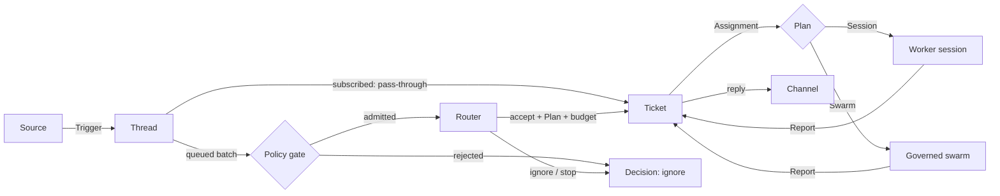
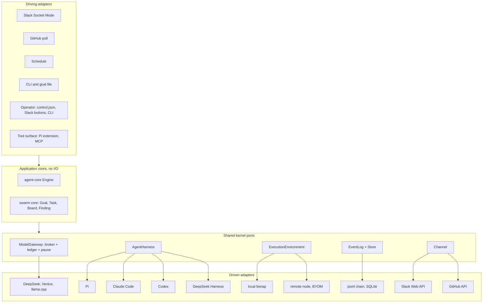

# Agent mode: plan

solos-swarm gains a second mode: a long-lived agent that lives in Slack, GitHub and schedules, takes requests,
notices work, runs it on isolated workers, and answers in the thread it came from. Swarm mode (`solos-swarm run`)
stays, and it is also one way agent mode can execute a Ticket. Both modes build from one workspace into one binary,
and run on the same broker, ledger, harness, sandbox and audit log. Decision record:
[ADR 0001](../adr/0001-hexagonal-ports-and-two-modes.md).

Reference design: DeepSeek, *Exploring Super-agent Design: Towards a More Autonomous Agent System* (November 2026),
and its MIT-licensed prototype `deepseek-ai/dsh-superagent-prototype` (docs 000-008).

## Status

| Phase | State |
|---|---|
| P0 Core and plan | Done (#18). `crates/agent-core`: domain, ports, Engine, in-memory store, allowlist Policy, 91 tests and a seeded fuzzer. Most tests are regressions from the adversarial review and the swarm review of PR #18. Swarm mode untouched. |
| P1 Harness seam | Done (#19). `src/harness.rs`: the `AgentHarness` port, `PiHarness` (the Pi launch moved out of `main.rs`, argv and env pinned by a golden test) and `harness::scripted::ScriptedHarness`. `run`, `work()`, `settled` and `rpc` use the port. A new end-to-end test runs `work()` with three scripted agents through the real broker, with no Pi, node or bwrap. Swarm runs unchanged. |
| P2a `run_goal` | Done (#20). `src/swarm.rs`: `swarm::run_goal(GoalRun, harness, provider) -> GoalOutcome` holds the run machinery that was in `main.rs` (spawn loop, `work`, nudges, deadline, broker socket, shutdown, `cleanup.json` and `runtime-report.json`), moved unchanged. `run` keeps the CLI part: flags, credential, Goal file, upstream, validation, the Linux and deadline checks, `PiHarness` and the provider, the stdout line and the exit code. The end-to-end test now drives `run_goal` with `ScriptedHarness`, so it also covers the spawn loop, shutdown and the run's files. Swarm runs unchanged. |
| P3a SQLite Store | **Done.** `crates/agent-store` (`solos-agent-store`): `SqliteStore` implements `Repositories` on one SQLite file (`rusqlite` 0.41.1 with bundled SQLite, WAL, `synchronous=FULL`, a versioned schema). Aggregates are JSON rows with index columns for active Threads, `thread_of_eval` and open Tickets. Each commit writes state, Effects and events in one transaction. The Effect queue lists due Effects oldest first and records done, or failed with an attempt count and a retry time; Sends to one Channel address keep commit order, and Launch, Deliver and Stop keep it per Ticket; every call is safe to repeat after a crash. The event log is hash-chained like `events.jsonl`, with `verify_chain()`. A seeded differential walk checks it against `MemoryRepositories` after every Engine command. |
| P2 (rest), P3b-P10 | Planned, below. |

## What "super-agent" means here

The article's four properties, and what already exists in solos-swarm to build each one:

| Property | Needs | Already in solos-swarm |
|---|---|---|
| Continuous: one agent across channels | Sources, Threads, a Router that keeps context | Hash-chained event log; `state.json` image |
| Productive: many tasks in parallel | Isolated Worker sessions, async tools | N sandboxed Pi agents, broker, `run_code`, per-task envelopes |
| Proactive: acts on events, quiet otherwise | Two-stage filter (code gate, then model), accept modes | Grants, Board entries that never grant authority, taint markings (mvp) |
| Persistent: always on, self-healing | Durable state and effects, Watchdog, BYOM execution | Pause/drain, outage pause after 5 failures, resume of a stopped run's state, self-update channels, progress |

What solos-swarm adds that the prototype does not have: hard budgets (a hold and a settlement per model call against the Goal cap
and per-task envelopes, cache-aware pricing, peak-hour refusal), a keyless broker (no credential ever enters a worker), `bwrap` isolation, and an audit
chain. Agent mode keeps all of them: every Router, Worker and swarm call goes through the same broker.

## Concepts

Agent mode uses the prototype's vocabulary, so its documents carry over:

| Article | Here | Notes |
|---|---|---|
| Trigger | `Trigger` | Immutable, idempotent by Source id. Its text is data and grants nothing. |
| Thread | `Thread` | At most one Eval at a time; Triggers arriving meanwhile join the next batch. |
| Subscription, pass-through | `Thread.subscriptions` | An allowed person's message on a subscribed Thread goes straight to the Ticket, with no Router turn. Bots, CI and unlisted people reach it as context and are also judged on their own. Only an allowed person resumes ended work or ends a hold, because a resume spends budget. This is stricter than the prototype, where any person (not a bot or CI) may resume. |
| Two-stage filter | `Policy::gate`, then `Effect::Assess` | The gate is code: allowlists, bot lists, accept mode. Only admitted batches cost a model call. |
| Router | Router session + `Engine::decide` | Long-lived, light model, router-only tools, no `run_code`. Batches candidates per turn. |
| Worker | `Plan::Session` Assignment | Own directory, full work tools, one Ticket. Never talks to people; reports. |
| (new) Swarm worker | `Plan::Swarm { agents }` | The Ticket's scope becomes a Goal for today's swarm, under the Ticket's budget. |
| Mandate | `Mandate` | What an accept grants, including `budget_microusd`. Fixed at accept time. |
| (new) Approval | `Approval` | Budgets above `auto_approve_microusd` wait for a person on the approver list. |
| Report | `Report` | `progress`/`waiting` are quiet; `ready` sends the result; a question, `blocked` or `failed` asks a person. |
| Watchdog | P6 | A separate control loop over progress, ledger and provider health. |
| Compute/state/execution separation | P3, P9 | Store and effect queue; then remote execution nodes. |

The flow:

## Architecture

### Dependency rules

- `crates/agent-core` imports nothing but `serde`, `serde_json` and `sha2`, and does no I/O. `tests/boundary.rs`
  checks the dependency list and every `std::` path in `src/` (grouped imports too) against an allowlist of pure
  modules. It is a source scan, not a proof.
- The swarm core reaches the same rule in P2: the pure parts of `broker.rs` (claims, envelopes, progress,
  artifact union) move out of the HTTP and file code.
- `crates/agent-store` is a driven adapter: it depends on agent-core and `rusqlite`; agent-core never depends on it.
- Adapters depend on ports, never on each other. Composition roots (`run`, `agent serve`) are the only places that
  name concrete adapters.
- One writer per state: the Engine writes Triggers, Threads, Decisions and Tickets; a Source writes only its read
  position and Thread metadata; the ledger writes holds and settlements; the event log is append-only.

### Ports

The core ports are in `crates/agent-core/src/ports.rs`: `Repositories`, `Policy`, `Clock`. They are synchronous,
and external work leaves as `Effect`s. The shell ports are async and live in the root crate:

| Port | Shape (sketch) | First adapter | Today's code it comes from |
|---|---|---|---|
| `AgentHarness` | `start(SessionSpec, events) -> Session`; `Session::{prompt, stop, join}`; events `TurnEnded`, `Rejected`, and an `Err` when a session's stream ends | `PiHarness`, `ScriptedHarness` | `src/harness.rs` (P1) |
| `ModelGateway` | One broker, many accounts: `reserve(account, request)`, `settle(intent, usage)`; pause and peak gates | today's broker | `broker.rs` `Store::reserve`/`settle`/`envelope`, `Goal::cost`/`settled_cost`, `Intent`, `effective_control` |
| `ModelUpstream` | `dispatch(body) -> receipt` | `OpenAiCompatible` | `broker::Provider` (1012); merged with `provider::Provider` (mvp) for llama.cpp |
| `ExecutionEnvironment` | `run(code) -> receipt`; `start(code) -> job`, `wait(job)`, `stop(job)` | local `bwrap` | `code.rs` `CodeExecutor`, plus the five hand-built `bwrap` command lines (`harness.rs:106` in `PiHarness::command`, `main.rs:280` in `doctor`, `code.rs:313`, `sandbox.rs:315` in `prepare_process`, `wasi_worker.rs:316`) |
| `EventLog` | `append(kind, data) -> seq`; `verify()` | `events.jsonl` hash chain | `Store::record` (452), `broker_control::read_chain`/`load_image` |
| `Source` | `run(sink, cancel)`; `context(trigger, part)` for bounded recall | CLI/jsonl, then Slack | new |
| `Channel` | `send(OutboundMessage) -> Sent \| Gone`; shapes text per medium (chat at most 100 words, PRs structured) | stdout, then Slack | new |
| `Store` | agent-core `Repositories` plus the effect queue | in-memory (P0), SQLite `crates/agent-store` (P3a) | new |
| `ToolSurface` | How a session calls tools: `/model` and `/tool/{name}` on the broker | Pi extension (`extensions/broker.ts`) | add an MCP facade, so any MCP harness gets the same tools |

`SessionSpec` names a role (`router`, `worker`, `swarm-agent`, `coordinator`), grants, model, working directory,
broker endpoint and token, and sandbox mounts. That one type replaces the `agent-NN`/`agent-00` conventions and
`SWARM_ROLE`/`SWARM_GRANTS`.

### What both modes share

| Shared piece | Swarm mode uses it for | Agent mode uses it for |
|---|---|---|
| Broker and ledger | Goal cap, per-task envelopes | Router daily cap, one envelope per Ticket, swarm Goals carved from a Ticket's envelope |
| Pause, drain, peak refusal, outage pause | Runs | The whole agent. No new Evals while paused. The core still records Triggers, resumes and wakes, and the effect runner holds every Effect until the pause lifts |
| `AgentHarness` | N swarm agents | The Router, Workers, and swarm agents |
| `ExecutionEnvironment` | `run_code` | Worker `run_code`, background jobs, remote nodes |
| Event log | `events.jsonl` | The same chain format with agent kinds, so dashboard, recover and replay readers keep working |
| Progress notices | 70%/90% budget notices, partial findings | Worker budget notices; Watchdog signals |
| Self-update channels, doctor, smoke | Candidates | The same, plus a drain that waits for open Assignments |
| Dashboard | Runs | Tickets and Threads as a second source |

## Roadmap

Every phase is one or two PRs. Gate on all of them: CI green, swarm parity (the same event kinds and `state.json`
schema for the external readers), and `solos-swarm smoke` passing.

**P0: core and plan (this PR).** Workspace with `crates/agent-core`, ADR 0001, and this plan. The Engine covers:
- intake: idempotent, pass-through, multi-Thread;
- Evals: one per Thread, batched by strength (weaker Triggers wait, unless a new Ticket adopts them), with
  gate-rejected Triggers kept out of the Router's view;
- Router verdicts: accept, ignore, stop;
- budget approval, checked at every launch against the current threshold;
- Assignments, Reports, resume, handback, retry, and Policy changes during an Eval.

A handed-back Trigger is judged once, on its primary Thread, however many Tickets hand it back. Pause stops new
Evals; the effect runner holds Effects. Swarm code is unchanged.

Open in P0: a Ticket whose Trigger names no reply channel (a schedule, for example) asks nobody when it needs a
person. P4 gives every Source an operator channel, and P6's Watchdog reports Tickets that wait for a person.

**P1: the harness seam.** Add the `AgentHarness` port and move the Pi launch out of `main.rs` into `PiHarness`
without changing behaviour. Add `ScriptedHarness`, which needs no Pi, node or bwrap and calls the real broker the way
the Pi extension does, and the end-to-end test `run`/`work()` lacked: three scripted agents and the `smoke::Scripted`
provider through the real broker. It runs on macOS too. Swarm mode is the first consumer. Done.

**P2: the shared kernel.**
- One `bwrap` builder.
- `EventLog` split from `Store`, which stops rewriting `state.json` on every event.
- A ledger with accounts (Goal, Task, Ticket, Router).
- Broker auth by principal (account, role, grants) instead of `agent-NN`.
- One `ModelUpstream` trait.
- P2a, done: `swarm::run_goal(GoalRun, harness, provider) -> GoalOutcome` as a library function in `src/swarm.rs`;
  the `run` CLI is a thin wrapper.
- The domain text in `nudge()` (now in `src/swarm.rs`) and `deferred_record` moves into Goal data.

**P3: local agent shell.**
- P3a (done): the SQLite Store, `crates/agent-store`, with the durable Effect queue and the event log.
- `solos-swarm agent serve --config agent.yaml`, built on that Store and an effect runner (retry with backoff,
  ordered per Channel).
- A CLI/jsonl Source and a stdout Channel.
- The Router session on `PiHarness`, with router tools on the broker (`router_decide`, `router_note`, `router_read`
  for bounded recall by id).
- `SessionExecutor`: one worker per Ticket in its own directory or git worktree, with worker tools `worker_report`
  and `worker_handback`.
- Async `run_code`: `job_start`, `job_wait` and `job_stop`, and auto-background after 5 s, so a worker can take new
  Inputs mid-command.
- Exit: the article's flow end to end on a laptop, with scripted Triggers.

**P4: Slack.**
- A Socket Mode Source, so no public endpoint is needed (the dashboard already binds only to `127.0.0.1`).
- A Web API Channel: threaded replies, at most 100 words in chat.
- Block Kit buttons for Approve and Stop, which call `approve` and `stop_ticket` as commands, never as text.
- A per-channel admission table. Operator DMs carry status and pause.
- `accept_mode: observe` to start.

**P5: SwarmExecutor.** `Plan::Swarm` Tickets run `swarm::run_goal` under the Ticket's envelope. The artifact
becomes a `ready` Report with a summary and a link. The Router prompt says when a swarm pays for itself: wide
research or tournaments, not a bug fix. Swarms above the threshold wait for approval (in the core already).

**P6: Watchdog.** A separate loop with its own small account.
- Inputs: progress (budget %, calls, time since the last Report), the provider outage streak, Evals that keep
  expiring, Effects that keep failing.
- Actions: notify the operator channel, retry an Assignment, pause.
- It answers "what is running and why" in operator DMs. It never widens a Mandate.

**P7: more harnesses, both directions.**
- *solos-swarm drives them.* `ClaudeCodeHarness` uses headless stream-json with `--mcp-config` and the broker as the
  model endpoint. `CodexHarness`, `DeepSeekHarnessHarness` and `OpenCodeHarness` follow the same pattern. The broker
  gains an Anthropic-messages facade next to the OpenAI one, so each harness's model traffic stays inside the ledger.
- *They host solos-swarm.* An MCP server (`solos-swarm mcp`) exposes `swarm_run`, `ticket_*` and the ledger as tools,
  so another harness's session can be the Router or call a governed swarm.

**P8: GitHub and schedules.** Poll notifications; Issue and pull-request Threads; CI results as bot Triggers; a
pull request bound to its Ticket. Structured PR comments. A cron Source for proactive sweeps.

**P9: separate execution.** `solos-swarm node` is a daemon on a user's machine (BYOM) or a cloud box. It runs
commands and holds no session state, and connects over the `mvp` QUIC mTLS transport (`cluster.rs`) with SPIFFE
identities (`identity.rs`). `transport.rs` is the local mTLS socket transport. When an intermittently online node reconnects, the Tickets waiting for it resume.
Credentials stay on the node and tools use them through scoped identities (`tool_identity.rs`), never in context.

**P10: benchmark.** Reproduce the article's ablation:
- Setup: a stream of about 300 chat and CI messages, about 20 work requests, and a work tool that only consumes
  time.
- Designs compared: our agent mode, agent mode without pass-through, and a single session with a subagent tool,
  with a neutral and with a delegation prompt.
- Metrics: completion p50/p95, Router decisions, cache-read tokens, dollars.
- Target: within the article's shape (p50 about 12 min, p95 about 16 min on its workload), at a budget we report.

## Security model

- Trigger text is data. It cannot change a permission, a budget or the Policy (the core has no path for it).
  An approval is an adapter command, authenticated by the adapter, never text. A stop is either an adapter
  command (`stop_ticket`) or a Router `Verdict::Stop` on an Eval of explicit strength.
- Only explicit strength stops work; bots and CI can at most make inferred candidates, and those start nothing
  outside `auto` mode with a matching enabled rule.
- Workers stay keyless: the broker holds the model key, and P9 keeps tool credentials on the node.
- The event-driven surface is larger than a batch run's. Router and workers keep the `bwrap` sandbox, workers get
  no network except through broker tools, and the Router gets no `run_code`.
- Open: the article's own caveat applies. A compromised control plane could drive every connected node. P9
  needs per-node capability leases (the `mvp` `DispatchPermit` design) before any node outside our own boxes joins.

## Open decisions

1. **Agent-mode store:** decided: SQLite (`rusqlite`, bundled), built in P3a. A JSON image like `state.json` does
   not scale to months of Triggers.
2. **Router model:** the cheapest model that judges reliably (the article uses a lighter model for the Router).
   This will be measured in P3.
3. **Slack app mode:** Socket Mode is recommended over the Events API, so there is no public endpoint.
4. **The `mvp` stack:** it is frozen and harvested as adapters (P7, P9). Deleting it is a separate decision.

## Non-goals

- Mapping one person's identities across Sources. That stays prompt text, as in the prototype.
- Replacing swarm mode's scorer, evaluator or tournament flow.
- Sessions as a user concept. As the article puts it, sessions are an implementation detail.
