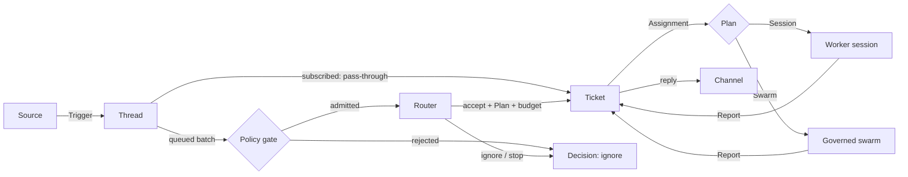
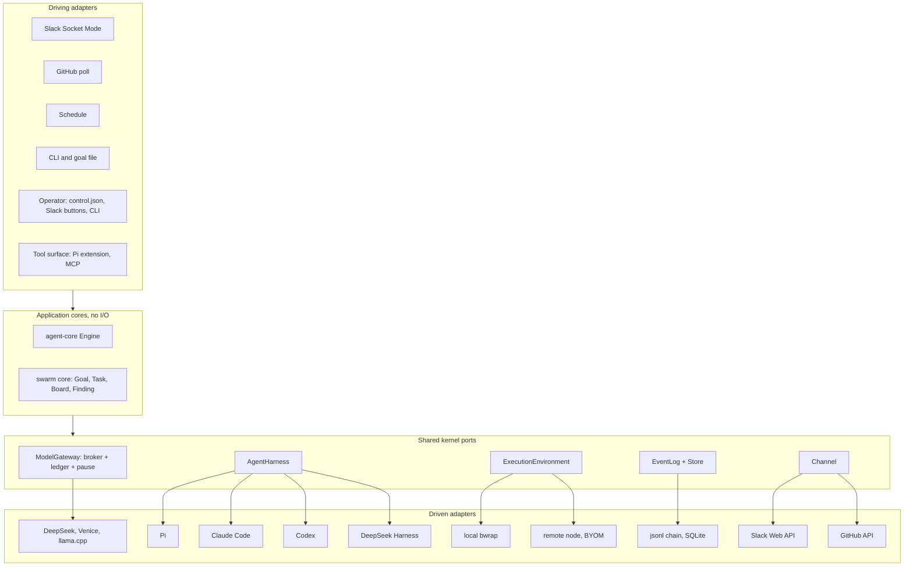

# Agent mode: plan

solos-swarm gains a second mode: a long-lived agent that lives in Slack, GitHub and schedules, takes requests,
notices work, runs it on isolated workers, and answers in the thread it came from. Swarm mode (`solos-swarm run`)
stays, and it is also one way agent mode can execute a Ticket. Both modes build from one workspace into one binary,
and run on the same broker, ledger, harness, sandbox and audit log. Decision record:
[ADR 0001](../adr/0001-hexagonal-ports-and-two-modes.md).

Reference design: DeepSeek, *Exploring Super-agent Design: Towards a More Autonomous Agent System* (November 2026),
and its MIT-licensed prototype `deepseek-ai/dsh-superagent-prototype` (docs 000-008).

## Status

| Phase | State |
|---|---|
| P0 Core and plan | Done (#18). `crates/agent-core`: domain, ports, Engine, in-memory store, allowlist Policy, 91 tests and a seeded fuzzer. Most tests are regressions from the adversarial review and the swarm review of PR #18. Swarm mode untouched. |
| P1 Harness seam | Done (#19). `src/harness.rs`: the `AgentHarness` port, `PiHarness` (the Pi launch moved out of `main.rs`, argv and env pinned by a golden test) and `harness::scripted::ScriptedHarness`. `run`, `work()`, `settled` and `rpc` use the port. A new end-to-end test runs `work()` with three scripted agents through the real broker, with no Pi, node or bwrap. Swarm runs unchanged. |
| P2a `run_goal` | Done (#20). `src/swarm.rs`: `swarm::run_goal(GoalRun, harness, provider) -> GoalOutcome` holds the run machinery that was in `main.rs` (spawn loop, `work`, nudges, deadline, broker socket, shutdown, `cleanup.json` and `runtime-report.json`), moved unchanged. `run` keeps the CLI part: flags, credential, Goal file, upstream, validation, the Linux and deadline checks, `PiHarness` and the provider, the stdout line and the exit code. The end-to-end test now drives `run_goal` with `ScriptedHarness`, so it also covers the spawn loop, shutdown and the run's files. Swarm runs unchanged. |
| P3a SQLite Store | Done (#21). `crates/agent-store` (`solos-agent-store`): `SqliteStore` implements `Repositories` on one SQLite file (`rusqlite` 0.41.1 with bundled SQLite, WAL, `synchronous=FULL`, a versioned schema). Aggregates are JSON rows with index columns for active Threads, `thread_of_eval` and open Tickets. Each commit writes state, Effects and events in one transaction. The Effect queue lists due Effects oldest first and records done, or failed with an attempt count and a retry time; Sends to one Channel address keep commit order, and Launch, Deliver and Stop keep it per Ticket; every call is safe to repeat after a crash. The event log is hash-chained like `events.jsonl`, with `verify_chain()`. A seeded differential walk checks it against `MemoryRepositories` after every Engine command. |
| P3b `agent serve` | Done (#22). `src/agent/`: the async shell ports `Source`, `Channel`, `Router` and `Executor`, a runtime with one task that owns the Engine on the SQLite Store, and `solos-swarm agent serve --config agent.yaml --state-dir DIR [--until-idle]`. The runtime stores Source Triggers, starts due Evals, hands each due Effect to its adapter, and marks it done or failed with exponential backoff. It applies adapter facts as `decide`, `assignment_started` and `report`, and holds every Effect while the Policy is paused. First adapters: `JsonlSource`, `JsonlChannel` (once per `MessageId`, safe after a crash), `ScriptedRouter` and `ScriptedExecutor`, so it runs with no model, Slack or sandbox. Tests cover a full run, a crash between a Launch and its done mark, a restart, retries, a pause and Thread context reaching the worker. |
| P3c Pi Router | **Done.** The Router is a long-lived Pi session behind the same `Router` port (`src/agent/pi_router.rs`): each Candidate becomes a compact card, the cards queued between turns go into one prompt, and a session that dies restarts while the core's Eval expiry brings back what it left undecided. It runs keyless in bwrap and calls the agent broker (`src/agent/broker.rs`), which speaks the swarm broker's wire on a socket in the state dir, holds and settles each model call against the Router's daily cap in the store's new spend ledger (schema v2), refuses calls while the state dir is paused, and serves the Router's two tools, `router_decide` (the Engine's answer, or its refusal, goes back to the model) and `router_read`. The pricing, request contract, providers and pause gate both brokers use moved to `src/gateway/`, with swarm mode unchanged. |
| P4 Slack | Done (#23). `src/agent/slack/`: `SlackSource` (Socket Mode: an outbound WebSocket, nothing exposed) and `SlackChannel` (Web API), configured as `kind: slack` and read from token files that are deleted once read. Events from the listed channels become Triggers (`slack:<channel>:<ts>`, Thread `slack:<channel>:<thread_ts>`); the bot's own messages, other channels, edits and other events are dropped, and every envelope is acknowledged. The Source reconnects with backoff after a `disconnect` or an error. Replies go in the Trigger's thread, escaped, with acknowledgements and questions cut to 500 characters and results to 3,000 with a marker. Each post carries its `MessageId` as metadata; a repeated Send looks for it in the thread first, so a crash between a post and its done mark does not post twice. A deleted or archived conversation is `Gone`; rate limits and 5xx retry, after `Retry-After`. An approval request carries Approve and Stop buttons; a click is a `Fact::Command` the runtime applies as `approve` or `stop_ticket` and answers in the thread. A budget above `auto_approve_microusd` is now accepted when a Slack channel and a `slack:` approver are configured. New dependency: `tokio-tungstenite` 0.29.0 on the existing rustls. Tests run against a fake Slack, including one `agent serve` end to end. |
| P8 GitHub and schedules | **Done.** `src/agent/github/`: `GithubSource` polls each listed repository's issues and pull requests, issue and review comments `since` a cursor, and its latest workflow runs, over REST (nothing exposed); `GithubChannel` comments on the issue or pull request. Configured as `kind: github` with a personal access token file that is deleted once read. An issue or pull request is the Thread `github:<owner>/<repo>#<number>`; its opening, each comment (`github:<owner>/<repo>:comment:<id>`) and each failed workflow run on a pull request (a bot Trigger on that pull request's Thread) are Triggers. A mention of the agent's login addresses it, `[bot]` accounts are bots, and the agent's own comments are dropped. Listings are conditional (`ETag`), rate limits are waited out, and the read position is an atomic file in the state directory that a restart resumes from without sending a Trigger twice. Each comment ends with a hidden marker naming its `MessageId`, so a crash between a post and its done mark does not post twice. `src/agent/schedule.rs`: `ScheduleSource` (`kind: schedule`) fires named slots, `every` an interval or `daily_at` a UTC time, as System Triggers `schedule:<name>:<slot start>`: a restart cannot fire a slot twice, and missed slots fire once. A schedule may name a `reply_to`. No new dependencies. Tests run against a fake GitHub and a clock the test moves, including one `agent serve` end to end. |
| P3d Pi workers | **Done.** `src/agent/pi_executor.rs`: `PiExecutor` runs each `Plan::Session` Assignment as a keyless Pi worker session in bwrap, in its Ticket's directory under the state dir, with an optional prepare command run once per Ticket and at most `max_workers` sessions at once (`executor: {kind: pi, ...}`). The agent broker admits each worker as a `Worker` principal on its Ticket's account, so the Mandate budget caps every Assignment of the Ticket together, and serves `worker_report`, `worker_handback`, `run_code` and `fetch_url` (`SWARM_TOOLSET=worker`). A worker is prompted with its Assignment, then with new Inputs between turns; a quiet turn counts as `waiting`. A start ends what the last run left without a worker ("host restarted") and relaunches working Tickets with `recovery`, through the new `Engine::restart`. `run_code`'s mounts and scratch directory are configurable, with swarm runs' sandbox command pinned unchanged. `Plan::Swarm` reports `failed` until P5; background `run_code` jobs came with P3e. |
| P6 Watchdog | **Done.** `src/agent/watchdog.rs`: a pure `assess(snapshot, now, thresholds)` over what the Store already holds, with no model: a Ticket waiting for a person (1h), a working Assignment with no Report (30m), an Effect with 3 failed attempts, an `unavailable` Decision in the last hour, an account at 80% of its cap, and a pause file held for 1h. Each alert id hashes its kind, its subject (with the problem's start) and a 6h bucket. With a `watchdog` section in agent.yaml, `agent serve` runs it every minute, tells the operator's conversation each new alert once through its Channel, and records it in `watchdog_alerts` (schema v3), so a restart tells nothing new. `retry_stalled` retries a stalled Assignment once per Ticket through the runtime. `solos-swarm agent status` reports Tickets, Decisions, Effects, spend, the pause and the current alerts from a read-only Store. Judging with a model whether a worker drifts from its goal is later. |
| P3e Background jobs | **Done.** `src/agent/jobs.rs`: a worker with `run_code` also gets `job_start {code, timeout_s?}`, `job_wait {job, wait_s?}` and `job_stop {job}`. A job runs in its Ticket's `/work` under `run_code`'s sandbox and limits, returns its id at once and belongs to its Assignment: a stop, the Ticket's end, a dead session or a shutdown kills it, and a kill reaches every process of its sandbox, even in bwrap's first milliseconds. A `run_code` still running after `background_after_secs` (5) becomes a job when the Ticket has room; a short one returns exactly as before, and swarm runs keep their synchronous `run_code`. A job's end reaches the worker once: in a turn only its `job_wait` or `job_stop` takes it, and an end the turn left, or one that comes between turns, becomes a Note on the Ticket (`Fact::Note`, applied as `Engine::note`) that wakes the worker. No core change. |
| P5 Swarm Tickets | Done (#28). `src/agent/swarm_executor.rs`: a `Plan::Swarm` Ticket runs one governed swarm per Assignment through `swarm::run_goal_until` on the Pi workers' harness, provider and credential (`executor.swarm`). Its Goal is rendered from a YAML template (`src/agent/goal_template.rs`, minijinja, every placeholder an escaped YAML literal) with the Ticket's title, scope, agent count and remaining budget, checked with `Goal::validate` at config load and at launch. The Goal's budget is the Mandate budget minus what the Ticket's account committed, and the run's spend is charged on that account (`SqliteStore::charge`, once per run) before its Report. At most `max_runs` swarms run at once (default 1). A Stop cancels a run through the new cancel input of `run_goal_until`, which `solos-swarm run` does not use, and the agent's pause holds running swarms. Completed reports `ready` with the findings, the spend and the artifact; stopped reports `failed`; drained reports `waiting`. A restart relaunches an interrupted swarm in a new run directory and charges the old one from its `state.json`. The Router's prompt says when a swarm pays for itself, and `router_decide` takes `goal_template`. |
| P2 (rest), P7, P9, P10 | Planned, below. |

## What "super-agent" means here

The article's four properties, and what already exists in solos-swarm to build each one:

| Property | Needs | Already in solos-swarm |
|---|---|---|
| Continuous: one agent across channels | Sources, Threads, a Router that keeps context | Hash-chained event log; `state.json` image |
| Productive: many tasks in parallel | Isolated Worker sessions, async tools | N sandboxed Pi agents, broker, `run_code`, per-task envelopes |
| Proactive: acts on events, quiet otherwise | Two-stage filter (code gate, then model), accept modes | Grants, Board entries that never grant authority, taint markings (mvp) |
| Persistent: always on, self-healing | Durable state and effects, Watchdog, BYOM execution | Pause/drain, outage pause after 5 failures, resume of a stopped run's state, self-update channels, progress |

What solos-swarm adds that the prototype does not have: hard budgets (a hold and a settlement per model call against the Goal cap
and per-task envelopes, cache-aware pricing, peak-hour refusal), a keyless broker (no credential ever enters a worker), `bwrap` isolation, and an audit
chain. Agent mode keeps all of them: every Router, Worker and swarm call goes through the same broker.

## Concepts

Agent mode uses the prototype's vocabulary, so its documents carry over:

| Article | Here | Notes |
|---|---|---|
| Trigger | `Trigger` | Immutable, idempotent by Source id. Its text is data and grants nothing. |
| Thread | `Thread` | At most one Eval at a time; Triggers arriving meanwhile join the next batch. |
| Subscription, pass-through | `Thread.subscriptions` | An allowed person's message on a subscribed Thread goes straight to the Ticket, with no Router turn. Bots, CI and unlisted people reach it as context and are also judged on their own. Only an allowed person resumes ended work or ends a hold, because a resume spends budget. This is stricter than the prototype, where any person (not a bot or CI) may resume. |
| Two-stage filter | `Policy::gate`, then `Effect::Assess` | The gate is code: allowlists, bot lists, accept mode. Only admitted batches cost a model call. |
| Router | Router session + `Engine::decide` | Long-lived, light model, router-only tools, no `run_code`. Batches candidates per turn. |
| Worker | `Plan::Session` Assignment | Own directory, full work tools, one Ticket. Never talks to people; reports. |
| (new) Swarm worker | `Plan::Swarm { agents, goal_template }` | The Ticket's scope becomes a Goal for today's swarm, rendered from a [Goal template](#goal-templates), under what the Ticket's budget has left. |
| Mandate | `Mandate` | What an accept grants, including `budget_microusd`. Fixed at accept time. |
| (new) Approval | `Approval` | Budgets above `auto_approve_microusd` wait for a person on the approver list. |
| Report | `Report` | `progress`/`waiting` are quiet; `ready` sends the result; a question, `blocked` or `failed` asks a person. |
| Watchdog | Watchdog (P6) | A separate control loop over the Store: waits, stalls, failing Effects, Router failures, spend and pauses. |
| Compute/state/execution separation | P3, P9 | Store and effect queue; then remote execution nodes. |

The flow:



## Architecture



### Dependency rules

- `crates/agent-core` imports nothing but `serde`, `serde_json` and `sha2`, and does no I/O. `tests/boundary.rs`
  checks the dependency list and every `std::` path in `src/` (grouped imports too) against an allowlist of pure
  modules. It is a source scan, not a proof.
- The swarm core reaches the same rule in P2: the pure parts of `broker.rs` (claims, envelopes, progress,
  artifact union) move out of the HTTP and file code.
- `crates/agent-store` is a driven adapter: it depends on agent-core and `rusqlite`; agent-core never depends on it.
- Adapters depend on ports, never on each other. Composition roots (`run`, `agent serve`) are the only places that
  name concrete adapters.
- One writer per state: the Engine writes Triggers, Threads, Decisions and Tickets; a Source writes only its read
  position and Thread metadata; the ledger writes holds and settlements; the event log is append-only.

### Ports

The core ports are in `crates/agent-core/src/ports.rs`: `Repositories`, `Policy`, `Clock`. They are synchronous,
and external work leaves as `Effect`s. The shell ports are async and live in the root crate:

| Port | Shape (sketch) | First adapter | Today's code it comes from |
|---|---|---|---|
| `AgentHarness` | `start(SessionSpec, events) -> Session`; `Session::{prompt, stop, join}`; events `TurnEnded`, `Rejected`, and an `Err` when a session's stream ends | `PiHarness`, `ScriptedHarness` | `src/harness.rs` (P1) |
| `ModelGateway` | One broker, many accounts: `reserve(account, request)`, `settle(intent, usage)`; pause and peak gates | today's broker; the agent broker (P3c) | `broker.rs` `Store::reserve`/`settle`/`envelope`, `Intent`; shared since P3c in `src/gateway/`: `PriceTable` (was `Goal::cost`/`settled_cost`), `Receipt`, `admit_request`/`upstream_body`, `effective_control` |
| `ModelUpstream` | `dispatch(body) -> receipt` | `OpenAiCompatible` | `broker::Provider` (1012); merged with `provider::Provider` (mvp) for llama.cpp |
| `ExecutionEnvironment` | `run(code) -> receipt`; `start(code) -> job`, `wait(job)`, `stop(job)` | local `bwrap` | `code.rs` `CodeExecutor`, plus the five hand-built `bwrap` command lines (`harness.rs:106` in `PiHarness::command`, `main.rs:280` in `doctor`, `code.rs:313`, `sandbox.rs:315` in `prepare_process`, `wasi_worker.rs:316`) |
| `EventLog` | `append(kind, data) -> seq`; `verify()` | `events.jsonl` hash chain | `Store::record` (452), `broker_control::read_chain`/`load_image` |
| `Source` | `run(sink, facts)`, with people's commands (Slack buttons) as `Fact::Command`; later `context(trigger, part)` for bounded recall | `JsonlSource` (P3b), `SlackSource` (P4), `GithubSource` and `ScheduleSource` (P8) | new |
| `Channel` | `send(OutboundMessage, SendOptions { repeat, approval }) -> Sent \| Gone`; shapes text per medium (short chat, PRs structured) | `JsonlChannel` (P3b), `SlackChannel` (P4), `GithubChannel` (P8) | `src/agent/jsonl.rs`, `src/agent/slack/`, `src/agent/github/` |
| `Store` | agent-core `Repositories` plus the effect queue | in-memory (P0), SQLite `crates/agent-store` (P3a) | new |
| `ToolSurface` | How a session calls tools: `/model` and `/tool/{name}` on the broker | Pi extension (`extensions/broker.ts`) | add an MCP facade, so any MCP harness gets the same tools |

`SessionSpec` names a role (`router`, `worker`, `swarm-agent`, `coordinator`), grants, model, working directory,
broker endpoint and token, and sandbox mounts. That one type replaces the `agent-NN`/`agent-00` conventions and
`SWARM_ROLE`/`SWARM_GRANTS`.

### What both modes share

| Shared piece | Swarm mode uses it for | Agent mode uses it for |
|---|---|---|
| Broker and ledger | Goal cap, per-task envelopes | Router daily cap, one envelope per Ticket, swarm Goals carved from a Ticket's envelope |
| Pause, drain, peak refusal, outage pause | Runs | The whole agent. No new Evals while paused. The core still records Triggers, resumes and wakes, and the effect runner holds every Effect until the pause lifts |
| `AgentHarness` | N swarm agents | The Router, Workers, and swarm agents |
| `ExecutionEnvironment` | `run_code` | Worker `run_code`, background jobs, remote nodes |
| Event log | `events.jsonl` | The same chain format with agent kinds, so dashboard, recover and replay readers keep working |
| Progress notices | 70%/90% budget notices, partial findings | Worker budget notices; Watchdog signals |
| Self-update channels, doctor, smoke | Candidates | The same, plus a drain that waits for open Assignments |
| Dashboard | Runs | Tickets and Threads as a second source |

## Roadmap

Every phase is one or two PRs. Gate on all of them: CI green, swarm parity (the same event kinds and `state.json`
schema for the external readers), and `solos-swarm smoke` passing.

**P0: core and plan (this PR).** Workspace with `crates/agent-core`, ADR 0001, and this plan. The Engine covers:
- intake: idempotent, pass-through, multi-Thread;
- Evals: one per Thread, batched by strength (weaker Triggers wait, unless a new Ticket adopts them), with
  gate-rejected Triggers kept out of the Router's view;
- Router verdicts: accept, ignore, stop;
- budget approval, checked at every launch against the current threshold;
- Assignments, Reports, resume, handback, retry, and Policy changes during an Eval.

A handed-back Trigger is judged once, on its primary Thread, however many Tickets hand it back. Pause stops new
Evals; the effect runner holds Effects. Swarm code is unchanged.

Open in P0: a Ticket whose Trigger names no reply channel (a schedule, for example) asks nobody when it needs a
person. P8 lets a schedule name its `reply_to`, a Slack channel or a GitHub issue. A schedule without one still asks
nobody itself; since P6 the Watchdog tells the operator when such a Ticket waits for a person.

**P1: the harness seam.** Add the `AgentHarness` port and move the Pi launch out of `main.rs` into `PiHarness`
without changing behaviour. Add `ScriptedHarness`, which needs no Pi, node or bwrap and calls the real broker the way
the Pi extension does, and the end-to-end test `run`/`work()` lacked: three scripted agents and the `smoke::Scripted`
provider through the real broker. It runs on macOS too. Swarm mode is the first consumer. Done.

**P2: the shared kernel.**
- One `bwrap` builder.
- `EventLog` split from `Store`, which stops rewriting `state.json` on every event.
- A ledger with accounts (Goal, Task, Ticket, Router).
- Broker auth by principal (account, role, grants) instead of `agent-NN`.
- One `ModelUpstream` trait.
- P2a, done: `swarm::run_goal(GoalRun, harness, provider) -> GoalOutcome` as a library function in `src/swarm.rs`;
  the `run` CLI is a thin wrapper.
- The domain text in `nudge()` (now in `src/swarm.rs`) and `deferred_record` moves into Goal data.

**P3: local agent shell.**
- P3a (done): the SQLite Store, `crates/agent-store`, with the durable Effect queue and the event log.
- P3b (done): `solos-swarm agent serve --config agent.yaml --state-dir DIR`, built on that Store and an effect
  runner (retry with backoff, ordered per lane), with `--until-idle` for tests and dry runs. A jsonl Source and a
  jsonl Channel, a `ScriptedRouter` (accepts explicit requests as one session) and a `ScriptedExecutor` (reports
  `ready` at once).
- P3c (done): the Router session on `PiHarness`, behind the same `Router` port.
  - Shared, not generalized: pricing (`PriceTable`, `Receipt`, `completion_usage`), the request contract and
    upstream body, the providers (`provider_for`) and the pause gate moved to `src/gateway/`; swarm mode calls them
    and its broker tests, smoke and golden launch are unchanged.
  - The agent broker (`src/agent/broker.rs`) maps each bearer token to a `Grant`: a principal (the Router; a
    Worker per Assignment since P3d), an account and model terms. Accounts are `router` (capped per UTC day by
    `budgets.router_daily_microusd`) and `ticket:<id>` (capped for life by the Mandate budget). Holds and
    settlements are rows in the store's `spend` table, so a restart keeps every cap; a closed row is final.
  - Router tools: `router_decide` (one flat object: eval, decision, reason, and the accept or stop fields; an accept
    above the approval threshold stands only when Slack can take the approval, through a Slack channel and a
    `slack:` approver, and its Ticket then waits for one; otherwise it is refused) and `router_read` (a
    Trigger, Thread or Ticket with its neighbours' ids). No `run_code`, no `fetch_url`. The Pi extension picks the
    set with `SWARM_TOOLSET=router` and takes the Router's system prompt from the broker.
  - `router_note` and an outage pause in the agent broker are not built yet.
- P3d (done): `PiExecutor` (`src/agent/pi_executor.rs`), behind the same `Executor` port, runs each Assignment of a
  `Plan::Session` Ticket as one worker session on `PiHarness`. `Plan::Swarm` goes through the same dispatch point
  and reports `failed` until P5.
  - A worker has its Ticket's directory, `<state>/tickets/<ticket>/`, whose `work/` is `run_code`'s `/work`; an
    optional `prepare` command (a `git worktree add`, say) runs there once per Ticket. At most `max_workers`
    sessions live at once; a launch past it waits for a slot.
  - The worker is a `Worker` principal in the agent broker on the account `ticket:<id>`, which every Assignment of
    the Ticket shares, so a retry spends from the same budget and a call past it is refused, while the Router's
    account is untouched. Its tools: `worker_report` (status, text, question; the spend comes from the ledger),
    `worker_handback` (a follow-up that is not the Ticket's goes to the Router, once), `run_code` (the shared
    `CodeExecutor`, now with configurable mounts and a caller-owned scratch directory; swarm runs keep their exact
    sandbox command) and `fetch_url` (`broker::fetch`, swarm mode's limits). `SWARM_TOOLSET=worker` selects them.
  - It is prompted with its Assignment (title, scope, matched rules, every Input so far, how to report, and with
    `recovery` a note to check `/work` before repeating outside actions), then with each later batch of Inputs
    between turns. A turn that ends with no Report, or with `progress` only, counts as `waiting`. A session that
    dies reports `failed` and ends its Assignment, so the next reply starts a new one.
  - At start, an Assignment the last run left running, or pending with its Launch performed, ends with "host
    restarted", oldest Ticket first. One that was working starts again with `recovery` through
    `Engine::restart` (the end and the new launch in one transaction); one that waited for input, an answer or a
    person starts again with the Input that wakes it.
- P3e (done): background jobs (`src/agent/jobs.rs`), so a worker can take new Inputs mid-command.
  - `job_start {code, timeout_s?}` starts one bash command in the Ticket's `/work`, under `run_code`'s sandbox and
    limits (`CodeExecutor::start_job_in`; CPU time stays capped at 300 s), and returns `{job, status}` at once.
    `job_wait {job, wait_s?}` waits up to `wait_s` (default 30, at most 120) and returns the job's end, or its status
    and what it printed since the last look; it returns early, once per batch, when new input waits for the next
    turn. `job_stop {job}` kills it and returns its end with the output not yet read. Each stream keeps at most
    `job_output_bytes` unread; each byte reaches the worker once.
  - A `run_code` still running after `background_after_secs` returns `{job, status: "running", note}` when the
    Ticket has room for a job, and otherwise stays in the foreground as before. One that ends sooner returns the same
    receipt as before. Swarm runs keep `CodeExecutor::run`, unchanged.
  - Jobs belong to their Assignment, in a table on its `WorkerSeat`, so a Router token is refused (403) and another
    Ticket's worker finds no such job (404). When the worker ends (a stop, the Ticket's end, a dead session, a
    shutdown or a revoked token) its jobs are killed and none is reported. A kill freezes bwrap, kills the namespace
    it cloned, then bwrap, since a plain kill in bwrap's first milliseconds leaves the namespace running. Jobs do not
    survive a restart; the recovery prompt already says to check `/work`.
  - A job's end reaches the worker once. One lock covers the turn and the jobs, and whoever takes an end removes
    the job: in a turn only the worker's `job_wait` or `job_stop`; at the turn's end, every end the turn left; between
    turns, the end as it comes. The last two become a Note on the Ticket (`Fact::Note`, applied as `Engine::note`),
    which the Engine delivers as a new Input, so the worker reads it on its next turn. A turn that ends quietly with a
    job running reports `progress`, not `waiting`, so the Ticket stays at work for `--until-idle` and the Watchdog's
    stall clock starts over.
  - Limits under `executor.run_code`, checked at load: `background_after_secs` (5, 1..=300), `max_jobs` (2 per
    Ticket whose end has not reached the worker, 1..=8), `job_max_secs` (1800, 300..=86400, the default and most of
    `timeout_s`; at least 300 so a moved `run_code` keeps its own timeout) and `job_output_bytes` (65536, 1 KiB..=1
    MiB). Jobs hold `run_code` slots (`concurrency`) like any sandbox.
- Design change (P3b): agent mode keeps its own accounts, one per Ticket plus the Router's, in the agent Store. It
  shares the swarm code that really is common (pricing, the provider call, the pause gate, `fetch`, `run_code`)
  instead of generalizing swarm mode's Goal-shaped broker `Store`. P2b and P2c shrink to extracting those pieces
  when P3c and P3d need them; P3c extracted pricing, the provider call and the pause gate, and P3d `run_code`'s
  mounts and scratch directory.
- Exit: the article's flow end to end on a laptop, with scripted Triggers.

**P4: Slack.** Done; setup in [Slack app setup](#slack-app-setup).
- Done: a Socket Mode Source, so no public endpoint is needed (the dashboard already binds only to `127.0.0.1`).
  It listens to the configured channel ids only and drops the bot's own messages.
- Done: a Web API Channel with threaded replies. Acknowledgements and questions are cut to 500 characters, results
  to 3,000 with a marker, and all text is escaped so a worker cannot ping `<!channel>`. Each post carries its
  `MessageId` as message metadata, and a repeated Send searches the thread for it first, since Slack does not
  deduplicate.
- Done: Block Kit buttons for Approve and Stop, which reach the runtime as `Fact::Command` and call `approve` and
  `stop_ticket` as commands, never as text. The Policy's `approvers` may approve; approvers and `people` may stop.
  The outcome is answered in the thread, best effort: a crash can lose that answer, never the command.
- Later: a per-channel admission table, and operator DMs that carry status and pause.
- `accept_mode: observe` (the Policy default) to start.

**P5: SwarmExecutor.** Done; how to write a template in [Goal templates](#goal-templates).
- Done: `executor: {kind: pi, ..., swarm: {templates, default_template, max_runs}}`. `PiExecutor`'s one dispatch
  point sends `Plan::Swarm` Assignments to `SwarmExecutor`, which runs each as one `swarm::run_goal_until` on the
  `PiHost` that serves the workers: `PiHarness`, the provider and the credential. At most `max_runs` swarms (default
  1) run at once, apart from `max_workers`, since one swarm is many sessions; a launch past it waits for a slot.
- Done: the Goal comes from the template the Plan names, or the default, filled with the Ticket's id, title, scope,
  agent count and remaining budget. It must pass `Goal::validate`, and its budget and agent count must be the
  Ticket's. Config load renders every template for one and two agents, so a bad template stops `agent serve` before
  it starts; a Goal that still fails at launch is a `failed` Report, never a crash.
- Done: the Goal's budget is the Mandate budget minus what the Ticket's account (`ticket:<id>`) committed, so a
  Ticket never spends past its Mandate across its Assignments. The swarm's own broker holds and settles each call
  against the Goal; when the run ends, its spend, with any hold still open at its hold, is charged on the Ticket's
  account (`SqliteStore::charge`, once per `swarm:<run dir>`) before the Report, so the next Assignment and every
  worker call see it. A stopped run is charged too.
- Done: each run has its own directory, `<state>/tickets/<ticket>/swarm/<assignment>` (`-2`, `-3` when a launch
  repeats), with the swarm's usual files: `config.yaml` (the rendered Goal), `manifest.json`, `events.jsonl`,
  `state.json`, `artifacts/final.json`, `cleanup.json`, `runtime-report.json` and the transcripts. It stays as
  evidence.
- Done: Completed is a `ready` Report naming the filed findings, the spend and the artifact's path; Stopped is
  `failed` with the reason; Drained is `waiting`. A failed or drained swarm also ends its Assignment, so the next
  message from a person starts a new run. While it runs, a swarm sends a quiet `progress` Report with what it has
  filed and spent, at half the Watchdog's `stalled` threshold and at least every 5 minutes, so P6 never takes a long
  swarm for a stalled Assignment.
- Done: a Stop Effect cancels a running swarm through `run_goal_until`'s cancel input (`swarm::Cancel::on`), which
  takes the operator-cancel path (partial findings, the artifact of what was filed, every session stopped,
  `cleanup.json`) and waits until it is done. `run_goal` keeps SIGTERM and Ctrl-C, so `solos-swarm run` is
  unchanged; under `agent serve` the agent owns the signals and cancels its swarms as it shuts down. The agent's
  pause gate holds running swarms through a `PAUSE` file in their run directories.
- Done: after a restart, P3d's recovery relaunches an interrupted swarm Assignment with `recovery`, in a new run
  directory; the old one stays as it was, and its spend is charged from its `state.json` before the new Goal's
  budget is read. There is no `run --resume`.
- Done: the Router's prompt says a session fits most work, a bug fix above all, and a swarm only work that splits
  into many independent parts (wide research, many checks, a tournament); it lists the templates and says that a
  swarm budget above the approval threshold waits for a person's approval. `router_decide` takes `goal_template`
  and refuses a swarm where none runs or a template that does not exist.
- Later: a running swarm takes no new Input; a follow-up on its Thread waits for the Ticket's next Assignment.

**P6: Watchdog.** Done; setup in [Watchdog](#watchdog).
- Done: `assess(snapshot, now, thresholds)` in `src/agent/watchdog.rs` is pure. It reads only what the Store holds
  (open Tickets, recent Decisions, pending Effects with their attempt counts, the spend ledger) and the state
  directory's pause gate. It calls no model, so it needs no account. Signals, with their default thresholds:
  - a Ticket that has waited 1h for a person: an approval, an answer, or a look at blocked or failed work. A
    Ticket whose request named no reply channel says that nobody else was asked;
  - a working Assignment with no Report for 30m (stalled). A pause holds this signal, and the quiet time restarts
    when the pause lifts, since workers cannot call a model while paused;
  - an Effect with 3 failed attempts, such as a Send stuck on one conversation;
  - 1 `unavailable` Decision in the last hour: the Router left an Eval undecided three times running;
  - an account at 80% of its cap: the Router's daily cap (known from agent.yaml) and each open Ticket's budget;
  - a pause that the state directory's `control.json` or `PAUSE` has held for 1h, timed from the file. A pause set
    in agent.yaml, or the peak window, raises nothing.
- Done: alert ids. An id is `wd_` and a hash of the kind, the subject and a bucket of `repeat` (6h). The subject
  holds the problem's start where the Store has one: the launch or Report a stall counts from, the Report or step a
  wait counts from, the call that crossed a cap, the pause file's time. Buckets count from when the threshold was
  crossed. So a problem is told when it crosses its threshold and once every 6h while it lasts, and a problem that
  comes back is a new alert. A failing Effect and `unavailable` Decisions have no start in the Store, so their
  buckets are the clock's.
- Done: the loop. With a `watchdog` section in agent.yaml, `agent serve` runs it beside the runtime every `every`
  (1m), the first time one interval after the start, once the runtime has recovered what the last run left. Each
  new alert becomes a row in the Store's `watchdog_alerts` table (schema v3), which only the Watchdog writes: the
  row is written before the alert is sent and marked sent after. A known id is never told again, so a restart
  tells nothing new; an unsent row goes out at the next tick. The alert goes to `watchdog.operator`, a reply
  address on a source a configured Channel serves, as an attention message, during a pause too.
- Done: one action, `retry_stalled`. The Watchdog asks the runtime to retry a stalled Assignment as `Fact::Retry`,
  so the Engine keeps one writer. The runtime first checks that the Assignment is still the Ticket's working one,
  with the Reports the Watchdog saw, then calls `Engine::retry`, which spends from the same Ticket budget. It acts
  once per Ticket; a second stall of the same Ticket is only told. It never widens a Mandate or a budget.
- Done: `solos-swarm agent status --state-dir DIR [--config agent.yaml] [--json]`, a report of what is running and
  why: open Tickets with their stage, age, plan, spend against budget, the request that started them and their
  latest Assignment; the latest Decisions; pending and failing Effects; the Router's spend today; the pause; and the
  alerts `assess` would raise now. It opens the Store read-only (no migration, no write), so it is safe while the
  agent serves. `--config` adds the Router's cap, the Watchdog's thresholds and a pause set in agent.yaml.
- Later: judging with a model whether a worker is drifting from its goal, beyond silence; the provider outage
  streak, and Evals that keep expiring before they turn `unavailable`; a pause as an action; and operator DMs that
  answer "what is running and why" with the status report.

**P7: more harnesses, both directions.**
- *solos-swarm drives them.* `ClaudeCodeHarness` uses headless stream-json with `--mcp-config` and the broker as the
  model endpoint. `CodexHarness`, `DeepSeekHarnessHarness` and `OpenCodeHarness` follow the same pattern. The broker
  gains an Anthropic-messages facade next to the OpenAI one, so each harness's model traffic stays inside the ledger.
- *They host solos-swarm.* An MCP server (`solos-swarm mcp`) exposes `swarm_run`, `ticket_*` and the ledger as tools,
  so another harness's session can be the Router or call a governed swarm.

**P8: GitHub and schedules.** Done; setup in [GitHub token](#github-token).
- Done: a polling Source (`kind: github`) for the listed repositories, not the notifications API, which only works
  with classic tokens and folds a conversation's comments into one notification. Each poll reads issues and pull
  requests, issue comments and review comments oldest first `since` a cursor, and the latest completed workflow runs.
  An issue or pull request is the Thread `github:<owner>/<repo>#<number>`. Triggers: its opening
  (`github:<owner>/<repo>#<number>`), each comment (`github:<owner>/<repo>:comment:<id>`; a review comment is
  `...:review_comment:<id>`, since GitHub numbers the two apart), and CI below. A mention of the agent's login
  (`@login`, any case, not inside a word or an email address) is `Addressed::Mention`; an account of type Bot or one
  ending in `[bot]` is a bot. The agent's own comments are dropped; it learns its login from `GET /user`.
- Done: CI results as bot Triggers. A failed, timed-out or never-started workflow run on a pull request
  (`github:<owner>/<repo>:run:<id>:<attempt>`, actor `github-actions[bot]`) joins that pull request's Thread. A run
  from a fork names no pull request, so its head commit is matched against the open ones. A token without Actions
  access turns CI Triggers off for that repository and says so once.
- Done: the read position is `github-cursor.json` in the state directory, replaced atomically. For each repository
  and listing it holds the latest `updated_at` read and the Trigger ids sent that a listing can still return. Each read
  goes back 10 minutes behind it, for items GitHub lists late and for clock skew, and skips what it sent. It is saved a
  poll after its batch went out, once the runtime has taken every batch, so a crash cannot move it past Triggers that
  were not stored. A first start reads the last 10 minutes.
- Done: rate limits and conditional requests. A 403 or 429 waits `Retry-After`, or until `X-RateLimit-Reset` when
  nothing remains, or a minute; a response that spent the last request holds the next one back. The Source and the
  Channel share that hold. A listing read whole carries its `ETag`, so a quiet repository costs 304s, which GitHub does
  not count; a listing longer than a page is read whole each time, since new items land on its last page.
- Done: a Channel (`kind: github`) that comments on the issue or pull request. Acknowledgements and questions are cut to
  2,000 characters, results to 16,000 (GitHub allows 65,536), with a note; a code block left open is closed, and
  `@mentions` outside code go in backticks, so a worker cannot notify anyone. Each comment ends with a hidden
  `<!-- solos-swarm message <id> -->` marker; a repeated Send looks for it among the agent's comments, newest pages
  first, before posting. A missing issue or repository (404, 410) or a locked issue is `Gone`; 5xx, a refused
  permission and rate limits are retried.
- Done: a schedule Source (`kind: schedule`): named slots `every` an interval (slots start at whole multiples of it
  since the Unix epoch) or `daily_at` a UTC time. Each firing is a System Trigger `schedule:<name>:<slot start>` on the
  Thread `schedule:<name>`, so a restart in the same slot repeats an id the Engine holds, and a start after a gap fires
  the latest slot once, the first start included. A schedule may name its `reply_to`: a Slack channel or thread, or a
  GitHub issue, whose Thread joins the Trigger's so an answer there reaches the Ticket.
- Later: a pull request bound to its Ticket (with P3d's workers), pull request reviews themselves, check runs of other
  CI apps and commit statuses, and webhooks for lower latency.

**P9: separate execution.** `solos-swarm node` is a daemon on a user's machine (BYOM) or a cloud box. It runs
commands and holds no session state, and connects over the `mvp` QUIC mTLS transport (`cluster.rs`) with SPIFFE
identities (`identity.rs`). `transport.rs` is the local mTLS socket transport. When an intermittently online node reconnects, the Tickets waiting for it resume.
Credentials stay on the node and tools use them through scoped identities (`tool_identity.rs`), never in context.

**P10: benchmark.** Reproduce the article's ablation:
- Setup: a stream of about 300 chat and CI messages, about 20 work requests, and a work tool that only consumes
  time.
- Designs compared: our agent mode, agent mode without pass-through, and a single session with a subagent tool,
  with a neutral and with a delegation prompt.
- Metrics: completion p50/p95, Router decisions, cache-read tokens, dollars.
- Target: within the article's shape (p50 about 12 min, p95 about 16 min on its workload), at a budget we report.

## Slack app setup

The agent connects out over Socket Mode, so the app needs no request URL and the host exposes nothing.

1. Create an app at <https://api.slack.com/apps> ("From scratch") in your workspace.
2. **Socket Mode:** turn it on. Slack offers to create an app-level token; give it the `connections:write` scope.
   This is the `xapp-` token.
3. **OAuth & Permissions**, bot token scopes:
   - `app_mentions:read` for mentions;
   - `chat:write` to reply;
   - `channels:history` for public channels, `groups:history` for private ones, and `im:history` for direct
     messages. These carry the message events and let a repeated reply search its thread (`conversations.replies`).
4. **Event Subscriptions:** turn them on and subscribe to the bot events `app_mention`, `message.channels`, and as
   needed `message.groups` and `message.im`. A mention arrives as both `app_mention` and `message`; both map to the
   same Trigger id, so it is stored once.
5. **Interactivity & Shortcuts:** turn it on. Under Socket Mode no request URL is needed; the Approve and Stop
   clicks arrive on the socket.
6. Install the app to the workspace and copy the bot token (`xoxb-`). Invite the bot to each channel it should
   listen to (`/invite @your-app`), and note each channel's id (channel details, at the bottom: `C...`). A direct
   message with the bot has a `D...` id that can be listed too.
7. Write each token to its own file, readable only by the agent's user. Each start reads both files and deletes
   them, so the tokens live only in the process; provide fresh files for every start.

```yaml
policy:
  people: [slack:U012ALICE]            # who may ask for work
  approvers: [slack:U012ALICE]         # who may approve a budget above the threshold
  auto_approve_microusd: 2000000
sources:
  - kind: slack
    channels: [C0123OPS]
    app_token_file: secrets/slack-app-token   # xapp-..., relative to this file
    bot_token_file: secrets/slack-bot-token   # xoxb-...
    # api_base: https://slack.com/api/        # the default; tests point it at a fake
channels:
  - kind: slack                        # replies with the slack source's bot token
router: {kind: scripted}
executor: {kind: scripted}
budgets: {session_microusd: 500000}
```

Message metadata (`solos_swarm_message`, holding the agent's message id) is visible to members of the workspace;
it carries nothing else.

## GitHub token

The agent polls GitHub with a token of its own account, so it can tell its comments from everyone else's
(`GET /user`). Use a dedicated machine account, not a person's.

1. Give the account access to each repository it should read. On a private repository the Read role is enough: it can
   open and comment on issues and pull requests.
2. Create a fine-grained personal access token (Settings, Developer settings, Personal access tokens, Fine-grained
   tokens). Resource owner: the organization, whose owners may have to approve it. Repository access: only the
   listed repositories. Repository permissions:
   - Metadata: Read (every token has it);
   - Issues: Read and write, to list issues and their comments and to post replies;
   - Pull requests: Read and write, to list pull requests and review comments and to reply on pull requests;
   - Actions: Read, for the workflow runs behind CI Triggers. Without it CI Triggers are off.

   Set an expiry and replace the token file before it.
3. A classic token works too, with the `repo` scope (or `public_repo` for public repositories only). GitHub App
   installation tokens (`ghs_`) are refused: they expire within the hour and `GET /user` cannot name their account.
4. Write the token to a file readable only by the agent's user. Each start reads it and deletes it, so provide a fresh
   file for every start.

```yaml
policy:
  people: [github:alice]                # GitHub logins who may ask for work
  bots: ["github:github-actions[bot]"]  # CI failures become inferred candidates
sources:
  - kind: github
    repos: [acme/widgets]
    token_file: secrets/github-token    # ghp_... or github_pat_..., relative to this file
    # poll_secs: 60                     # each poll costs at most four requests per repository
    # api_base: https://api.github.com/ # the default; GitHub Enterprise Server is https://HOST/api/v3/
  - kind: schedule
    schedules:
      - name: triage
        every: 6h                       # 00:00, 06:00, 12:00 and 18:00 UTC
        text: Triage the issues opened since the last sweep.
        reply_to: {kind: github, repo: acme/widgets, number: 1}
      - name: standup
        daily_at: "09:00"               # UTC
        text: Summarise yesterday's merged pull requests.
        reply_to: {kind: github, repo: acme/widgets, number: 2}
channels:
  - kind: github                        # comments with the github source's token
router: {kind: scripted}
executor: {kind: scripted}
budgets: {session_microusd: 500000}
```

A schedule's `reply_to` can also be `{kind: slack, channel: C0123OPS}`, or a thread with `thread_ts`, when a channel
serves slack. Anyone who can comment on a listed repository reaches the Policy gate, which admits requests only from
`policy.people`. The hidden marker in each comment holds the agent's message id and nothing else.

## Goal templates

A swarm Ticket runs the Goal its template renders. A template is a swarm Goal file, the YAML `solos-swarm run
--config` reads, with minijinja placeholders for the Ticket: `ticket`, `title`, `scope`, `agents` and
`budget_microusd`, which is what the Ticket has left to spend. Every placeholder prints a quoted, escaped YAML value,
so a title or scope that came from a message cannot add a key or end a string. Use a placeholder as a whole value,
and join text inside the braces with `~`.

- Write `agent_count: {{ agents }}` and `budget_microusd: {{ budget_microusd }}`, with one task per agent: a
  `` loop. A Goal with another budget or agent count does not launch.
- The swarm's calls go through the workers' provider and credential. A Goal that names an `upstream` must name that
  provider, and one that does not gets it, as `solos-swarm run --provider` does. Its `model` must be one that
  provider admits, and its prices at least the admitted rates.
- The rest is the swarm's own, as in swarm mode: `scope` on the deployment allowlist, `deadline_seconds`,
  `max_calls_per_agent`, the request limits, the `grants` and the prompts. `worker_prompt` and `synthesis_prompt`
  together stay within 8,192 bytes, so keep a long scope in the task inputs.

`agent serve` renders each template for one and two agents as it loads the config, and refuses one that does not
make a valid Goal. The example below is `tests/fixtures/goal-template.yaml`:

```yaml
schema_version: 1
intent: {{ title }}
worker_prompt: {{ "Claim your task, then file one record for your part. Ticket " ~ ticket ~ ": " ~ scope }}
synthesis_prompt: Call read_findings, then submit_artifact with every record of every finding.
scope: synthetic-fixtures-only
model: deepseek-flash
agent_count: {{ agents }}
deadline_seconds: 600
budget_microusd: {{ budget_microusd }}
max_calls_per_agent: 16
max_input_bytes: 262144
max_output_tokens: 2048
input_price_microusd_per_million: 300000
output_price_microusd_per_million: 1200000
grants: [claim_task, board_read, board_post, submit_finding, read_findings, submit_artifact]
tasks:
  - id: {{ "part-" ~ n }}
    input: {part: {{ n }}, of: {{ agents }}, question: {{ scope }}}
seed: 1
catalog_version: agent-swarm
scorer_version: "1"
```

```yaml
executor:
  kind: pi
  provider: deepseek
  model: deepseek-flash
  prices: {input_microusd_per_million: 300000, output_microusd_per_million: 1200000}
  swarm:
    templates: {research: goals/research.yaml}   # relative to this file
    default_template: research                   # for a swarm plan that names none
    # max_runs: 1                                # swarms at once
```

## Watchdog

The Watchdog writes to one conversation an operator reads, through a Channel the config already has.

```yaml
watchdog:
  operator: {source: slack, address: {channel: D0123OPS}}  # a DM or channel the bot can post in
  every: 1m                    # how often it looks
  retry_stalled: true          # retry a stalled Assignment, once per Ticket
  thresholds:                  # each optional; these are the defaults
    waiting: 1h                # a Ticket waiting for a person
    stalled: 30m               # a working Assignment with no Report
    failed_attempts: 3         # an Effect's failed attempts
    unavailable: 1             # unavailable Decisions...
    unavailable_within: 1h     # ...within this window
    spend_percent: 80          # of the Router's daily cap or a Ticket's budget
    paused: 1h                 # a pause held by control.json or PAUSE
    repeat: 6h                 # a problem that lasts is told again this often
```

On Slack, `address` takes `channel` and, for a thread, `thread_ts`; on GitHub, `repo` and `number` (an issue). A
top-level Slack post cannot be searched for like a thread reply, so a crash between a post and its record there can
post one alert twice. `solos-swarm agent status --state-dir DIR --config agent.yaml` shows what it would raise now.

## Security model

- Trigger text is data. It cannot change a permission, a budget or the Policy (the core has no path for it).
  An approval is an adapter command, authenticated by the adapter, never text: a Slack button click arrives on
  the socket the agent opened with its app token, and Slack names the user. A stop is either an adapter
  command (`stop_ticket`, open to approvers and allowed people) or a Router `Verdict::Stop` on an Eval of explicit
  strength.
- Only explicit strength stops work; bots and CI can at most make inferred candidates, and those start nothing
  outside `auto` mode with a matching enabled rule.
- Workers stay keyless: the broker holds the model key, and P9 keeps tool credentials on the node. A swarm's
  agents are keyless too, behind the swarm's own broker, and the Goal they run is the operator's template: Trigger
  text reaches it only as escaped values, and its budget is what the Ticket has left.
- The event-driven surface is larger than a batch run's. Router and workers keep the `bwrap` sandbox, workers get
  no network except through broker tools, and the Router gets no `run_code`.
- Open: the article's own caveat applies. A compromised control plane could drive every connected node. P9
  needs per-node capability leases (the `mvp` `DispatchPermit` design) before any node outside our own boxes joins.

## Open decisions

1. **Agent-mode store:** decided: SQLite (`rusqlite`, bundled), built in P3a. A JSON image like `state.json` does
   not scale to months of Triggers.
2. **Router model:** the cheapest model that judges reliably (the article uses a lighter model for the Router).
   This will be measured in P3.
3. **Slack app mode:** decided: Socket Mode, built in P4, so there is no public endpoint.
4. **The `mvp` stack:** it is frozen and harvested as adapters (P7, P9). Deleting it is a separate decision.

## Non-goals

- Mapping one person's identities across Sources. That stays prompt text, as in the prototype.
- Replacing swarm mode's scorer, evaluator or tournament flow.
- Sessions as a user concept. As the article puts it, sessions are an implementation detail.
