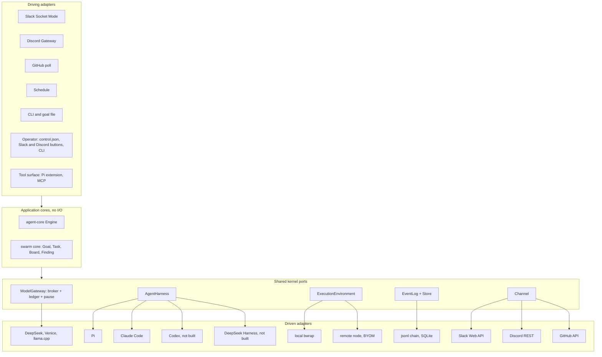

# Agent mode architecture

Agent mode and swarm mode build from one workspace into one binary. Both run on the same broker code, ledger, harness,
sandbox and audit log, and swarm mode is also one way agent mode runs a Ticket. This page is for contributors: it
explains how the code is laid out, which rules keep the core pure, and what the two modes share. The decision is
recorded in [ADR 0001](../adr/0001-hexagonal-ports-and-two-modes.md).

## The layout

The layout is hexagonal. Application cores do no I/O. They talk to the world through ports, and adapters fill the
ports. The diagram is the target that ADR 0001 sets. Codex and the DeepSeek harness are not built yet.



The agent broker's providers are DeepSeek and Venice (`src/gateway/upstream.rs`). llama.cpp is served only on the
frozen `mvp` path.

## Dependency rules

- `crates/agent-core` imports nothing but `serde`, `serde_json` and `sha2`, and does no I/O.
  `crates/agent-core/tests/boundary.rs` checks the dependency list, and every `std::` path in `src/` (grouped imports
  too), against an allowlist of pure modules. It is a source scan, not a proof.
- The swarm core does not follow that rule. The pure parts of `broker.rs` (claims, envelopes, progress, artifact
  union) still sit beside its HTTP and file code. Agent mode shares pieces of it instead of splitting it (see
  [Decisions along the way](status.md#decisions-along-the-way)).
- `crates/agent-store` is a driven adapter. It depends on agent-core and `rusqlite`, and agent-core never depends on it.
- Adapters depend on ports, never on each other. The composition roots (`run` and `agent serve`) are the only places
  that name concrete adapters.
- Each piece of state has one writer. The Engine writes Triggers, Threads, Decisions and Tickets. A Source writes only
  its read position and Thread metadata. The ledger writes holds and settlements. The event log is append-only.

## Ports

The core ports are in `crates/agent-core/src/ports.rs`: `Repositories`, `Policy` and `Clock`. They are synchronous,
and external work leaves the core as `Effect`s. The shell ports are async traits in the root crate: `Source`,
`Channel`, `Router`, `Executor` and `Forge` in `src/agent/ports.rs`, `AgentHarness` in `src/harness.rs`, and
`ExecutionEnvironment` in `src/agent/environment.rs`. `ModelGateway`, `ModelUpstream`, `EventLog`, `Store` and
`ToolSurface` name roles in the design. The code fills them without a trait of that name, except `ModelUpstream`,
whose trait is `gateway::upstream::Provider`.

| Port | Shape | Adapters | Where the code is |
|---|---|---|---|
| `AgentHarness` | `start(SessionSpec, events) -> Session`. `Session::{prompt, stop, join}`. Events: `TurnEnded`, `Said`, `Rejected` and `OutputCut`, and an `Err` when a session's stream ends. | `PiHarness`, `ScriptedHarness`, `ClaudeCodeHarness` | `src/harness.rs`, `src/harness/claude_code.rs` |
| `ModelGateway` | One broker, many accounts: `reserve(account, request)`, `settle(intent, usage)`, and the pause and peak gates. | Swarm mode's broker, and the agent broker with its Anthropic Messages facade | `broker.rs` (`Store::reserve`, `settle`, `envelope`, `Intent`). Shared in `src/gateway/`: `PriceTable` (which replaced `Goal::cost` and `settled_cost`), `Receipt`, `admit_request`, `upstream_body`, `effective_control`. |
| `ModelUpstream` | `dispatch(body) -> receipt` | `OpenAiCompatible` | `gateway::upstream::Provider` (`src/gateway/upstream.rs`). The frozen mvp keeps its own `provider::Provider` (`src/provider.rs`). |
| `ExecutionEnvironment` | `ready()`. `run_code(work, args)` and `job(work, code, timeout, bounds)` return a `Started` that reads, waits and stops. | `Local`, `RemoteNode` | `src/agent/environment.rs`, over `code.rs`'s `CodeExecutor` |
| `EventLog` | `append(kind, data) -> seq`, `verify()` | The `events.jsonl` hash chain, and the agent Store's chain | `Store::record` (`src/broker.rs`), `broker_control::read_chain` and `load_image`, `SqliteStore` |
| `Source` | `run(sink, facts)`. People's commands (Slack and Discord buttons) arrive as `Fact::Command`. | `JsonlSource`, `SlackSource`, `GithubSource`, `ScheduleSource`, `DiscordSource`, the MCP inbox | `src/agent/ports.rs` and each adapter's module |
| `Channel` | `send(OutboundMessage, SendOptions { repeat, approval }) -> Sent \| Gone`. Shapes text per medium. | `JsonlChannel`, `SlackChannel`, `GithubChannel`, `DiscordChannel`, the MCP outbox | `src/agent/jsonl.rs`, `src/agent/slack/`, `src/agent/github/`, `src/agent/discord/`, `src/agent/mcp.rs` |
| `Router` | `assess(candidate, facts)` | `ScriptedRouter`, the Pi Router | `src/agent/scripted.rs`, `src/agent/pi_router.rs` |
| `Executor` | `launch`, `deliver` and `stop` | `ScriptedExecutor`, `PiExecutor`, the simulated executor | `src/agent/scripted.rs`, `src/agent/pi_executor.rs`, `src/agent/simulated.rs` |
| `Forge` | `prepare(repo, dirs) -> Workspace` clones a repository Ticket's `work/` from the host's mirror and writes `repo.json`. `admit(proposal) -> Harvest \| Refusal` judges a worker's commits in the mirror. `dependencies(workspace)` returns the installed dependencies. `execute(job) -> Observed` makes the forge hold the head and a ready pull request, each step an "ensure". | `GithubForge`, `LocalForge` (which clones and admits, and publishes nothing) | `src/agent/forge/` |
| `Store` | agent-core's `Repositories`, plus the Effect queue | In-memory (`MemoryRepositories`), `SqliteStore` | `crates/agent-core`, `crates/agent-store` |
| `ToolSurface` | How a session calls tools: `GET /tools`, `/model` (or `/v1/messages`) and `/tool/{name}` on the broker | The Pi extension (`extensions/broker.ts`), `solos-swarm mcp` | The schemas live in `src/agent/broker/registry.rs`. |

**`SessionSpec`** (`src/harness.rs`) is everything one session needs to start: an id, a role, its grants, its bearer
token, its model, its run directory, the broker socket, the Pi settings, node and Pi root, and the pstack tree to bind.
The role is `coordinator` or `worker` for a swarm's agents, `router` for agent mode's Router, or `ticket-worker` for a
worker on one Ticket. `PiHarness` passes the role and grants to the Pi extension as `SWARM_ROLE` and `SWARM_GRANTS`,
and the Router's and ticket workers' tool sets as `SWARM_TOOLSET`. `SessionSpec` has no `Debug`, since it carries a
bearer token.

## What both modes share

| Shared piece | Swarm mode uses it for | Agent mode uses it for |
|---|---|---|
| Broker and ledger | The Goal cap and per-task envelopes | The Router's daily cap, one account per Ticket, and swarm Goals whose budget comes out of a Ticket's budget |
| Pause, drain, peak refusal and outage pause | Runs | The whole agent. No new Evals while paused. The core still records Triggers, resumes and wakes, and the effect runner holds every Effect until the pause lifts. |
| `AgentHarness` | N swarm agents | The Router, workers and swarm agents |
| `ExecutionEnvironment` | `run_code` | Workers' `run_code`, background jobs and remote nodes |
| Event log | `events.jsonl` | The same chain format with agent kinds, so the dashboard, recover and replay readers keep working |
| Progress notices | 70% and 90% budget notices, partial findings | Worker budget notices and Watchdog signals |
| Self-update channels, doctor, smoke | Candidates | The same, plus a drain that waits for open Assignments |
| Dashboard | Runs | Tickets and Threads, through `agent publish` |

The agent broker has no outage pause of its own yet.

## The Store

`crates/agent-store` (`solos-agent-store`) has `SqliteStore`, which implements `Repositories` on one SQLite file,
`<state>/agent.db`. It uses `rusqlite` 0.41.1 with bundled SQLite, WAL, `synchronous=FULL`, and a versioned schema
(latest: 9). A connection that writes runs with `secure_delete`.

- Aggregates are JSON rows, with index columns for active Threads, `thread_of_eval` and open Tickets.
- Each commit writes state, Effects and events in one transaction.
- The Effect queue lists due Effects oldest first, and records each done, or failed with an attempt count and a retry
  time. Sends to one Channel address keep commit order, and Launch, Deliver and Stop keep it per Ticket. Every call is
  safe to repeat after a crash.
- The event log is hash-chained like `events.jsonl`, with `verify_chain()`.
- A seeded differential walk checks it against `MemoryRepositories` after every Engine command.

Every PR that adds a Ticket field, an Input kind or an event bumps the schema version, with an empty migration when no
table changes, so an older build refuses the file instead of dropping what it cannot read. The tables added so far:
the `spend` ledger (V2), `watchdog_alerts` (V3), the trail (V4) and memos (V8).

## The agent broker

The agent broker (`src/agent/broker.rs`) speaks the swarm broker's wire on a socket in the state directory,
`<state>/broker.sock`. It maps each bearer token to a `Grant`: a principal (the Router, or a Worker per Assignment), an
account and model terms.

- **Accounts.** `router` is capped per UTC day by `budgets.router_daily_microusd`. `ticket:<id>` is capped for life by
  the Mandate budget, and every Assignment of the Ticket shares it. `memory` holds the memo review's and the dream's
  calls, capped per UTC day by `memory.daily_microusd`. Each cap is optional, and an account without one is still
  held and settled ([Budgets](concepts.md#budgets)).
- **Holds and settlements.** Each model call takes a hold and settles at the receipt's cost. They are rows in the
  Store's `spend` table, so a restart keeps every cap, and a closed row is final.
- **Pause.** The broker refuses model calls while the state directory is paused, with a 503 before any hold, so a
  paused call costs nothing and leaves no row. It never refuses a tool call for a pause.
- **Shared code.** Pricing (`PriceTable`, `Receipt`, `completion_usage`), the request contract and upstream body, the
  providers (`provider_for`) and the pause gate live in `src/gateway/`, and both brokers call them. Swarm mode's broker
  `Store` stays as it is.

## The tool surface

One Rust registry is the source of truth for the agent broker's tools. `src/agent/broker/registry.rs` holds each
tool's name, handler, description and JSON Schema, keyed by principal kind, and whether it is `repeatable` (see
[The loop guard](runtime.md#the-loop-guard)). The broker serves the calling token's tools at `GET /tools`, a call is
`POST /tool/{name}`, and a model call is `/model` or `/v1/messages`.

A seat's tools are bound once, when it is admitted (`src/agent/broker/toolbox.rs`). Each tool is built from the host
resources its handler runs on: an environment's `run_code`, the vault, the browser, the seat's `read` reader, and for
`write_file` and `edit_file` the seat's `/work` where its `run_code` runs on this host. A tool whose resource is missing
is never held, and `/tool` refuses it with the reason. Every write the broker makes in a worker's `/work`
(`write_file`, `edit_file` and `run_code`'s `files`) goes through `src/beneath.rs`, which follows no link the worker
made there ([Files](runtime.md#files)). `ROUTER_TOOLS` and `WORKER_TOOLS` are the registry's names. A worker's tools
are the ones it holds (`AgentBroker::worker_tools`, and `seat_tools` for a seat).

The Pi extension builds its tools from `extensions/agent-tools.json`, a generated copy of the registry. A Rust test
holds it equal to the registry, and a Node test holds the extension to it, so neither can drift. To rewrite it:

```sh
cargo test --lib regenerate_agent_tools_json -- --ignored
```

### The MCP server

`solos-swarm mcp` (`src/mcp.rs`, `src/mcp/`) is a stdio Model Context Protocol server written by hand on `serde_json`,
with no SDK: JSON-RPC 2.0, one message per line. To use it, see
[Hand the agent work from an MCP host](how-to/mcp.md).

- It answers `initialize` with the protocol version the host asks for when it is one of 2025-11-25, 2025-06-18,
  2025-03-26 and 2024-11-05, or else the newest, and the `tools` capability. It also answers `ping`, `tools/list` and
  `tools/call`. Notifications get no reply, and an unknown method gets the standard error, -32601.
- Requests run concurrently, so a call that waits does not hold up a `ping`.
- With `--socket` and `--token-file`, it offers one principal's tools through the broker. The token file is read once
  and deleted, and the token is never logged. `tools/list` is `GET /tools`, and `tools/call` is `POST /tool/{name}`
  with the bearer token. A broker refusal is a tool result with `isError: true` and the broker's reason as its text, so
  the model can correct the call. A tool the token was not offered is JSON-RPC error -32602. Only the process that
  admits a principal mints its token. Claude Code workers use this direction.
- A 503 pause reply is waited out as the Pi extension does (`retry_after_s`, 0.1 to 300 s), for at most
  `--max-pause-wait-secs` (45, inside a host's tool timeout), and then reported as an error that says nothing was
  done. The agent broker refuses only `/model` while paused, never a tool call, so this handling exists for a future
  pause gate on tools, and needs no client change then.
- With `--state-dir` and `--operator NAME`, it offers an operator's tools over a running agent: `agent_status`,
  `agent_request`, `agent_replies`, `agent_memos`, `agent_memo_add` and `agent_memo_retire`. See [MCP](channels.md#mcp).

### The Anthropic Messages facade

The agent broker serves `POST /v1/messages` (`src/agent/broker/messages.rs`), so a harness that speaks Anthropic's
Messages API, such as Claude Code, runs under the same governance as Pi. It takes the same tokens (bearer or
`x-api-key`), accounts, holds, settlement, model contract and 503 pause as `/model`, through the same `Call`: the model
limit, the pause before any hold, the contract, the overrun stop, and a hold and a settlement on the token's account.

The executor's `wire` chooses how a request reaches the provider. On `chat` (the default), `gateway::anthropic`
(`src/gateway/anthropic.rs`) translates each way, so swarm mode could reuse it:

- `system`, a string or text blocks, becomes the system message. A message's text blocks join into one.
- An assistant's `tool_use` blocks become `tool_calls`, with the input as their JSON arguments. A user's `tool_result`
  blocks become `tool` messages right after the call, and an `is_error` one is prefixed `Error: `.
- `thinking` blocks are dropped, since the upstream runs with reasoning off.
- Tools become functions, with `input_schema` as their parameters.
- The upstream gets the lower of the request's `max_tokens` and the broker's, and `stop_sequences` as `stop`.
- Images, documents, server tools and misplaced blocks are refused as `invalid_request_error`. `tool_choice`,
  `temperature`, `metadata` and the rest are not forwarded. The broker sets the temperature: a worker's
  `executor.temperature`, or else 0.

The reply's content is text, then `tool_use` blocks. `stop_reason` is `tool_use` when the reply calls a tool,
`max_tokens` for `length` (and a call cut off by it is dropped), `refusal` for `content_filter`, and `end_turn`
otherwise. `usage` puts prompt cache hits in `cache_read_input_tokens`, apart from `input_tokens`.

With `stream: true`, the broker writes the settled reply as server-sent events after the call settled:
`message_start`, then per block a `content_block_start`, one `content_block_delta` (`text_delta` or
`input_json_delta`) and a `content_block_stop`, then `message_delta` and `message_stop`.

On `anthropic` (`src/gateway/forward.rs`), the broker forwards the request to the provider's own Messages endpoint
(`https://api.deepseek.com/anthropic/v1/messages`), with the broker's key and `anthropic-version: 2023-06-01`:

- `Forward::admit` refuses what `/model` refuses: a model other than the executor's (the `[1m]` long-context suffix
  names the same model), no message, a tool that is not a granted client tool, or a server tool. The only server tool
  a forwarded call may carry is the web search the broker adds itself.
- The fields sent upstream are `messages`, `system`, `tools`, `tool_choice`, `stop_sequences`, `thinking` and
  `output_config` as the session wrote them, plus the broker's `model`, `stream`, the lower `max_tokens`, and
  `temperature` where the call does not think. `metadata`, `mcp_servers`, `container` and every other field drop.
- A streamed reply passes back to the session byte for byte as the provider frames it. The broker reads the events
  only for the message's id and final usage, skipping content events unread; a session that hangs up still has its
  call read to the end for its usage.
- The call settles from the reply's `usage`: `input_tokens` and `cache_creation_input_tokens` at the input rate,
  `cache_read_input_tokens` at the cache-hit rate, and each `server_tool_use.tool_search` search at its price. A
  reply over the call's `max_tokens`, a reply that cannot be read, a stream cut before its usage, or a timeout charges
  the hold as an unknown cost. A provider refusal releases the hold and is a 403 that names the provider's reason.
  A whole reply gains `swarm_cost_microusd`; a streamed one is settled when it ends.

A refusal is an Anthropic error body with the broker's reason. A pause also keeps `paused` and `retry_after_s` and sets
`Retry-After`. A settled reply that cannot be translated is a 502 with `x-should-retry: false`, since a retry would pay
again. `HEAD /api/hello`, Claude Code's preconnect, gets 200. Any other path is a `not_found_error`, told on stderr.

A Codex harness would need a Responses facade, `POST /v1/responses`, since Codex 0.145.0 refuses `wire_api = "chat"`
("no longer supported"). It is a later step: see [Later steps](status.md#later-steps).

## The sandbox builder

`src/bwrap.rs` is the one place that builds the run path's bwrap command lines: the Pi launch (`PiHarness::command`,
for swarm agents and for agent mode's Router and workers), `run_code`'s sandbox (background jobs too), and `doctor`'s
probe.

- `Bwrap` adds one flag per call, in call order: `unshare_all`, `die_with_parent`, `new_session`, `ro_bind`,
  `ro_bind_try`, `bind`, `dev`, `proc`, `tmpfs`, `tmpfs_sized` (`--size` and the tmpfs it sizes, as one call), `dir`,
  `symlink`, `clearenv`, `setenv` and `chdir`.
- `exec(program, args)` ends the line and returns the argument vector, without bwrap itself. So a caller still chooses
  the binary (`bwrap` on `PATH`, or `run_code`'s configured one behind `prlimit`), the host environment and the stdio.
- `Bwrap` has no `Debug`, since a `setenv` value can be a bearer token.

The golden tests of the Pi launch and of the swarm `run_code` command pin the lines, and a test pins `doctor`'s probe.
The frozen `mvp` path keeps its own hand-built lines, in `sandbox.rs` (`prepare_process`) and `wasi_worker.rs`. They
are out of scope while that path is frozen.

## Running a Goal as a library

`swarm::run_goal(GoalRun, harness, provider) -> GoalOutcome` (`src/swarm.rs`) holds the run machinery: the spawn loop,
`work`, nudges, the deadline, the broker socket, shutdown, `cleanup.json` and `runtime-report.json`. `solos-swarm run`
is a thin wrapper that keeps the CLI part: flags, the credential, the Goal file, the upstream, validation, the Linux and
deadline checks, `PiHarness` and the provider, the stdout line and the exit code. `run_goal_until` adds a cancel input,
which agent mode's swarm Tickets use and `solos-swarm run` does not. An end-to-end test drives `run_goal` with
`ScriptedHarness` through the real broker, with no Pi, node or bwrap, and it runs on macOS too.

## Swarm Goal words

The swarm runtime's domain words are Goal data (`src/broker_goal_text.rs`), so a Goal that is not research can say its
own. Two optional Goal fields hold them, and a Goal template can set both
([Write a Goal template](how-to/goal-templates.md#give-it-its-own-words)).

**`nudges: {explore, assemble, file, file_without_contract}`** is what `run_goal` tells an agent whose turn ended before
it filed. `explore` applies from the first nudge and `assemble` from the 16th. From the 32nd, `file` applies to an agent
whose claimed Task has a whole `output_contract` (result key, required fields, severities), and
`file_without_contract` otherwise. Each is a template:

- Every stage takes `{agent_id}`.
- `file` also takes `{task_id}`, `{result_key}`, `{required_fields}` (joined with `, `), `{severities}` (joined with
  ` | `) and `{call}`, the exact `submit_finding` call.
- A template has no other brace.

**`record_fields: {file_from, copy, result_key, marked_result_key, marked_by}`** shapes the record the host files for
an agent that never filed (`defer_task`, `file_partial_findings`). Its `file` is the first string among the Task
input's `file_from` fields, and the `copy` fields are copied as they are. A Task whose contract names no `result_key`
files under `marked_result_key` when its input has any of `marked_by`, and under `result_key` otherwise.

**Defaults.** A Goal that leaves a field out gets the research swarm's value: the research texts for the nudges, and
`file_from: [seed_url, paper_url, artifact_file]`, `copy: [experiment, component, compute]`,
`result_key: inconsistencies`, `marked_result_key: experiments` and `marked_by: [experiment, artifact_fields]`. Tests
compare the nudges of every stage, and the records and result keys for a spread of Task inputs, against copies of the
code before the move. A Goal without the fields serializes without them, so `smoke`'s `config.yaml` keeps its bytes.

**Validation.** `Goal::validate` renders every stage once, so a template with an unknown or misplaced placeholder, an
unclosed or stray brace, a blank stage, or a stage over 4,096 bytes is refused at admission rather than mid-run. It also
refuses a blank field name, a list of more than 32, and a `copy` field that the record sets itself (`id`, `title`,
`file`, `description`, `severity`, `code`, `output`, `evidence`).
