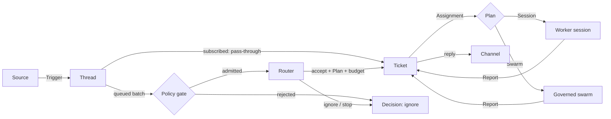

# Agent mode concepts

Agent mode is a long-lived agent that lives in Slack, Discord, GitHub and schedules. It takes requests, notices work,
runs it on isolated workers, and answers in the thread the request came from. This page explains the idea it comes
from, the words it uses, how a request flows, and how budgets apply. How the running pieces behave is in
[How the agent runs work](runtime.md).

The reference design is DeepSeek's *Exploring Super-agent Design: Towards a More Autonomous Agent System* (November
2026), and its MIT-licensed prototype `deepseek-ai/dsh-superagent-prototype` (docs 000 to 008).

## What a super-agent is here

The article names four properties. This table shows what each one needs, and what solos-swarm already had to build it:

| Property | Needs | Already in solos-swarm |
|---|---|---|
| Continuous: one agent across channels | Sources, Threads, and a Router that keeps context | A hash-chained event log, and the `state.json` image |
| Productive: many tasks in parallel | Isolated worker sessions and async tools | N sandboxed Pi agents, the broker, `run_code`, and per-task envelopes |
| Proactive: acts on events, quiet otherwise | A two-stage filter (code gate, then model) and accept modes | Grants, Board entries that never grant authority, and taint markings (mvp) |
| Persistent: always on, self-healing | Durable state and effects, a Watchdog, and BYOM execution | Pause and drain, an outage pause after 5 failures, resuming a stopped run's state, self-update channels, and progress notices |

solos-swarm adds what the prototype does not have:

- **Hard budgets.** A hold and a settlement per model call against the Goal cap and per-task envelopes, cache-aware
  pricing, and peak-hour refusal.
- **A keyless broker.** No credential ever enters a worker.
- **`bwrap` isolation.**
- **An audit chain.**

Agent mode keeps all of them: every Router, worker and swarm call goes through the same broker code.

## The vocabulary

Agent mode uses the prototype's words, so its documents carry over:

| Article | Here | Notes |
|---|---|---|
| Trigger | `Trigger` | Immutable, and idempotent by its Source id. Its text is data and grants nothing. |
| Thread | `Thread` | At most one Eval at a time. Triggers that arrive meanwhile join the next batch. |
| Subscription, pass-through | `Thread.subscriptions` | An allowed person's message on a subscribed Thread goes straight to the Ticket, with no Router turn. Bots, CI and unlisted people reach it as context, and are also judged on their own, but only beside a Ticket that is still open: on a Thread whose Tickets have all ended, an unlisted person is rejected `not_listed` and costs no Router call. Context starts no worker turn. It waits for the next turn that an allowed person, a note from a finished job or the host starts. Only an allowed person resumes ended work or ends a hold, because a resume spends budget. This is stricter than the prototype, where any person who is not a bot or CI may resume. |
| Two-stage filter | `Policy::gate`, then `Effect::Assess` | The gate is code: allowlists, bot lists and the accept mode. Only admitted batches cost a model call. |
| Router | The Router session and `Engine::decide` | Long-lived, on a light model, with Router-only tools and no `run_code`. It takes up to `max_batch` candidates per turn. |
| Worker | A `Plan::Session` Assignment | Its own directory, full work tools, one Ticket. It never talks to people: it reports. |
| (new) Swarm worker | `Plan::Swarm { agents, goal_template }` | The Ticket's scope becomes a Goal for a governed swarm, rendered from a [Goal template](how-to/goal-templates.md), under what the Ticket's budget has left. |
| Mandate | `Mandate` | What an accept grants, including `budget_microusd`. Fixed at accept time. |
| (new) Approval | `Approval` | A budget above `auto_approve_microusd` waits for a person on the approver list. |
| Report | `Report` | `progress` and `waiting` are quiet. `ready` sends the result. A question, `blocked` or `failed` asks a person. |
| Watchdog | The Watchdog | A separate control loop over the Store: waits, stalls, failing Effects, Router failures, spend and pauses. |
| Compute, state and execution separation | The Store, the Effect queue and remote nodes | Durable state and Effects in SQLite, and commands that can run on another machine. |

An Eval is one Router judgment of a batch of Triggers on a Thread. A Ticket is the accepted work, and an Assignment is
one run of a worker (or a swarm) on it. A Ticket can have several Assignments: a retry, a resume after a follow-up, or
a relaunch after a restart.

## How a request flows



A Source stores a Trigger on its Thread. If the Thread is subscribed to an open Ticket and the author is an allowed
person, the Trigger goes straight to that Ticket. Otherwise it waits in the Thread's batch. The Policy gate judges the
batch in code. Only an admitted batch reaches the Router, which accepts it as a Ticket with a Plan and a budget, ignores
it, or stops a Ticket. The Ticket's Assignments run as a worker session or a governed swarm, report back, and the
Ticket's replies go out through the Channel of the Thread they came from.

## Budgets

Every cap is configuration, and each is optional. An agent that runs for its owner can leave out the whole `budgets`
section. Another operator sets the caps they want, with the same binary. The fields are in the
[configuration reference](configuration.md#budgets).

```yaml
budgets:
  session_microusd: 500000        # what a session Ticket gets; absent: a session has no budget
  router_daily_microusd: 3000000  # a Pi Router's calls per UTC day; absent: no daily cap
executor:
  kind: pi
  swarm:
    default_budget_microusd: 1500000   # what a swarm accept that names no budget gets
```

**Where a cap is absent, nothing is capped there.** A session Ticket accepted with no `budgets.session_microusd` has no
Mandate budget. Its account `ticket:<id>` is never refused for spend, so no model call stops with "budget is reached",
no accept waits for an Approve whatever `policy.auto_approve_microusd` is, and the worker is told its Ticket has no
cap. With no `router_daily_microusd`, the Router is never refused for spend either, and a Pi Router does not need one
to start. `budget_microusd` on `router_decide` is for a swarm: a session takes one only where `session_microusd` is
set, and otherwise the argument is not used. A repository's `budget_microusd` under `forge.repos` is the operator's own
cap and still holds for that repository's Tickets, so leave it out for no cap there.

**An uncapped account is still held and settled.** Each model call takes a hold and closes it at the receipt's cost.
So the spend is in the ledger, `agent status` reads it (`committed $1.25, no cap`, and in JSON `budget_microusd` and
`daily_cap_microusd` are `null`), and the Ticket's Reports carry it. The Watchdog's spend alert (80% of a cap) needs a
cap, so it fires only for a capped account. A provider that bills more than a call's hold is an overrun. A capped
account stops there. An account with no cap records the cost, logs it and goes on, since no cap relies on the hold.

**A swarm always has a budget.** A swarm Ticket spends through its own governed broker, which needs a Goal cap. So its
accept takes the Router's `budget_microusd`, or else `executor.swarm.default_budget_microusd`, or else
`budgets.session_microusd`, and is refused if none is set. A swarm budget above `policy.auto_approve_microusd` still
waits for an approver's Approve. The Goal's budget is what the Ticket has left ([Swarm Tickets](runtime.md#swarm-tickets)).
Goals that `solos-swarm run` runs are not touched.

**Some Tickets cannot wait for a click.** A Ticket from GitHub, MCP or a schedule has no Approve button to wait on, so
its accept may name at most `policy.auto_approve_microusd`, even where Slack or Discord takes approvals for requests
that came from them. The Router's prompt says so, and `router_decide` refuses more and names the cap. Where sessions
have no budget, this limit concerns only a swarm's or a repository's budget.

**What stays.** A budget is fixed at accept time, so Tickets accepted before a change keep theirs. The pause (`PAUSE`
or `control.json`) still stops every model call and every Effect. The loop guard still refuses a worker that repeats
itself, and the model's input and output limits still apply. [production.md](production.md#the-production-config)
shows the config of an agent with no caps.

## Non-goals

- Mapping one person's identities across Sources. That stays prompt text, as in the prototype.
- Replacing swarm mode's scorer, evaluator or tournament flow.
- Sessions as a user concept. As the article puts it, sessions are an implementation detail.
